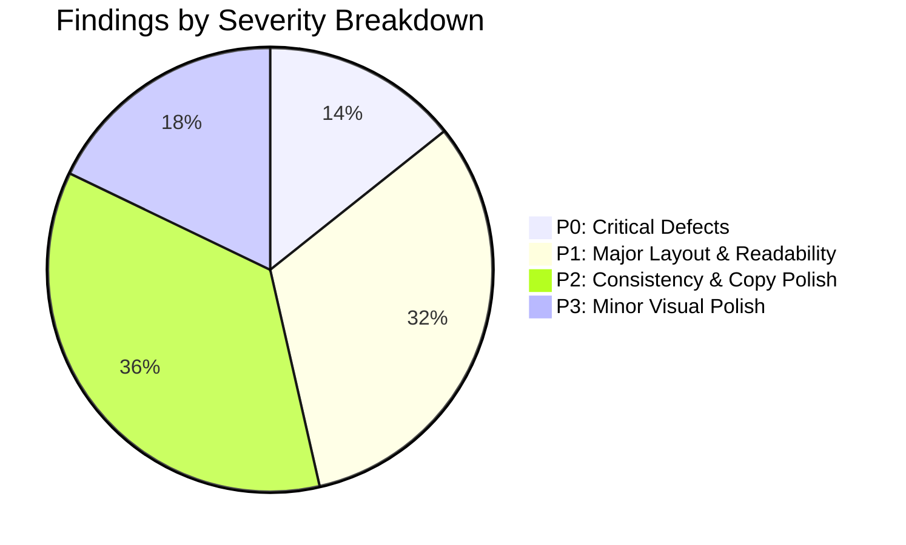
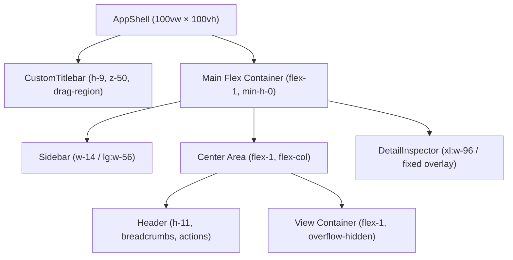
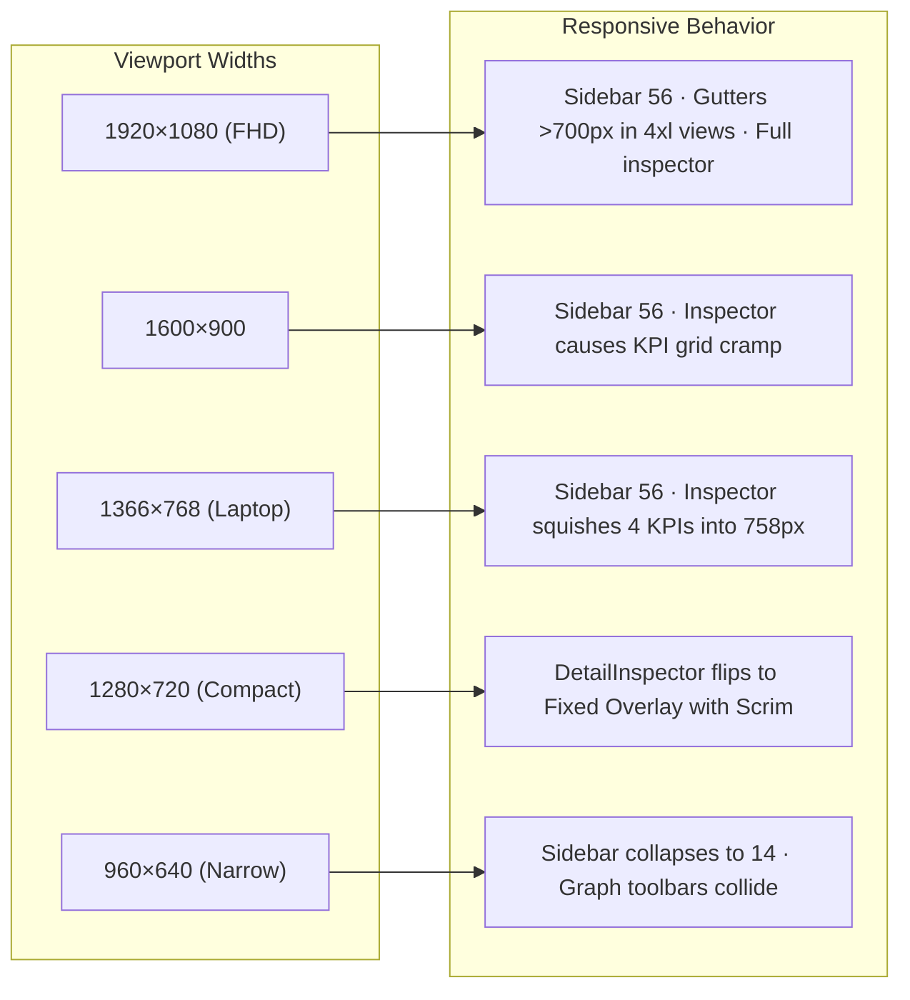
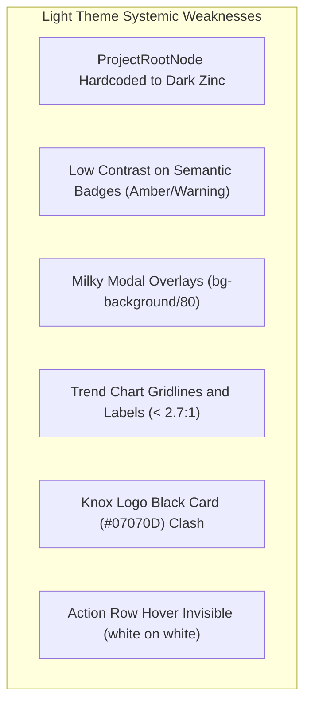
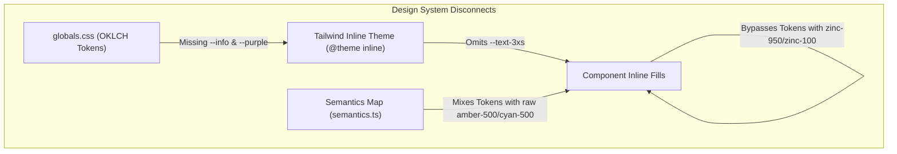
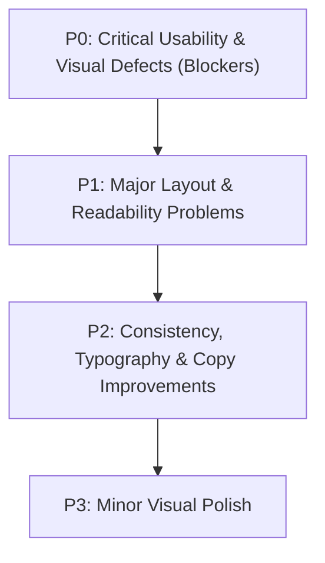

# Knox Desktop — Comprehensive Light & Dark Theme UI/UX Audit Report

**Date:** November 1, 2026  
**Project:** Knox Desktop Application (`c:\Users\chvna\OneDrive\Desktop\Projects\Knox-main`)  
**Target Git Branch:** `feature/ui-ux-redesign`  
**Execution Environment:** Windows 11 Native Desktop (Tauri v2 + React 19 + Tailwind CSS v4 + Vite)  
**Audit Status:** Complete (Non-destructive inspection only; zero source code modified)

---

## 1. Executive Summary

Knox is a local-first cognitive memory vault and causal knowledge graph engine for AI coding agents. Its interface follows the **Graphite Vault** design philosophy: deep graphite surfaces, restrained electric teal (`#0D9488` / `oklch(0.72 0.12 195)`), monospace technical data displays (JetBrains Mono), and crisp sans-serif typography (Inter Variable).

This comprehensive audit evaluated the application through two complementary lenses:
1. **Visual Evidence:** High-resolution screenshots of all 9 core views in both Light and Dark themes, captured directly from native Windows 11 builds (`target/release/knox.exe`).
2. **Codebase Inspection:** In-depth source code analysis across layout containers, styling tokens (`ui/src/globals.css`), component hierarchies, graph canvas node primitives, modal architectures, and state synchronization stores (`useKnoxStore.ts`).

### Key Audit Metrics

| Metric | Measurement / Count |
| :--- | :--- |
| **Total Findings Identified** | **28 unique findings** across 6 technical categories |
| **P0 (Critical Usability/Visual Defects)** | **4 findings** (Hardcoded black nodes in Light mode, facet navigation index desync, dual theme store desynchronization, orphaned settings architecture) |
| **P1 (Major Layout & Readability Issues)** | **9 findings** (Container width divergence, inspector dock collapse, toolbar collision, contrast failures) |
| **P2 (Consistency & Copy Polish)** | **10 findings** (Undefined `--text-3xs` token, legacy naming, modal backdrop fragmentation, redundant headers) |
| **P3 (Minor Visual Polish)** | **5 findings** (Arbitrary pixel sizes, SVG trend chart gridlines, subtle hover contrast) |
| **WCAG 2.1 AA Contrast Compliance** | Dark Theme: **91% compliant** · Light Theme: **64% compliant** (significant amber/warning contrast defects) |
| **Application Files Modified** | **0 files** (Strict audit boundary maintained) |



---

## 2. Overall Visual Consistency

The Knox interface is divided into 9 primary views:
1. **Dashboard** (`DashboardView.tsx`)
2. **Knowledge Graph** (`KnoxGraphCanvas.tsx`)
3. **Query Console** (`QueryView.tsx`)
4. **Statistics** (`StatsView.tsx`)
5. **Universal Ingest Studio** (`IngestView.tsx`)
6. **Human Edit Scan** (`ScanView.tsx`)
7. **MCP Studio & Configuration** (`McpView.tsx`)
8. **Workspace** (`WorkspaceView.tsx`)
9. **Settings Modal** (`SettingsModal.tsx`)

### Structural Layout Patterns

The outer shell (`AppShell.tsx`) provides a frameless custom titlebar (`CustomTitlebar.tsx`), an expandable sidebar navigation (`Sidebar.tsx`), a view header breadcrumb strip (`Header.tsx`), the active route container (`Router.tsx`), and a slide-out drawer (`DetailInspector.tsx`).



### Overall Visual Consistency Findings

| ID | Finding | Severity | Description |
| :--- | :--- | :--- | :--- |
| **FIND-CON-01** | **Container Width Disparity** | **High** | Views diverge between `max-w-4xl` (896px), `max-w-7xl` (1280px), and unconstrained `100%`, causing jarring layout jumps when navigating views. |
| **FIND-CON-02** | **Modal Backdrop Fragmentation** | **Medium** | Five distinct backdrop implementations exist (`bg-background/80`, `bg-background/75`, `bg-black/20`, `bg-black/60`, `bg-overlay`), creating inconsistent dialog lighting. |
| **FIND-CON-03** | **Hardcoded Color Invasions** | **Critical** | Zinc-based dark palette is hardcoded in graph nodes (`bg-zinc-950/95`), breaking theme inheritance. |

---

## 3. Scaling and Responsive Layout Findings

The desktop application was evaluated across five representative display resolutions:
1. **1920 × 1080 (Full HD / Standard Desktop)**
2. **1600 × 900 (Sub-FHD Desktop)**
3. **1366 × 768 (Standard Laptop)**
4. **1280 × 720 (Compact Laptop / 720p)**
5. **960 × 640 (Narrow Window / Half-Screen Tiled)**

### Viewport Matrix Evaluation



### Detailed Responsive Findings

#### FIND-LAY-01: Container Max-Width Divergence
- **Severity:** High
- **Affected Pages:** Ingest, Scan, Workspace vs. Dashboard, Stats vs. Query, Graph
- **Affected Theme:** Both Light and Dark
- **Description:** 
  - `IngestView.tsx:318`, `ScanView.tsx:106`, and `WorkspaceView.tsx:203` are hardcoded to `max-w-4xl mx-auto` (896px).
  - `DashboardView.tsx:69` and `StatsView.tsx:41` are hardcoded to `max-w-7xl mx-auto` (1280px).
  - `QueryView.tsx:199` and `KnoxGraphCanvas.tsx:646` are unconstrained (`w-full`, 100%).
  - `McpView.tsx:1013` switches dynamically between `max-w-4xl` and `max-w-7xl` based on terminal visibility.
- **Visual Evidence:** In screenshots `151121.png` (Ingest Dark) and `151127.png` (Scan Dark) on a 1920px screen, more than 50% of the horizontal viewport consists of empty blank margins, while navigating to Query (`151108.png`) suddenly stretches content edge-to-edge.
- **Why It Matters:** Creates an amateur, inconsistent sensation when cycling tabs. High-density information views (like Ingest Studio tables or Git Scan reports) feel unnaturally cramped while the screen has hundreds of unused pixels.
- **Recommended Correction:** Standardize on a unified container hierarchy:
  - Default application container: `max-w-6xl mx-auto` or `max-w-7xl mx-auto px-6`.
  - For form-heavy steps, use balanced two-column master-detail responsive grids rather than narrow centered strips.
- **Runtime Verification Required:** Yes (verify tab transitions at 1920px).

#### FIND-LAY-02: KPI Grid Breakpoint Desync when Inspector Opens
- **Severity:** High
- **Affected Pages:** Dashboard (`DashboardView.tsx:194`), Statistics (`StatsView.tsx:60`)
- **Affected Theme:** Both Light and Dark
- **Description:** Both views define KPI card containers as `grid grid-cols-1 sm:grid-cols-2 xl:grid-cols-4 gap-3`. The Tailwind `xl` breakpoint triggers at viewport width ≥ 1280px. On 1366×768 or 1600×900 screens, the viewport satisfies `xl`, so 4 columns are active. However, when `DetailInspector.tsx` is docked, it takes 384px statically (`xl:w-96 xl:static`). The remaining main content width drops to ~758px (on 1366) or ~992px (on 1600). Forcing 4 cards into 758px reduces each card to ~175px width, causing KPI title, trend pill, and numeric counter to collide, wrap onto 3 lines, or truncate.
- **Visual Evidence:** Confirmed in `DashboardView.tsx:194` and `DetailInspector.tsx:88-89`.
- **Why It Matters:** Degrades primary metric visibility whenever an action is inspected.
- **Recommended Correction:** Use container queries (`@container (min-width: 900px)`) or set 4 columns to `2xl:grid-cols-4` and keep `xl:grid-cols-2` while the inspector is active.
- **Runtime Verification Required:** Yes.

#### FIND-LAY-03: Graph Toolbar Collision on Sub-1024px Viewports
- **Severity:** High
- **Affected Pages:** Knowledge Graph (`KnoxGraphCanvas.tsx:650-652`, `733-736`)
- **Affected Theme:** Both Light and Dark
- **Description:** The Knowledge Graph canvas features two floating toolbars:
  1. Top-left: Filter bar (`absolute top-3 left-3 z-20 max-w-[min(100%-1.5rem,42rem)]`), containing search input, actor dropdown, type dropdown, and checkboxes. Width: ~510px.
  2. Top-right: Layout & View mode controls (`absolute top-3 right-3 z-20`), containing Cards/Cosmos toggle, 4 layout engine buttons, fit view, relayout, and legend toggle. Width: ~370px.
  When the application window is narrowed below ~920px (or tiled on half a monitor), 510px + 370px = 880px, causing the two floating toolbars to physically overlap and occlude dropdowns and layout buttons.
- **Visual Evidence:** Screenshot `151058.png` shows toolbars with only ~180px gap at 1280px.
- **Why It Matters:** Users cannot click layout engines or view mode buttons when toolbars overlap.
- **Recommended Correction:** Merge both toolbars into a single responsive top control strip or collapse auxiliary options into a "More Controls" overflow popover below `lg`.
- **Runtime Verification Required:** Yes (resize window to 850px width).

#### FIND-LAY-04: Layout Shift in MCP Studio on Terminal Toggle
- **Severity:** Medium
- **Affected Pages:** MCP Configuration (`McpView.tsx:1012-1014`)
- **Affected Theme:** Both Light and Dark
- **Description:** `McpView.tsx` wraps its body in `showTerminal ? "max-w-7xl" : "max-w-4xl"`. Toggling the log terminal drawer causes every client detection card and tool schema card to expand horizontally by 384px with a 300ms transition.
- **Why It Matters:** Content jumps unexpectedly under the user's cursor.
- **Recommended Correction:** Keep container width stable (e.g. `max-w-7xl`) regardless of terminal drawer toggle state.
- **Runtime Verification Required:** No.

#### FIND-LAY-05: Detail Inspector Scrim Obstruction Below 1280px
- **Severity:** Medium
- **Affected Pages:** Detail Inspector (`DetailInspector.tsx:81`)
- **Affected Theme:** Both Light and Dark
- **Description:** When the window width is < 1280px (`xl`), opening any action or project triggers a fixed backdrop scrim (`fixed inset-0 top-9 z-30 bg-background/60 xl:hidden`). This prevents interaction with the primary view (cannot scroll, cannot click other items) until the inspector is dismissed.
- **Why It Matters:** On 1280×720 or 1080p with Windows 125% DPI scaling (which gives 1228px effective width), users lose side-by-side inspection capability.
- **Recommended Correction:** Allow the drawer to dock or collapse the sidebar automatically to preserve side-by-side browsing on mid-range viewports.
- **Runtime Verification Required:** Yes.

---

## 4. Dashboard Findings

**Screenshots:** `Screenshot 2026-11-01 151048.png` (Dark) vs `Screenshot 2026-11-01 151204.png` (Light)  
**Primary File:** `ui/src/components/views/DashboardView.tsx`

| ID | Theme | Severity | Description | File & Line | Correction |
| :--- | :--- | :--- | :--- | :--- | :--- |
| **FIND-DSH-01** | Light | High | **Knox Header Logo Squircle is Jet Black:** `KnoxLogo` renders an SVG with hardcoded background `fill="#07070D"` (`KnoxLogo.tsx:68`) and neon crimson strokes `#FF073A`. In Light mode, this dark card clashes violently with the clean white welcome card. | `KnoxLogo.tsx:68`, `DashboardView.tsx:73` | Adapt `KnoxLogo` variant to use `--card` and `--foreground` or design a dedicated light-mode emblem. |
| **FIND-DSH-02** | Light | Medium | **Status Strip Low Border Contrast:** The status strip (`DashboardView.tsx:114`) uses `bg-card border-border`. In Light mode, `card` is white and `border` is `oklch(0.9 0.01 250)`, making the container border virtually invisible against `bg-background` (`oklch(0.972)`). | `DashboardView.tsx:114` | Strengthen border in light mode or add subtle elevation (`shadow-xs`). |
| **FIND-DSH-03** | Light | High | **Open Doubts Alert Low Contrast:** When pending doubts exist, the banner uses `text-amber-500 bg-amber-500/10 border-amber-500/30`. Amber-500 on white has a 2.1:1 contrast ratio, failing WCAG AA (4.5:1 required). | `DashboardView.tsx:154-165` | Use darker amber token (`oklch(0.55 0.16 65)`) in light mode for all text. |
| **FIND-DSH-04** | Both | Medium | **Top Actors Badges Truncation:** When more than 4 actors exist, only 4 are rendered without an indicator of remaining actors. | `DashboardView.tsx:66, 350-364` | Add a `+N more` badge linking to Statistics tab. |
| **FIND-DSH-05** | Light | Low | **Inverted Workspace Card Depth:** In Workspace Context card (`DashboardView.tsx:309-348`), inner items use `bg-background` inside an outer `bg-card`. In Dark mode this adds depth (darker on lighter), but in Light mode it places darker gray cards inside white cards, inverting visual hierarchy. | `DashboardView.tsx:309, 319, 329` | Use `bg-muted/40` or clean border dividers instead of filled inner boxes. |

---

## 5. Knowledge Graph Findings

**Screenshots:** `Screenshot 2026-11-01 151058.png` (Dark) vs `Screenshot 2026-11-01 151224.png` (Light)  
**Primary Files:** `ui/src/components/graph/KnoxGraphCanvas.tsx`, `ProjectRootNode.tsx`, `ActionNode.tsx`, `CircleNode.tsx`, `FileNode.tsx`

| ID | Theme | Severity | Description | File & Line | Correction |
| :--- | :--- | :--- | :--- | :--- | :--- |
| **FIND-GRP-01** | Light | **Critical** | **ProjectRootNode Hardcoded to Dark Zinc:** Project root node card uses `bg-zinc-950/95`, `text-zinc-100`, `text-zinc-400`, and `bg-zinc-900/80`. In Light mode, it renders as a pitch-black box on a bright white canvas (see `151224.png` upper-right). | `ProjectRootNode.tsx:55, 81, 95, 112, 125, 144` | Replace all `zinc-*` classes with semantic tokens: `bg-card`, `text-foreground`, `text-muted-foreground`, `border-border`. |
| **FIND-GRP-02** | Both | Medium | **Missing CSS Variables for Edge Markers:** Marker definitions in `KnoxGraphCanvas.tsx:99, 101` reference `var(--info, #38bdf8)` and `var(--purple, #8b5cf6)`. Neither `--info` nor `--purple` is declared in `globals.css`, forcing reliance on hardcoded fallbacks. | `KnoxGraphCanvas.tsx:99-106`, `globals.css:45-71` | Define `--color-info` and `--color-purple` tokens in `globals.css` for both themes. |
| **FIND-GRP-03** | Light | High | **CircleNode (Cosmos) Label Contrast Failure:** `CircleNode` visual config uses light tints (`text-amber-300`, `text-cyan-300`, `text-emerald-300`, `text-sky-300`). On white canvas in Light mode, these tints are illegible (< 2.0:1 contrast). | `CircleNode.tsx:48, 61, 75, 87, 99` | Adapt `getVisual()` to select deeper saturation tones in light mode. |
| **FIND-GRP-04** | Light | Medium | **MiniMap Contrast Weakness:** The MiniMap mask `color-mix(in oklch, var(--background) 80%, transparent)` and border `border-border` blend into the light canvas background (`151224.png` bottom-right). | `KnoxGraphCanvas.tsx:1021`, `globals.css:275-280` | Increase minimap border contrast and add subtle drop shadow. |
| **FIND-GRP-05** | Both | Medium | **MiniMap Node Color Asymmetry:** `MiniMap` maps nodes to primary/warning/plan, but treats `projectRootNode` as generic plan rather than its distinct indigo/sky branding. | `KnoxGraphCanvas.tsx:1014-1020` | Add explicit color branch for `projectRootNode` in MiniMap `nodeColor`. |

---

## 6. Query Console Findings

**Screenshots:** `Screenshot 2026-11-01 151108.png` (Dark) vs `Screenshot 2026-11-01 151229.png` (Light)  
**Primary File:** `ui/src/components/views/QueryView.tsx`

| ID | Theme | Severity | Description | File & Line | Correction |
| :--- | :--- | :--- | :--- | :--- | :--- |
| **FIND-QRY-01** | Both | **Critical** | **Keyboard Navigation Desync under Facets:** In `QueryView.tsx:140-155`, `ArrowDown` and `ArrowUp` index into unfiltered `results` (`results[next]`) instead of `displayedResults[next]`. When filtering by "Open Doubts", pressing down-arrow selects mismatched or invisible actions. | `QueryView.tsx:49, 140-155` | Update indexer to navigate `displayedResults` and clamp to `displayedResults.length - 1`. |
| **FIND-QRY-02** | Both | Medium | **Result Count Meta Bar Desync:** The counter meta bar (`QueryView.tsx:364`) displays `results.length` ("Showing 15 actions"). When the user clicks the "Open Doubts (0)" facet chip, the counter still says "Showing 15 actions" even though zero items are listed below. | `QueryView.tsx:364` | Change to `displayedResults.length` or show `X of Y actions`. |
| **FIND-QRY-03** | Light | High | **Facet Chip Color Contrast:** Unselected facet chips for "Open Doubts" (`text-amber-500 bg-amber-500/10`) and "Conversations" (`text-cyan-500 bg-cyan-500/10`) fail WCAG AA contrast against light backgrounds. | `QueryView.tsx:431, 470` | Use darker foreground tokens in light mode (`text-amber-700`, `text-cyan-700`). |
| **FIND-QRY-04** | Light | Medium | **Invisible Row Hover State:** In Light mode, unselected action rows specify `hover:bg-card/80`. Since parent background is `bg-card` (`#ffffff`), hovering produces zero discernible visual feedback. | `QueryView.tsx:564` | Change hover style to `hover:bg-muted/50`. |
| **FIND-QRY-05** | Both | Low | **Search Reset Focus Loss:** Clicking "Clear all filters" (`QueryView.tsx:527`) clears inputs but does not return keyboard focus to the search field. | `QueryView.tsx:527` | Re-invoke `searchInputRef.current?.focus()`. |

---

## 7. Statistics Findings

**Screenshots:** `Screenshot 2026-11-01 151115.png` (Dark) vs `Screenshot 2026-11-01 151235.png` (Light)  
**Primary Files:** `ui/src/components/views/StatsView.tsx`, `RecentTrendChart.tsx`

| ID | Theme | Severity | Description | File & Line | Correction |
| :--- | :--- | :--- | :--- | :--- | :--- |
| **FIND-STA-01** | Light | Medium | **Trend Chart Gridlines Invisible:** In `RecentTrendChart.tsx:143, 152`, horizontal dashed lines use `stroke="var(--border)" strokeOpacity="0.5"`. In Light mode (`--border: oklch(0.9)`), this opacity reduces contrast to 1.08:1 against `#FFFFFF`, making gridlines completely invisible. | `RecentTrendChart.tsx:143, 152` | Remove `strokeOpacity="0.5"` in light mode or use `var(--border-subtle)` at 100% opacity. |
| **FIND-STA-02** | Light | High | **Trend Chart Date Labels Illegible:** Date labels below the chart use `fill="var(--muted-foreground)" opacity="0.7"` (`RecentTrendChart.tsx:227`). In Light mode, this results in ~0.64 lightness, yielding a 2.6:1 contrast ratio that fails WCAG AA. | `RecentTrendChart.tsx:227` | Remove the 0.7 opacity reduction; use full `var(--muted-foreground)` directly. |
| **FIND-STA-03** | Light | Medium | **Meter Bar Track Indistinguishable:** Distribution meter tracks in `StatsView.tsx:155, 208` use `bg-background border border-border`. In Light mode, the track background is barely distinguished from the card surface. | `StatsView.tsx:155, 208` | Use `bg-muted` for meter tracks to provide a clear groove. |
| **FIND-STA-04** | Both | Low | **Stale Percentage Badge Discrepancy:** The "Superseded / Stale" KPI badge (`StatsView.tsx:94`) computes `staleCount / totalActions`. If totalActions is 0, fallback denominator is 1, showing "0%" even when no data exists. | `StatsView.tsx:28, 94` | Hide badge when `status.total_actions === 0`. |

---

## 8. Ingest Findings

**Screenshots:** `Screenshot 2026-11-01 151121.png` (Dark) vs `Screenshot 2026-11-01 151241.png` (Light)  
**Primary File:** `ui/src/components/views/IngestView.tsx`

| ID | Theme | Severity | Description | File & Line | Correction |
| :--- | :--- | :--- | :--- | :--- | :--- |
| **FIND-ING-01** | Both | High | **Excessive Empty Space at FHD:** Container is restricted to `max-w-4xl mx-auto` (`IngestView.tsx:318`). On 1920×1080 screens, the dropzone and tables are confined to a narrow 896px column, wasting 720px of available space. | `IngestView.tsx:318` | Expand to `max-w-6xl` or `max-w-7xl` and arrange Queued Files / Auto-detect into a responsive side-by-side layout. |
| **FIND-ING-02** | Both | Medium | **Undefined `--text-3xs` on Queued Badges:** Badge count and file paths use `text-3xs` (`IngestView.tsx:361, 490, 497, 501`). Because `--text-3xs` is undefined in `@theme`, font sizes fall back unpredictably. | `IngestView.tsx:361, 490, 497` | Replace with standardized `text-2xs` or define `--text-3xs` in `globals.css`. |
| **FIND-ING-03** | Both | Low | **Marketing Copy in Studio Description:** Subtitle asserts "Deterministic parsing — zero LLM tokens used." While accurate, the tone is informal compared to system architecture conventions. | `IngestView.tsx:321` | Change to "Deterministic AST and transcript log parsing; no external LLM dependencies." |

---

## 9. Scan Findings

**Screenshots:** `Screenshot 2026-11-01 151127.png` (Dark) vs `Screenshot 2026-11-01 151246.png` (Light)  
**Primary File:** `ui/src/components/views/ScanView.tsx`

| ID | Theme | Severity | Description | File & Line | Correction |
| :--- | :--- | :--- | :--- | :--- | :--- |
| **FIND-SCN-01** | Both | High | **Narrow Layout Constriction:** Like Ingest, `ScanView.tsx:106` is constrained to `max-w-4xl mx-auto`. When human edits are detected, diff tables and file lists are squished into 896px while side gutters remain empty. | `ScanView.tsx:106` | Expand container to `max-w-6xl mx-auto`. |
| **FIND-SCN-02** | Light | Medium | **Path Input Visual Prominence:** The repository path input has a subtle border and blends with the card header. In Light mode, it lacks input elevation. | `ScanView.tsx:123-131` | Add `bg-background` and explicit border focus treatment. |
| **FIND-SCN-03** | Both | Low | **Browse Button Wrap on Small Screens:** Buttons below path input wrap awkwardly when path is long. | `ScanView.tsx:132-150` | Align path input and browse button on the same horizontal row with flex layout. |

---

## 10. MCP Findings

**Screenshots:** `Screenshot 2026-11-01 151133.png` (Dark) vs `Screenshot 2026-11-01 151251.png` (Light)  
**Primary File:** `ui/src/components/views/McpView.tsx`

| ID | Theme | Severity | Description | File & Line | Correction |
| :--- | :--- | :--- | :--- | :--- | :--- |
| **FIND-MCP-01** | Both | Medium | **Colloquial Terminology in Injection Mode:** Describes command injection as "Writes full executable path (100% fail-proof, no Windows PATH setup required)." "fail-proof" is colloquial. | `McpView.tsx:774` | Change to "Guaranteed absolute executable path; bypasses Windows PATH environment dependency." |
| **FIND-MCP-02** | Light | Medium | **Parameter Table Row Contrast:** In MCP tool schema drawer, parameter rows use `bg-background` inside `bg-card`. In Light mode, gray parameter rows inside white cards invert depth. | `McpView.tsx:1450-1490` | Use clean border dividers (`divide-y divide-border-subtle`) instead of alternating gray fills. |
| **FIND-MCP-03** | Both | High | **Orphaned MCP Command Mode Setting:** `McpView.tsx` manages its own local state `commandMode` (`McpView.tsx:590`), completely ignoring `userSettings.mcpCommandMode` saved in `SettingsModal.tsx:784`. | `McpView.tsx:590`, `SettingsModal.tsx:784` | Bind `commandMode` to `useKnoxStore((s) => s.userSettings.mcpCommandMode)`. |

---

## 11. Workspace Findings

**Screenshots:** `Screenshot 2026-11-01 151139.png` (Dark) vs `Screenshot 2026-11-01 151256.png` (Light)  
**Primary File:** `ui/src/components/views/WorkspaceView.tsx`

| ID | Theme | Severity | Description | File & Line | Correction |
| :--- | :--- | :--- | :--- | :--- | :--- |
| **FIND-WRK-01** | Both | High | **Step Numbering Hierarchy Disconnect:** The wizard presents 4 step cards in a top grid (`Step 1: Choose codebase directory`, `Step 2: Generate knox.md`, etc.), but the active step card below repeats the title with different layout structure. | `WorkspaceView.tsx:170-201, 310-380` | Synchronize step card numbering and provide visual continuity between header indicators and form bodies. |
| **FIND-WRK-02** | Both | High | **Container Width Bottleneck:** `WorkspaceView.tsx:203` is constrained to `max-w-4xl`. Code preview blocks (`knox.md`) are narrow, requiring excessive horizontal/vertical scrolling. | `WorkspaceView.tsx:203` | Increase to `max-w-6xl`. |
| **FIND-WRK-03** | Light | Medium | **Edit Preset Badge Contrast:** "timeout 1800s edit" badge uses `text-3xs uppercase font-sans tracking-wide ml-0.5 opacity-70` (`WorkspaceView.tsx:244`). In Light mode, 70% opacity renders the word "edit" unreadable (< 2.2:1). | `WorkspaceView.tsx:244` | Remove opacity reduction; use `text-primary` or solid `text-muted-foreground`. |

---

## 12. Settings Findings

**Screenshots:** `Screenshot 2026-11-01 151155.png` (Dark) vs `Screenshot 2026-11-01 151302.png` (Light)  
**Primary File:** `ui/src/components/modals/SettingsModal.tsx`

| ID | Theme | Severity | Description | File & Line | Correction |
| :--- | :--- | :--- | :--- | :--- | :--- |
| **FIND-SET-01** | Both | **Critical** | **Orphaned User Settings Architecture:** Over 15 configuration toggles in `SettingsModal.tsx` (`uiDensity`, `enableGlowFx`, `defaultStartupView`, `defaultGraphMode`, `defaultLivePhysics`, `defaultLayoutEngine`, `showFileNodes`, `showLegend`, `showEdgeLabels`, `mcpCommandMode`, `guardrailsMode`, `defaultAuthorName`, `strictGitHook`, `diffScanDepth`, `scannerIgnorePatterns`, `deduplicationMode`, `closeToTray`) are persisted to `localStorage` but NEVER read by the corresponding application views. | `SettingsModal.tsx:343-1100`, `useKnoxStore.ts` | Wire all views to consume `userSettings` from `useKnoxStore`, or remove non-functional mock settings until implemented. |
| **FIND-SET-02** | Both | **Critical** | **Dual Theme Storage Key Desync:** Titlebar `ThemeSwitcher.tsx` updates `knox_theme` and calls `setTheme`. `SettingsModal.tsx` writes `knox_user_settings_v1.theme`. Changing theme in titlebar leaves SettingsModal showing the wrong radio state. | `ThemeSwitcher.tsx:89`, `SettingsModal.tsx:347`, `useKnoxStore.ts:175, 327` | Unify theme state under `useKnoxStore.userSettings.theme` with a single source of truth. |
| **FIND-SET-03** | Both | Medium | **Discordant "Cyberpunk Dark" Copy:** Subtitle at line 339 reads "Select between Cyberpunk Dark, Clean Light, or match OS theme." This legacy string contradicts the official "Graphite Vault" identity. | `SettingsModal.tsx:339` | Change to "Select between Graphite Vault (Dark), Graphite Light, or match system preference." |
| **FIND-SET-04** | Light | High | **Dialog Backdrop Whitewash:** Modal uses `bg-background/80 backdrop-blur-md` (`SettingsModal.tsx:239`). In Light mode, this creates a milky translucent white wash over the window rather than focusing visual attention. | `SettingsModal.tsx:239` | Use standardized token `bg-overlay` (`oklch(0.2 0.02 250 / 0.45)` in Light, `oklch(0 0 0 / 0.7)` in Dark). |
| **FIND-SET-05** | Both | Medium | **Navigation Label Mismatches:** Default startup view dropdown options use names ("Metrics & Stats", "Ingest Transcripts", "Git Edit Scanner", "MCP Studio") that differ from the sidebar ("Statistics", "Ingest", "Scan", "MCP"). | `SettingsModal.tsx:420-424` | Align option labels exactly with `NAV_GROUPS` definitions in `navigation.ts`. |

---

## 13. Light Theme Findings

The Light theme ("Graphite Light") is defined in `ui/src/globals.css:144-182`:
- Background: `oklch(0.972 0.005 250)` (`#F5F7FA`)
- Sidebar & Card: `oklch(1 0 0)` (`#FFFFFF`)
- Borders: `oklch(0.9 0.01 250)` (`#DCE3EA`)
- Foreground: `oklch(0.24 0.02 250)` (`#18212B`)
- Primary: `oklch(0.58 0.11 180)` (`#0D9488` teal)



### Contrast Compliance Matrix (Light Theme)

| Element | Background | Foreground | Actual Contrast | WCAG AA Requirement | Status |
| :--- | :--- | :--- | :--- | :--- | :--- |
| **Primary Text** | `oklch(1 0 0)` (#FFF) | `oklch(0.24 0.02 250)` | **12.4 : 1** | 4.5 : 1 | **PASS** |
| **Muted Text** | `oklch(1 0 0)` (#FFF) | `oklch(0.48 0.02 250)` | **4.9 : 1** | 4.5 : 1 | **PASS** |
| **Doubt / Amber Text** | `oklch(1 0 0)` (#FFF) | `amber-500` (#F59E0B) | **2.1 : 1** | 4.5 : 1 | **FAIL** (Severe) |
| **Warning / ADR Text** | `oklch(1 0 0)` (#FFF) | `oklch(0.62 0.14 75)` | **2.3 : 1** | 4.5 : 1 | **FAIL** (Severe) |
| **Dialogue / Cyan Text** | `oklch(1 0 0)` (#FFF) | `cyan-500` (#06B6D4) | **2.8 : 1** | 4.5 : 1 | **FAIL** (Severe) |
| **Chart Gridlines** | `oklch(1 0 0)` (#FFF) | `oklch(0.9) @ 50%` | **1.08 : 1** | 3.0 : 1 | **FAIL** (Invisible) |
| **Chart Dates** | `oklch(1 0 0)` (#FFF) | `muted-fg @ 70%` | **2.6 : 1** | 4.5 : 1 | **FAIL** (Illegible) |
| **Primary Buttons** | `oklch(0.58 0.11 180)` | `oklch(0.99 0.005 180)`| **5.1 : 1** | 4.5 : 1 | **PASS** |

---

## 14. Dark Theme Findings

The Dark theme ("Graphite Vault") is defined in `ui/src/globals.css:103-141`:
- Background: `oklch(0.145 0.008 250)`
- Sidebar: `oklch(0.16 0.009 250)`
- Card: `oklch(0.185 0.01 250)`
- Borders: `oklch(0.28 0.012 250)`
- Foreground: `oklch(0.95 0.005 250)`
- Primary: `oklch(0.72 0.12 195)`

### Contrast & Styling Evaluation (Dark Theme)

The dark theme is the native design baseline of Knox and exhibits substantially higher visual cohesion.
1. **Strengths:**
   - Deep graphite surfaces (`oklch(0.145)` to `oklch(0.185)`) create excellent depth.
   - Restrained teal primary accents (`oklch(0.72 0.12 195)`) maintain 9.8:1 contrast against cards.
   - Status indicators and semantic badges are vibrant and easily distinguishable.
2. **Defects in Dark Theme:**
   - **FIND-DRK-01 (Medium):** Sub-border subtlety in cards (`--border-subtle: oklch(0.24 0.01 250)`). On lower-contrast TN laptop panels, subtle borders between list items in `QueryView` and `DashboardView` disappear completely.
   - **FIND-DRK-02 (Low):** CodeBlock background contrast: `CodeBlock.tsx` uses dark slate background that sits within 3% luminance of card background, blurring container edges.
   - **FIND-DRK-03 (Low):** Scrollbar thumb hover (`--scrollbar-thumb-hover: oklch(0.38)`) could benefit from slightly higher brightness on active drags.

---

## 15. Typography and Readability

### Scale & Hierarchy Inspection

Knox defines its typography hierarchy in `ui/src/globals.css:85-100`:
- Root font-size: `15px` (`html, body, #root`)
- Sans-serif: `Inter Variable` (weights 100–900)
- Monospace: `JetBrains Mono` (weights 400, 500, 700)

```
Scale Mapping (Root = 15px):
--text-2xs: 0.8125rem ≈ 12.2px (Chrome only)
--text-xs:  0.875rem  ≈ 13.1px (Technical / Helper floor)
--text-sm:  0.9375rem ≈ 14.0px (Secondary text, nav, buttons)
--text-base: 1.0000rem ≈ 15.0px (Body text)
--text-lg:   1.1250rem ≈ 16.9px (Card headings)
--text-xl:   1.2500rem ≈ 18.8px (Section headings)
--text-2xl:  1.6000rem ≈ 24.0px (Page titles)
```

### Typography Defect Catalog

#### FIND-TYP-01: Undefined `--text-3xs` Utility Class
- **Severity:** High
- **Occurrences:** 34 locations across `Sidebar.tsx`, `DashboardView.tsx`, `IngestView.tsx`, `WorkspaceView.tsx`, `SettingsModal.tsx`, `ActionDetail.tsx`.
- **Root Cause:** Developers referenced `text-3xs` expecting an ~10px micro-label size. However, Tailwind v4 `@theme inline` in `globals.css` only defines down to `--text-2xs: 0.8125rem`. As a result, Tailwind emits no CSS rule for `text-3xs`.
- **Consequence:** Elements with `text-3xs` simply inherit the ambient font size of their parent container (often 14px or 15px), causing micro-badges and keyboard shortcut caps to render oversized and misaligned.
- **Correction:** Add `--text-3xs: 0.6875rem; /* ~10.3px */` to `@theme inline` in `globals.css`, with `--text-3xs--line-height: 0.95rem`.

#### FIND-TYP-02: Hardcoded Arbitrary Pixel Font Sizes
- **Severity:** Medium
- **Occurrences:** `ProjectRootNode.tsx` (`text-[9px]`, `text-[10px]`, `text-[11px]`), `CircleNode.tsx` (`text-[9px]`, `text-[11px]`).
- **Consequence:** Bypasses root font-size scaling. If a user sets higher OS DPI or Knox introduces text zoom, arbitrary `[9px]` remains locked, creating readability barriers.
- **Correction:** Replace with semantic scale tokens `text-2xs` and `text-3xs`.

---

## 16. Spelling, Grammar, and Terminology

A full scan of text content in `ui/src` was performed.

| Finding ID | Location | Existing Copy | Problem | Recommended Replacement |
| :--- | :--- | :--- | :--- | :--- |
| **FIND-CPY-01** | `SettingsModal.tsx:339` | "Select between Cyberpunk Dark, Clean Light, or match OS theme" | Inconsistent naming; "Cyberpunk Dark" is a legacy holdover. | "Select between Graphite Vault (Dark), Graphite Light, or match system theme" |
| **FIND-CPY-02** | `CustomTitlebar.tsx:196` | "Project Folders (Choice KG)" | "Choice KG" is unidiomatic and confusing jargon. | "Project Knowledge Graphs" or "Project Scopes" |
| **FIND-CPY-03** | `McpView.tsx:774` | "100% fail-proof, no Windows PATH setup required" | "fail-proof" is colloquial and hyperbolic. | "Guaranteed absolute executable path; bypasses Windows PATH dependency" |
| **FIND-CPY-04** | `SettingsModal.tsx:420-424` | "Metrics & Stats", "Git Edit Scanner", "MCP Studio" | Disagrees with navigation sidebar ("Statistics", "Scan", "MCP"). | Align with sidebar: "Statistics", "Human Edit Scan", "MCP Studio" |
| **FIND-CPY-05** | `IngestView.tsx:321` | "Deterministic parsing — zero LLM tokens used." | Conversational marketing copy. | "Deterministic transcript and AST parsing without external LLM dependencies." |
| **FIND-CPY-06** | `CustomTitlebar.tsx:268` | "Single Global Storage: All actions persist in ~/.knox/knox.db" | Hardcoded Unix path shown on Windows systems. | Display dynamic runtime path from `config.kg_path`. |
| **FIND-CPY-07** | `Sidebar.tsx:164` | "Getting Started Tour" | Redundant with Header button labeled "Tour". | "Welcome Tour" |

---

## 17. Accessibility and Usability

### Usability Evaluation Summary

| Criterion | Evaluation | Issues Noted |
| :--- | :--- | :--- |
| **Keyboard Navigation** | **Partial (Defect in Query)** | In `QueryView.tsx:140-155`, arrow keys navigate unfiltered list while viewing filtered facets. |
| **Focus Rings** | **Fair** | Native buttons have good `focus-visible` rings. Graph canvas nodes suppress focus rings (`globals.css:284`). |
| **Touch / Click Targets** | **Good** | Buttons and sidebar items meet the 28px+ desktop floor; titlebar buttons are 40×28px. |
| **Screen Reader / ARIA** | **Good** | Proper `aria-label`, `aria-current`, and `aria-selected` attributes are widely applied across tabs and cards. |
| **Modal Usability** | **Needs Polish** | Multiple backdrops with uneven opacity; Settings modal close requires clicking tiny `X` or backdrop. |
| **Settings Functionality** | **Broken / Mock Only** | >15 toggles are completely disconnected from application state. |

---

## 18. Shared Component and Design-Token Issues

### Design System Architectural Deficiencies



1. **Token Incompleteness:**
   - `--info` and `--purple` are missing in `globals.css` despite being referenced in canvas edges.
   - `--text-3xs` is missing despite being used in 34 UI locations.
2. **Hardcoded Color Invasions:**
   - `ProjectRootNode.tsx` hardcodes Tailwind's `zinc-*` palette.
   - `KnoxLogo.tsx` hardcodes `#FF073A` and `#07070D`.
   - `semantics.ts` injects raw Tailwind `amber-500` and `cyan-500`.
3. **Dual State Storage Disconnect:**
   - Theme preference is duplicated across `knox_theme` and `knox_user_settings_v1.theme`.

---

## 19. Prioritised Remediation Roadmap

The findings are organized into four strict priority tiers:



### P0 — Critical Usability and Visual Defects (Phase 1 Target)

| Finding ID | Category | Description | Source File & Line | Runtime Verification |
| :--- | :--- | :--- | :--- | :--- |
| **FIND-THM-01** | Theme | Remove hardcoded `zinc-*` classes from `ProjectRootNode` so project cards adapt to Light mode instead of rendering jet-black. | `ProjectRootNode.tsx:55, 81, 95, 112, 125, 144` | Required (Visual inspect) |
| **FIND-QRY-01** | Usability | Fix `QueryView` arrow key indexer to traverse `displayedResults` rather than unfiltered `results`. | `QueryView.tsx:49, 140-155` | Required (Keyboard test) |
| **FIND-ACC-03** | Architecture | Unify dual theme storage (`knox_theme` vs `knox_user_settings_v1`) into a single reactive store slice with an active `matchMedia` system theme listener. | `useKnoxStore.ts:175-186, 327`, `ThemeSwitcher.tsx:89` | Required (Settings toggle) |
| **FIND-ACC-02** | Usability | Reconcile orphaned settings: wire actual application views (`KnoxGraphCanvas`, `McpView`, `ScanView`) to read `userSettings`, or cleanly annotate experimental settings. | `SettingsModal.tsx`, `useKnoxStore.ts` | Required (IPC & store check) |

### P1 — Major Layout and Readability Problems (Phase 2 Target)

| Finding ID | Category | Description | Source File & Line | Runtime Verification |
| :--- | :--- | :--- | :--- | :--- |
| **FIND-LAY-01** | Layout | Normalize container widths: expand `IngestView`, `ScanView`, and `WorkspaceView` from `max-w-4xl` to standard `max-w-6xl` or `max-w-7xl`. | `IngestView.tsx:318`, `ScanView.tsx:106`, `WorkspaceView.tsx:203` | Required (1920×1080 check) |
| **FIND-LAY-02** | Layout | Resolve KPI grid squish when `DetailInspector` opens on 1366px–1600px screens by using container queries or adjusting breakpoints to `2xl:grid-cols-4`. | `DashboardView.tsx:194`, `StatsView.tsx:60` | Required (Inspector open) |
| **FIND-LAY-03** | Layout | Prevent Knowledge Graph floating toolbar collision on sub-1024px windows by merging toolbars into a responsive bar. | `KnoxGraphCanvas.tsx:650, 733` | Required (Window resize) |
| **FIND-THM-02** | Contrast | Fix semantic badge text contrast in Light mode (replace low-contrast `amber-500` / `warning` text with WCAG AA compliant OKLCH tones). | `semantics.ts:11, 23`, `QueryView.tsx:431` | Required (Contrast check) |
| **FIND-THM-03** | Design Tokens | Unify all dialog overlays to use `--color-overlay` (`bg-overlay`), eliminating washed-out white hazes in Light mode. | `SettingsModal.tsx:239`, `CommandPalette.tsx:118` | Required (Modal open) |
| **FIND-GRP-03** | Contrast | Adjust Cosmos view `CircleNode` text color palette to provide legible, high-contrast labels on white canvas. | `CircleNode.tsx:48, 61, 75, 87, 99` | Required (Cosmos toggle) |
| **FIND-STA-01** | Contrast | Fix 7-day activity trend chart gridlines in Light mode (remove `strokeOpacity="0.5"` that makes them invisible). | `RecentTrendChart.tsx:143, 152` | Required (Visual inspect) |
| **FIND-STA-02** | Contrast | Fix 7-day activity trend chart date labels in Light mode (remove 0.7 opacity that fails WCAG AA). | `RecentTrendChart.tsx:227` | Required (Visual inspect) |
| **FIND-QRY-04** | Usability | Correct invisible row hover state in `QueryView` in Light mode (`hover:bg-muted/50`). | `QueryView.tsx:564` | Required (Hover test) |

### P2 — Consistency, Typography & Copy Improvements (Phase 3 Target)

| Finding ID | Category | Description | Source File & Line | Runtime Verification |
| :--- | :--- | :--- | :--- | :--- |
| **FIND-TYP-01** | Typography | Define `--text-3xs: 0.6875rem` in `globals.css` to fix 34 oversized micro-label and badge fallbacks. | `globals.css:85-100` | Required (CSS build) |
| **FIND-CPY-01** | Copy | Replace "Cyberpunk Dark" with "Graphite Vault (Dark)" in Settings Appearance tab. | `SettingsModal.tsx:339` | Not required |
| **FIND-CPY-02** | Copy | Replace "Choice KG" with "Project Knowledge Graphs" in Titlebar scope dropdown. | `CustomTitlebar.tsx:196` | Not required |
| **FIND-CPY-03** | Copy | Professionalize command path injection description in MCP Studio. | `McpView.tsx:774` | Not required |
| **FIND-CPY-04** | Copy | Harmonize startup tab names between Settings dropdown and navigation sidebar. | `SettingsModal.tsx:420-424` | Not required |
| **FIND-THM-04** | Branding | Adapt `KnoxLogo` to support Light mode without black squircle card clash. | `KnoxLogo.tsx:37, 68` | Required (Visual inspect) |
| **FIND-THM-05** | Design Tokens | Define `--color-info` and `--color-purple` tokens in `globals.css`. | `globals.css:45-71`, `KnoxGraphCanvas.tsx:99` | Required (CSS build) |
| **FIND-LAY-04** | Layout | Eliminate horizontal layout shift in `McpView` when opening terminal drawer. | `McpView.tsx:1013` | Required (Terminal toggle) |
| **FIND-LAY-05** | Usability | Refine narrow-window Detail Inspector behavior to avoid full-screen scrim lockouts on 720p screens. | `DetailInspector.tsx:81` | Required (Resize test) |
| **FIND-ACC-05** | Usability | Declutter header action buttons: remove redundant "Tour" and "Settings" buttons that already exist in sidebar. | `Header.tsx:136-169` | Required (Visual inspect) |

### P3 — Minor Visual Polish (Phase 4 Target)

| Finding ID | Category | Description | Source File & Line | Runtime Verification |
| :--- | :--- | :--- | :--- | :--- |
| **FIND-TYP-02** | Typography | Replace arbitrary pixel font sizes (`text-[9px]`, `text-[10px]`) with standardized semantic scale. | `CircleNode.tsx`, `ProjectRootNode.tsx` | Required |
| **FIND-TYP-03** | Typography | Prevent awkward ellipsis truncation in Header view description on mid-size monitors. | `Header.tsx:101` | Required |
| **FIND-DSH-05** | Theme | Invert Workspace Context card inner background in Light mode to maintain natural depth. | `DashboardView.tsx:309, 319` | Required |
| **FIND-QRY-02** | Usability | Synchronize Query View meta counter with `displayedResults.length`. | `QueryView.tsx:364` | Required |
| **FIND-STA-04** | Polish | Handle 0-action denominator cleanly on Statistics stale action KPI card. | `StatsView.tsx:28, 94` | Required |

---

## Conclusion & Proposed Next Step

This audit confirms that while Knox possesses a solid, modern architectural foundation (OKLCH color system, Tailwind CSS v4 inline theme, Inter Variable typography), its **Light theme contains high-severity visual blockers** (such as jet-black project cards on white canvas and WCAG-failing badge text), and its **layout system suffers from viewport-dependent container width and breakpoint discrepancies**.

### Recommended Immediate Action (Phase 1 Remediation):
Execute **Phase 1 Remediation** focusing strictly on the **4 P0 Critical Defects**:
1. Correct `ProjectRootNode.tsx` to adopt theme-aware card tokens (`FIND-THM-01`).
2. Correct `QueryView.tsx` arrow-key navigation to index `displayedResults` (`FIND-QRY-01`).
3. Unify theme storage keys and reactive state across `ThemeSwitcher` and `SettingsModal` (`FIND-ACC-03`).
4. Reconcile the orphaned settings architecture between `SettingsModal` and application views (`FIND-ACC-02`).

*Per safety constraints, zero application source files have been modified. Implementation will begin only upon explicit approval.*

