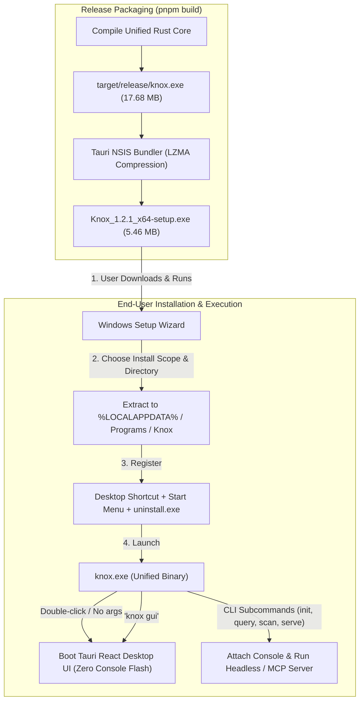

# Knox — Knowledge Graph for AI-Assisted Development

> **A persistent knowledge graph built from IDE/coding-tool conversation history, so AI agents query context instead of re-deriving it — saving tokens, preserving decisions, and keeping every agent in sync.**

---

## Vision

Every time an AI coding agent starts a task, it wastes tokens rediscovering project context — what was already decided, what approaches were tried, what files were changed and why. Knox solves this by maintaining a **conversation-derived knowledge graph (KG)** keyed by `project → folder → file → work`. IDE agents read from and write to Knox via MCP, making context persistent across sessions, tools, and time.

---

## Tech Stack

| Layer | Choice | Rationale |
|---|---|---|
| **Language** | Rust | Single binary, cross-platform (Windows/macOS/Linux), high performance, no runtime dependency |
| **KG Storage** | SQLite (`rusqlite`) | Embedded, zero-config, single-file DB. Proven, lightweight, ships inside the binary |
| **Graph Traversal** | `petgraph` | In-memory graph algorithms (path queries, subgraph extraction, cycle detection). Loaded from SQLite at query time |
| **Agent Interface** | MCP Server (stdio) | Universal — works with Antigravity, Cursor, VS Code Copilot, Claude Desktop, OpenCode, and any MCP-compatible client |
| **CLI Framework** | `clap` | Standard Rust CLI parser. Powers `knox init`, `knox ingest`, `knox serve`, `knox query`, `knox status` |
| **File Watching** | `notify` (Rust crate) | Cross-platform filesystem event watcher for optional auto-ingest mode |
| **Serialization** | `serde` + `serde_json` | JSON parsing for transcript ingestion and MCP protocol |
| **Async Runtime** | `tokio` | Async I/O for the MCP stdio server and file watching |
| **Build / CI** | GitHub Actions | Cross-platform release builds (Windows, macOS, Linux) |
| **License** | MIT | Maximum adoption, no friction for commercial or open-source use |

---

## Architecture

```
┌──────────────────────────────────────────────────────┐
│                    IDE / Agent                        │
│  (Antigravity, Cursor, VS Code, Claude, OpenCode)    │
└────────────────────┬─────────────────────────────────┘
                     │  MCP (stdio)
                     ▼
┌──────────────────────────────────────────────────────┐
│                 Knox MCP Server                       │
│  ┌─────────────┐  ┌──────────────┐  ┌─────────────┐ │
│  │ Read Tools  │  │ Write Tools  │  │ Query Tools │ │
│  │ get_context │  │ record_action│  │ search_kg   │ │
│  │ get_history │  │ record_decide│  │ list_stale  │ │
│  └─────────────┘  └──────────────┘  └─────────────┘ │
└────────────────────┬─────────────────────────────────┘
                     │
          ┌──────────┴──────────┐
          ▼                     ▼
  ┌──────────────┐    ┌──────────────┐
  │   SQLite DB  │    │   petgraph   │
  │  (persisted) │───▶│ (in-memory)  │
  │  nodes/edges │    │  traversal   │
  └──────────────┘    └──────────────┘
```

---

## Scope — v1 (Global Release)

### In Scope

1. **Single-developer, local-only** — no cloud sync, no multi-user auth
2. **Global KG by default** — one SQLite database, hierarchically organized: `project → folder → file → work`. Per-project isolation available via config
3. **Append-only with supersede markers** — new edges never overwrite old ones; an edge can be marked `superseded_by` pointing to a newer decision. Full history preserved; agents filter for "current" state
4. **MCP server as the primary interface** — IDE agents both read and write via MCP tools. Knox is passive; agents push data in, agents pull context out
5. **Bulk transcript import** (`knox ingest`) — one-time bootstrap for existing conversation history (Antigravity `transcript.jsonl` first)
6. **knox.md per project root** — auto-generated file instructing IDE agents to connect to Knox MCP, check context before acting, and write actions back
7. **Software-prefixed edges** — edges are prefixed with the actual tool/IDE name, e.g. `gemini_read`, `chatgpt_write`, `cursor_plan`, `antigravity_decide`, `copilot_debug`, `claude_write`. One edge type carries both what happened and which software did it
8. **Timestamped everything** — every node and edge carries a timestamp
9. **No filtering at ingestion** — Knox stores everything the agent sends it. The querying IDE agent decides what's relevant at read time
10. **First ingestion target: Antigravity** (`transcript.jsonl`) — end-to-end proof before adding other tools

### Out of Scope (v1)

- Multi-user / cloud sync (v2)
- Multi-dev collaboration platform, reviewing agent, role-based access (v2)
- Git integration for monitoring other devs' commits (v2)
- GUI / TUI dashboard
- LLM-based filtering or summarization at ingestion time

---

## CLI Commands

| Command | Description |
|---|---|
| `knox init` | Initialize Knox for a project — creates `.knox/` dir (or registers in global DB), generates `knox.md` |
| `knox ingest <path>` | Bulk-import an existing transcript file (e.g., Antigravity `transcript.jsonl`) into the KG |
| `knox serve` | Start the MCP server (stdio). IDE agents connect here to read/write the KG |
| `knox query <pattern>` | CLI query tool — search the KG by file, project, keyword, or time range |
| `knox status` | Show KG stats — node/edge counts, last update, projects tracked |

---

## KG Data Model

### Nodes

| Node Type | Key Fields |
|---|---|
| `Project` | name, path, created_at |
| `File` | path (relative to project), language, created_at |
| `Action` | type (plan, write, change, decide, debug), content_summary, timestamp |
| `Actor` | software/IDE name (e.g., `gemini`, `chatgpt`, `cursor`, `antigravity`, `copilot`, `claude`, `human`) |

### Edges

| Edge Type | From → To | Description |
|---|---|---|
| `contains` | Project → File | Project hierarchy |
| `acted_on` | Actor → Action | Who performed the action |
| `targets` | Action → File | Which file was affected |
| `superseded_by` | Action → Action | Marks an older decision as replaced |
| `follows` | Action → Action | Temporal ordering within a session |
| `depends_on` | Action → Action | Directed causal prerequisite dependency |
| `implements` | Action → Action | Action implements an architectural decision |
| `verifies` | Action → Action | Test or benchmark verifies an implementation |
| `relates_to` | Action → Action | Conceptual or thematic association |
| `reverts` | Action → Action | Explicit rollback or undo of a target action |
| `resolves` | Action → Action | Decision or action resolves an earlier open doubt or question |

All edges carry: `timestamp`, `session_id`, `tool_source`.

---

## MCP Interface (17 Tools, Resources & Prompts)

When running `knox serve --stdio`, Knox exposes 17 tools, 3 native resources, and 2 guided prompts:

### 1. Session Management
- **`knox_start_session`** — Start an explicit work session (or rely on smart implicit auto-sessions).
- **`knox_end_session`** — Close an active work session.

### 2. Action, Decision & Cognitive Recording
- **`knox_record_action`** — Record an action with semantic relations, symbols, rationale, and context summary.
- **`knox_record_decision`** — Record an architectural decision (major or minor micro-decision) with rationale and prohibited alternatives.
- **`knox_record_doubt`** — Record an active human uncertainty, open question, or technical doubt with context.
- **`knox_resolve_doubt`** — Mark an open doubt as resolved, recording resolution rationale and creating a `Resolves` edge.
- **`knox_record_batch`** — Atomically record multiple related actions, decisions, and doubts in a single round trip.
- **`knox_ingest`** — Ingest entire conversations, chat notes, or raw transcripts with automatic plan/doubt/dialogue classification.

### 3. Context & Lineage Retrieval
- **`knox_get_context`** — Token-compact Markdown digest of active, non-superseded project decisions, open doubts, and files.
- **`knox_get_history`** — Full append-only historical audit trail.
- **`knox_get_lineage`** — Reverse DAG traversal tracing causal ancestry back to root plans.
- **`knox_get_impact`** — Forward DAG traversal computing downstream blast radius and affected files.
- **`knox_get_path`** — Shortest directed causal path between two actions or files.

### 4. Safety Guardrails & Maintenance
- **`knox_check_guardrails`** — Pre-flight safety check against active ADRs, rejected alternatives, and unresolved open doubts on target files.
- **`knox_search`** — SQLite FTS5 full-text keyword and code symbol search.
- **`knox_list_stale`** — Query superseded actions and outdated architectural patterns.
- **`knox_scan_staged`** — Git staged diff inspection for untracked human modifications.

### 5. Native MCP Resources & Prompts
- **Resources**: `knox://project/overview`, `knox://decisions/active`, `knox://context/{file}`
- **Prompts**: `architectural-audit`, `session-handover`

---

## Key Decisions (Locked)

| # | Decision | Rationale |
|---|---|---|
| 1 | **Rust from day one** | Performance, single binary, cross-platform. No runtime deps. |
| 2 | **SQLite + petgraph** | SQLite for durable storage, petgraph for fast in-memory graph traversal. Best of both. |
| 3 | **MCP server (stdio)** | Universal agent interface. One integration covers all MCP-compatible IDEs. |
| 4 | **Global KG (default)** | One DB organized `project → folder → file → work`. Per-project scope via config. |
| 5 | **Append-only + supersede** | Full history preserved. Supersede markers let agents filter for current state. |
| 6 | **Agents decide relevance** | No ingestion filtering. Knox stores what agents send. Querying agent judges importance. |
| 7 | **Software-prefixed edges** | Edges use the actual tool name as prefix (`gemini_read`, `chatgpt_write`, `cursor_plan`), not generic `user_`/`ai_`. |
| 8 | **Antigravity first** | First ingestion target — `transcript.jsonl` format is known, testable immediately. |
| 9 | **knox.md per project** | Auto-generated instruction file for IDE agents. Human-readable, version-controllable. |
| 10 | **CLI-first UX** | `knox init/ingest/serve/query/status`. Single binary, scriptable, composable. |
| 11 | **MIT license** | Maximum adoption. No commercial friction. |
| 12 | **Cross-platform** | Windows, macOS, Linux from day one. Rust makes this trivial. |
| 13 | **Unified Hybrid Binary (`knox.exe`)** | Win32 `#![windows_subsystem = "windows"]` for zero console flash GUI launch + dynamic `AttachConsole` for interactive terminal commands + inherited stdio pipe preservation for MCP agents. |
| 14 | **Token-Compact Markdown Digests** | High-density Markdown digest engine for MCP context queries, saving 70%+ context window tokens compared to verbose JSON envelopes. |
| 15 | **V2 Semantic Relations Graph** | First-class directional relationship graph (`depends_on`, `implements`, `verifies`, `relates_to`, `reverts`) and symbol indexing. |
| 16 | **ADRs as First-Class Citizens** | Decisions record mandatory rationale, affected symbols, and prohibited rejected alternatives directly in SQLite V2 schema. |
| 17 | **Pre-Flight Guardrails Engine** | `knox_check_guardrails` validates proposed modifications against active ADRs and catches conflicts with rejected alternatives before files are touched. |
| 18 | **Cosmos Circular Node Visualization** | Radiant circular nodes (`CircleNode.tsx`) with role-based glowing radial auras and cardinal handle routing for high-density cluster comprehension. |
| 19 | **Continuous Live D3 Force Simulation** | Dynamic physics simulation (`useLivePhysics.ts`) providing real-time node grabbing, spring constraints, and reheat motion. |
| 20 | **Guided Tour with Peek Window Mode** | 9-step interactive product walkthrough (`OnboardingTourModal.tsx`) with live background tab synchronization, keyboard navigation, and instant Peek Window toggle (<kbd>P</kbd>) docking into a bottom bar to view live windows unobstructed. |
| 21 | **Universal Ingestion System (Multi-Format & Multi-Source)** | Universal transcript parser supporting Antigravity, Cursor, Claude Code, Gemini CLI, raw JSON/JSONL, and git log history with live preview and project auto-discovery. |
| 22 | **Cognitive Memory & Doubts Lifecycle (V3)** | First-class capture of human inquiries, uncertainties, and open architectural doubts (`knox_record_doubt`, `knox_resolve_doubt`, `Resolves` relation) alongside major and minor micro-decisions (`significance: "minor"`). Prevents agents from prematurely concluding unverified assumptions. |
| 23 | **Tri-Channel Continuous Cognitive Capture** | Continuous thought/doubt capture across MCP stdio tools, Desktop Global Keyboard Shortcut (`Ctrl+Shift+T` / `QuickThoughtModal`), and CLI subcommands with instant UI graph synchronization. |

---

## `knox.md` Specification

`knox.md` is an auto-generated file placed at each project root by `knox init`. It serves **dual purpose**: human/agent-readable instructions **and** machine-readable configuration. This is the single entry point that makes any project Knox-aware.

### Structure

```markdown
<!-- knox:config
project_id: "uuid-v4-generated-at-init"
kg_path: "~/.knox/knox.db"                    # global KG path (or .knox/knox.db if per-project)
mcp_server: "knox serve --stdio"               # command to launch the MCP server
mcp_transport: "stdio"                          # transport protocol
tools_registered:
  - knox_start_session
  - knox_end_session
  - knox_record_action
  - knox_record_decision
  - knox_record_doubt
  - knox_resolve_doubt
  - knox_record_batch
  - knox_get_context
  - knox_get_history
  - knox_get_lineage
  - knox_get_impact
  - knox_get_path
  - knox_check_guardrails
  - knox_search
  - knox_list_stale
  - knox_scan_staged
  - knox_ingest
created_at: "2026-10-29T18:00:00Z"
knox_version: "1.2.1"
-->

# Knox — Active Knowledge Graph

This project is tracked by **Knox**, a persistent knowledge graph that stores
decisions, plans, and actions from every AI-assisted coding session.

## For AI Agents — MANDATORY PROTOCOL

1. **BEFORE acting on any task**: Call `knox_get_context` with the target file
   path(s) to retrieve current decisions, prior approaches, and recent actions.
   Do NOT re-derive context that already exists in the KG.

2. **AFTER completing significant work**: Call `knox_record_action` with:
   - `actor`: Your software name (e.g., `gemini`, `cursor`, `chatgpt`)
   - `action_type`: One of `plan`, `write`, `change`, `decide`, `debug`, `read`, `review`
   - `files`: List of affected file paths (relative to project root)
   - `summary`: Concise description of what was done and why
   - `supersedes` (optional): ID of a prior decision this replaces

3. **When making a design decision or choosing an approach**: Call
   `knox_record_decision` — these are the highest-value entries in the KG.
   Always include the rationale and alternatives considered.

4. **Edge naming convention**: Prefix every action with your software name:
   `gemini_write`, `cursor_plan`, `chatgpt_decide`, `copilot_debug`, etc.

5. **Never skip the read step**. Even if you think you know the context,
   the KG may contain decisions from other tools or sessions you're unaware of.

## For Humans

Run `knox status` to see what's tracked. Run `knox query <file>` to inspect
the decision history for any file. The KG is append-only — nothing is ever
deleted, only superseded.

## Connection

- **MCP Server**: `knox serve --stdio`
- **Direct CLI**: `knox query`, `knox status`
- **KG Location**: See config block above
```

### Design Principles

| Principle | Detail |
|---|---|
| **Dual-purpose** | Top section is a YAML config block inside an HTML comment (invisible to agents reading markdown, parseable by Knox). Body is natural-language instructions agents follow. |
| **Self-contained** | Everything an agent needs — MCP launch command, tool names, protocol rules, edge naming convention — is in this one file. No external docs needed. |
| **Version-controllable** | Checked into git. Team members (v2) get the same Knox config and agent instructions automatically. |
| **Idempotent generation** | `knox init` regenerates it safely — preserves the `project_id` and `created_at`, updates tool list and version. |
| **Agent-enforceable** | The "MANDATORY PROTOCOL" section is written as imperative instructions that LLM-based agents will follow. The read-before-act / write-after-act loop is explicit. |

---

## Resolved: KG Size Management Strategy

### Problem Statement

Knox uses a **global KG** (one SQLite DB, all projects) with **petgraph** for in-memory traversal. The KG is **append-only** — it only grows. A busy dev generates ~100-200 actions/day. Over a year, that's ~50K+ nodes and ~100K+ edges. Over multiple years or with future multi-dev support, this scales to hundreds of thousands of entries.

The risk: naively loading the entire graph into petgraph on every MCP query introduces **latency** (SQLite read + deserialization + graph construction) and **memory pressure** (holding the full graph in RAM for a single lookup that touches 20 nodes).

### Key Insight

Most MCP queries are **scoped** — an agent asks about a specific file, folder, or project. It almost never needs the entire graph. The solution is **scoped subgraph loading**: only pull the relevant slice of the KG into petgraph.

### Solution: Three-Tier Query Architecture

```
  Query arrives (e.g., "context for src/main.rs in Knox project")
          │
          ▼
  ┌─────────────────────────────────────┐
  │  Tier 1: SQLite Direct (Index Hits) │  ← Handles 80% of queries
  │  Simple lookups by file, project,   │
  │  timestamp range. No petgraph needed│
  │  Response time: <5ms                │
  └──────────────┬──────────────────────┘
                 │ Need graph traversal?
                 ▼
  ┌─────────────────────────────────────┐
  │  Tier 2: Scoped Subgraph Load       │  ← Handles 19% of queries
  │  Load only the connected component  │
  │  reachable from the query's anchor  │
  │  nodes (file/project). SQLite query │
  │  with bounded BFS, then petgraph.   │
  │  Response time: <50ms               │
  └──────────────┬──────────────────────┘
                 │ Need cross-project / global?
                 ▼
  ┌─────────────────────────────────────┐
  │  Tier 3: Full Graph (Cached)        │  ← Handles 1% of queries
  │  Load the entire KG into petgraph.  │
  │  Cache in memory with LRU eviction. │
  │  Invalidate on write.               │
  │  Response time: <500ms (first load) │
  └─────────────────────────────────────┘
```

### Implementation Details

| Component | Approach |
|---|---|
| **SQLite Indexes** | Composite indexes on `(project_id, file_path)`, `(file_path, timestamp)`, `(actor, action_type)`. These make Tier 1 queries fast without touching petgraph at all. |
| **Scoped BFS in SQL** | Use recursive CTEs to walk edges from anchor nodes up to a configurable depth (default: 3 hops). Returns a bounded subgraph. This subgraph is small enough to load into petgraph instantly. |
| **Subgraph Cache** | LRU cache keyed by `(project_id, file_path)` → petgraph subgraph. TTL-based invalidation: evict when a new write touches that scope. Cache size configurable (default: 32 subgraphs). |
| **Full Graph Cache** | Single cached petgraph instance for the entire KG. Lazy-loaded on first global query. Invalidated (dropped) on any write. Only used for cross-project queries like `knox_search` with no project/file filter. |
| **Write-Through Invalidation** | Every `knox_record_action` / `knox_record_decision` call writes to SQLite AND invalidates the relevant cache entries. Append-only means we never update existing cache entries — we only evict. |

### Sizing Estimates (Solo Dev, 1 Year)

| Metric | Value |
|---|---|
| Total nodes | ~50,000 |
| Total edges | ~100,000 |
| SQLite DB size | ~20-40 MB |
| Full petgraph in memory | ~75 MB |
| Typical scoped subgraph | ~200 nodes, ~400 edges (~0.5 MB) |
| Tier 1 query latency | <5 ms |
| Tier 2 query latency | <50 ms |
| Tier 3 first-load latency | <500 ms |

### Why This Works

- **99% of queries never load the full graph** — MCP queries are almost always "give me context for *this file*" or "what decisions were made in *this project*." Tier 1 + Tier 2 handle these in under 50ms.
- **Append-only simplifies caching** — old data never changes, so cached subgraphs stay valid until new writes touch their scope.
- **Graceful degradation** — even Tier 3 (full graph load) is under 500ms for a year of solo-dev data. It only becomes a real concern at ~500K+ nodes, which is years away or multi-dev (v2).

---

## Resolved: MCP Tool Schema

### Problem Statement

Knox exposes MCP tools that IDE agents call to read and write the KG. The schema must balance **richness** (agents send structured metadata for a high-quality graph) with **token efficiency** (the output format must be cheap for LLMs to consume). The agent does the heavy lifting of structuring its input; Knox stores and indexes it.

### Session Lifecycle

Knox owns sessions. A session represents one continuous work block (one Antigravity conversation, one Cursor chat thread).

```
  Agent connects
       │
       ▼
  knox_start_session(actor, project?)
       │ returns session_id
       ▼
  ┌──────────────────────────────┐
  │  Agent works, calling:       │
  │  knox_record_action(...)     │◄──── all actions reference session_id
  │  knox_record_decision(...)   │
  │  knox_get_context(...)       │
  └──────────────┬───────────────┘
                 │
       ┌─────────┴──────────┐
       ▼                    ▼
  Agent calls          Agent crashes /
  knox_end_session     IDE closes
       │                    │
       ▼                    ▼
  Session closed      Auto-timeout after
  explicitly          30 min of inactivity
```

### MCP Tools — Full Schema

#### `knox_start_session`
Starts a new session. Returns a `session_id` that all subsequent actions reference.

**Input:**
```json
{
  "actor": "gemini",                    // required — software name (free string)
  "project": "knox",                    // optional — project name or path
  "metadata": {}                        // optional — arbitrary key-value pairs
}
```
**Output:**
```json
{
  "session_id": "s-uuid-001",
  "created_at": "2026-10-29T18:00:00Z"
}
```

#### `knox_end_session`
Explicitly closes a session.

**Input:**
```json
{
  "session_id": "s-uuid-001"
}
```
**Output:**
```json
{
  "status": "closed",
  "actions_recorded": 7,
  "duration_seconds": 1800
}
```

#### `knox_record_action`
Records an action (write, debug, read, review) linked to the current session.

**Input:**
```json
{
  "session_id": "s-uuid-001",          // required — from knox_start_session
  "actor": "gemini",                    // required — software name
  "action_type": "write",              // required — free string (write/debug/read/review/plan/change)
  "summary": "Implemented nom-based parser with 12 grammar rules",  // required
  "files": ["src/parser.rs"],           // optional — affected file paths (relative to project root)
  "parent_action_id": "a-uuid-003",    // optional — causal link to a prior action ("I did this BECAUSE of that")
  "tags": ["parser", "refactor"],       // optional — free-form tags for search
  "confidence": 0.85,                   // optional — 0.0–1.0, hint for querying agents (not used by Knox to filter)
  "supersedes": "a-uuid-001"           // optional — ID of a prior decision this replaces
}
```
**Output:**
```json
{
  "id": "a-uuid-004",
  "status": "recorded",
  "timestamp": "2026-10-29T18:15:00Z"
}
```

#### `knox_record_decision`
Records a design decision or approach choice (major or minor micro-decision). Supports mandatory rationale, affected symbols, and prohibited rejected alternatives.

**Input:** Same as `knox_record_action`, but `action_type` defaults to `"decide"`. Optional `significance`: `"major"` (default) or `"minor"` (micro-decision, convention, tactical choice).

**Output:** Same as `knox_record_action`.

#### `knox_record_doubt`
Records a human technical inquiry, uncertainty, debate, or unresolved question. Prevents agents from prematurely concluding unverified assumptions.

**Input:**
```json
{
  "summary": "Should we use rusqlite bundled or dynamic linking on Alpine?",  // required
  "context_summary": "Musl target builds might need explicit libsqlite3 package", // optional
  "files": ["Cargo.toml", "Dockerfile"],                                      // optional
  "symbols": ["rusqlite"],                                                    // optional
  "tags": ["musl", "alpine", "sqlite"],                                       // optional
  "actor": "gemini"                                                           // optional (defaults to "human" / software)
}
```
**Output:**
```json
{
  "id": "a-uuid-005",
  "status": "recorded",
  "is_resolved": false,
  "timestamp": "2026-10-29T18:20:00Z"
}
```

#### `knox_resolve_doubt`
Resolves a previously recorded doubt or question, recording resolution rationale and establishing a `Resolves` causal edge to the resolving action/decision.

**Input:**
```json
{
  "doubt_id": "a-uuid-005",                                                   // required
  "resolution_note": "Decided on bundled sqlite3; tested successfully on musl", // required
  "resolving_action_id": "a-uuid-006",                                        // optional
  "actor": "gemini"                                                           // optional
}
```
**Output:**
```json
{
  "id": "a-uuid-005",
  "status": "resolved",
  "resolution_note": "Decided on bundled sqlite3; tested successfully on musl",
  "resolving_action_id": "a-uuid-006"
}
```

#### `knox_get_context`
Retrieves current context for a file or project. **Default behavior:** returns non-superseded actions, most recent first.

**Input:**
```json
{
  "file_path": "src/parser.rs",        // optional — at least one of file_path or project required
  "project": "knox",                    // optional
  "session_id": "s-uuid-001",          // optional — scope to a specific session
  "actor": "gemini",                    // optional — filter by software name
  "since": "2026-10-28T00:00:00Z",    // optional — only actions after this timestamp
  "current_only": true,                // optional — default true, excludes superseded actions
  "tags": ["architecture"],            // optional — filter by tags
  "limit": 20                          // optional — max results, default 20
}
```
**Output:** Flat list — structured JSON, causal links embedded as `parent_action_id`. The agent reads linearly.
```json
{
  "results": [
    {
      "id": "a-uuid-004",
      "actor": "gemini",
      "action_type": "write",
      "summary": "Implemented nom-based parser with 12 grammar rules",
      "files": ["src/parser.rs", "src/grammar.rs"],
      "tags": ["parser", "refactor"],
      "confidence": 0.85,
      "is_current": true,
      "timestamp": "2026-10-29T18:15:00Z",
      "session_id": "s-uuid-001",
      "parent_action_id": "a-uuid-003"
    }
  ],
  "total_count": 1,
  "has_more": false
}
```

#### `knox_get_history`
Full append-only history for a file or project, **including superseded entries**. Same input/output shape as `knox_get_context` but `current_only` defaults to `false`.

#### `knox_search`
Full-text and tag search across the entire KG.

**Input:**
```json
{
  "query": "parser error handling",     // required — keyword search across summaries
  "project": "knox",                    // optional — scope to project
  "actor": "cursor",                    // optional — filter by software
  "tags": ["architecture"],            // optional — filter by tags
  "since": "2026-10-01T00:00:00Z",    // optional
  "limit": 20                          // optional
}
```
**Output:** Same flat list format as `knox_get_context`.

#### `knox_list_stale`
Lists superseded entries for cleanup/review.

**Input:**
```json
{
  "project": "knox",                    // optional
  "file_path": "src/parser.rs",        // optional
  "limit": 50                          // optional
}
```
**Output:** Same flat list format, but only entries where `is_current: false`.

#### `knox_scan_staged`
Scans git staged changes and records human edits not covered by any AI action. See [Human Edit Detection](#resolved-human-edit-detection-via-staged-changes).

**Input:**
```json
{
  "project": "knox"                     // optional — defaults to current working directory
}
```
**Output:**
```json
{
  "human_edits_detected": 2,
  "actions_recorded": [
    {
      "id": "a-uuid-010",
      "actor": "human",
      "action_type": "human_write",
      "files": ["src/lib.rs", "README.md"],
      "summary": "Human edit: src/lib.rs (+10 -3), README.md (+5 -0)"
    }
  ]
}
```

### Design Principles

| Principle | Detail |
|---|---|
| **Rich input, flat output** | Agents send structured metadata (parent links, tags, confidence). Knox returns flat lists — LLMs read linearly, not as graphs. |
| **Free strings, no enums** | `actor` and `action_type` are free strings. Adding a new tool or action type never requires a Knox update. Conventions live in `knox.md`. |
| **Confidence is a hint** | Optional 0.0–1.0 float. Stored and surfaced in results, but Knox never uses it to filter or hide entries. The querying agent decides how to weight it. |
| **Causal chains via parent_action_id** | Agents link actions: "I wrote Y because of plan X." The KG becomes a DAG of intent → action, not just a timeline. |
| **Knox-managed sessions** | `knox_start_session` / `knox_end_session` with 30-min auto-timeout safety net. Sessions are a first-class query filter. |

---

## Resolved: Transcript Format Mapping

### Problem Statement

When bootstrapping Knox on an existing project, `knox ingest` reads transcript files (starting with Antigravity's `transcript.jsonl`) and converts them into Knox KG entries. A single conversation might have 200+ transcript lines but only 5-10 meaningful actions. The mapper must extract signal from noise without an LLM dependency.

### Solution: Intent-Based Clustering with State Machine

The mapper groups transcript lines into **action groups** bounded by `USER_INPUT` entries. Each group becomes 1-3 Knox entries.

### State Machine

```
  ┌────────────────────────────────────────────────┐
  │              Parse transcript.jsonl             │
  └──────────────────────┬─────────────────────────┘
                         │
                         ▼
  ┌────────────────────────────────────────────────┐
  │  State: IDLE                                    │
  │  Waiting for next USER_INPUT                   │
  └──────────────────────┬─────────────────────────┘
                         │ USER_INPUT found
                         ▼
  ┌────────────────────────────────────────────────┐
  │  State: COLLECTING                              │
  │  Start new action group                        │
  │  Record: human_plan (user's request)           │
  │                                                 │
  │  Collect PLANNER_RESPONSE lines until          │
  │  next USER_INPUT or end of file                │
  └──────────┬────────────┬────────────────────────┘
             │            │
     Has tool_calls    No tool_calls
     (edit_file,       (pure reasoning)
      write_file,      
      run_command)     
             │            │
             ▼            ▼
  ┌──────────────┐  ┌──────────────────┐
  │ Emit action: │  │ Emit action:     │
  │ write/debug  │  │ decide/plan      │
  │ files=[paths]│  │ summary=first    │
  │ summary=     │  │  200 chars       │
  │  paths+stats │  └──────────────────┘
  └──────────────┘
             │
             ▼
  ┌────────────────────────────────────────────────┐
  │  State: EMIT                                    │
  │  Yield 1-3 KnoxAction entries for this group   │
  │  Return to IDLE                                 │
  └────────────────────────────────────────────────┘
```

### Mapping Rules

| Transcript Pattern | Knox Entry |
|---|---|
| `USER_INPUT` with task description | `actor: "human"`, `action_type: "plan"`, summary = user's request text (first 200 chars) |
| `PLANNER_RESPONSE` + `edit_file` / `write_file` | `actor: "antigravity"`, `action_type: "write"`, files = paths from tool args, summary = file paths + line counts |
| `PLANNER_RESPONSE` + `run_command` | `actor: "antigravity"`, `action_type: "debug"`, summary = command + exit code |
| `PLANNER_RESPONSE` with no tool calls | `actor: "antigravity"`, `action_type: "decide"`, summary = first 200 chars of content |
| `SYSTEM` messages, errors, status | **Skipped** — no KG value |
| `PLANNER_RESPONSE` with `thinking` only | **Skipped** — internal reasoning, not an action |

### Summary Generation (Heuristic, No LLM)

| Action Type | Summary Source |
|---|---|
| `plan` (human) | First 200 chars of `USER_INPUT` content |
| `write` | File paths + diff stats: `"src/parser.rs (+42 -15), src/grammar.rs (new)"` |
| `debug` | Command + exit code: `"cargo test -- --nocapture (exit: 0)"` |
| `decide` | First 200 chars of `PLANNER_RESPONSE` content (excluding thinking) |

### Causal Linking During Ingest

Within each action group, Knox auto-links entries:
- The `human_plan` entry has no parent (it's the root of the group)
- Each agent action gets `parent_action_id` pointing to the `human_plan`
- Sequential agent actions within the group are linked with `follows` edges

### Extensibility: TranscriptMapper Trait

```rust
pub trait TranscriptMapper {
    /// Identify which tool produced this transcript
    fn tool_name(&self) -> &str;
    
    /// Check if this mapper can handle the given file
    fn can_parse(&self, raw: &[u8]) -> bool;
    
    /// Parse raw transcript bytes into Knox actions
    fn map(&self, raw: &[u8]) -> Result<Vec<KnoxAction>>;
}
```

| Tool | Status | Format |
|---|---|---|
| Antigravity | **v1 — built-in** | `transcript.jsonl` (JSONL, well-documented) |
| Cursor | v2 — planned | SQLite DB in `~/.cursor/` |
| VS Code Copilot | v2 — planned | JSON logs |
| Claude Desktop | v2 — planned | JSONL conversations |
| ChatGPT | v2 — planned | Exported JSON archives |
| OpenCode | v2 — planned | JSONL logs |

Each mapper implements `TranscriptMapper`. `knox ingest` auto-detects the format via `can_parse()` and routes to the correct mapper.

---

## All Questions Resolved ✓

All design questions have been answered. Knox is ready for implementation.


### Problem Statement

Not all code changes happen through an AI chat. A developer might open a file, edit it directly, and `git add` it — no agent involved. Knox needs to capture these edits too, otherwise the KG has gaps: an agent later queries context for that file and sees no record of the change.

### Solution: Git Staged Changes Diffing

Knox monitors `git diff --cached` (staged changes) and cross-references against recent KG entries. Any staged file change that **doesn't have a matching AI action recorded in the KG** within a configurable time window is attributed to a **human edit**.

### Flow

```
  Developer stages changes (`git add`)
          │
          ▼
  ┌─────────────────────────────────────┐
  │  Knox detects staged changes        │
  │  (via `git diff --cached --name-only│
  │   --diff-filter=ACMR`)             │
  └──────────────┬──────────────────────┘
                 │
                 ▼
  ┌─────────────────────────────────────┐
  │  For each staged file, check KG:    │
  │  "Is there a recent action (within  │
  │   last N minutes) from any AI tool  │
  │   targeting this file?"             │
  └──────┬──────────────┬──────────────┘
         │              │
    Has AI action    No AI action
         │              │
         ▼              ▼
  ┌──────────┐  ┌───────────────────────┐
  │  Skip —  │  │  Record as human edit │
  │  already │  │  actor: "human"       │
  │  tracked │  │  action: "human_write"│
  │          │  │  files: [changed list]│
  │          │  │  summary: auto-gen    │
  │          │  │   from diff stats     │
  └──────────┘  └───────────────────────┘
```

### Trigger Modes

| Mode | How It Works | When to Use |
|---|---|---|
| **Pre-commit hook** | Knox registers a git pre-commit hook (`knox hook install`). Runs automatically on every `git commit`. Zero manual effort after setup. | Default — recommended for v1 |
| **Manual scan** | `knox scan` — one-time CLI command that checks current staged changes against the KG. | For projects that don't want hooks |
| **MCP-triggered** | An IDE agent calls `knox_scan_staged` MCP tool before starting work — ensures the KG is up to date before it reads context. | Agent-initiated, most reliable |

### What Gets Recorded

For a detected human edit, Knox auto-generates a KG entry:

```json
{
  "actor": "human",
  "action_type": "human_write",
  "files": ["src/parser.rs", "src/lib.rs"],
  "summary": "Human edit: src/parser.rs (+42 -15), src/lib.rs (+3 -1)",
  "timestamp": "2026-10-29T18:10:00Z",
  "metadata": {
    "detection_method": "staged_changes",
    "diff_stats": { "insertions": 45, "deletions": 16 },
    "git_ref": "HEAD"
  }
}
```

### Edge Cases Handled

| Case | Handling |
|---|---|
| AI edited file, human also edited same file before staging | Both actions exist — AI action from MCP write, human delta detected from staged diff minus AI's known changes |
| File staged but then unstaged | No action recorded — Knox only looks at the index at trigger time |
| Multiple humans on the same machine (v2) | v1: all non-AI edits attributed to `"human"`. v2: git author identity distinguishes users |
| Merge commits / rebases | Diff against the merge base, not HEAD. Only net-new changes counted |

### Why Staged Changes (Not File Watcher)

- **Intentional signal** — `git add` means the developer considers the change meaningful. A file watcher fires on every save, including typo fixes, auto-format, and temp files.
- **Already scoped** — staged changes are per-file with clean diffs. No need to debounce or filter noise.
- **Works offline** — no background daemon needed. The pre-commit hook runs at exactly the right moment.
- **Git is already required** — Knox targets dev workflows that use git. No new dependency.

---

## Knox v1.2.1 — Distribution Architecture, Unified Binary & Setup Wizard

Knox v1.2.1 introduces a complete consumer-grade desktop distribution and execution model, eliminating separate application binaries in favor of a single unified hybrid executable, a multi-page Windows NSIS setup wizard with uninstaller, and an in-app onboarding flow.



### 1. Single Unified Hybrid Binary (`knox.exe`)

Instead of maintaining disjointed executables (`knox-desktop.exe` for the GUI and `knox.exe` for the CLI), Knox compiles a single hybrid executable that adapts dynamically to its invocation context:
- **Desktop Launch (Zero Console Flash)**: Compiled under `#![windows_subsystem = "windows"]`. When launched by double-clicking the desktop icon, Start Menu shortcut, or running without arguments, Knox immediately opens the frameless Tauri desktop UI with zero command prompt flashing.
- **Terminal CLI Dispatch**: When invoked from an existing terminal session (`knox status`, `knox query`, `knox init`, `knox scan`, `knox hook`), Knox calls Win32 `AttachConsole(ATTACH_PARENT_PROCESS)` and rebinds standard streams (`CONOUT$`, `CONIN$`) to `SetStdHandle()`. This routes output directly into the caller's console.
- **AI Agent Stdio Protocol**: When an AI coding assistant (Antigravity, Cursor, Claude Code, Gemini CLI) spawns `knox serve --stdio`, standard handles are already inherited pipes (`FILE_TYPE_PIPE`). Knox detects this and preserves the pipes untouched, ensuring 100% reliable JSON-RPC communication.
- **Explicit `knox gui` Command**: Developers can launch the graphical desktop application directly from their terminal via `knox gui`.
- **Synchronous Shell Wrapper (`knox.cmd`)**: Windows shells spawn GUI subsystem binaries asynchronously. Knox ships `knox.cmd` to provide synchronous command execution and clean prompt return in Windows Command Prompt and PowerShell.

### 2. Default Windows NSIS Setup Wizard & Dedicated Uninstaller

Running `pnpm build` produces the primary distribution installer:
- **Installer Package**: `target/release/bundle/nsis/Knox_1.2.1_x64-setup.exe` (~5.46 MB).
- **LZMA Compression**: Compresses the 17.68 MB unified binary down to 5.46 MB for fast downloads.
- **Interactive Wizard Pages**:
  - Welcome & Branding screen.
  - Installation scope selection (`installMode: "both"`: per-user `%LOCALAPPDATA%\Programs\Knox` default requiring no admin rights, or machine-wide `Program Files\Knox`).
  - Destination directory picker.
  - Desktop icon and Start Menu shortcut group.
- **Integrated Uninstaller**: Automatically packages `uninstall.exe`, creates an "Uninstall Knox" Start Menu shortcut, and registers Knox in Windows *Settings > Installed apps* / *Control Panel* for clean, complete file and registry removal.

### 3. In-App First-Run Onboarding Wizard

Knox features an embedded first-run onboarding dialog (`OnboardingWizard.tsx`) that greets users upon opening the application:
1. **Welcome & Concept**: Introduces Knox's local-first knowledge graph, causal lineage tracking, and zero-token-waste context architecture.
2. **Storage Verification**: Confirms active SQLite database status (`~/.knox/knox.db`) and workspace summary (`knox.md`).
3. **1-Click AI Tool Configuration**: Provides instant copyable JSON configurations for Antigravity, Cursor, Claude Code, and Gemini CLI.
4. **Keyboard Navigation Guide**: Highlights essential shortcuts (`Ctrl+K` for Command Palette, `1-8` for view switching, `F5` for live refresh).
5. **Re-accessible**: Users can reopen the wizard at any time via the "Setup Guide" button in the Desktop Title Header.

### 4. Build Artifacts vs. End-User Distribution Model

| Audience | What is Handled | Files Involved |
|---|---|---|
| **End User** | Downloads **1 single file** (`Knox_1.2.1_x64-setup.exe`). The setup wizard automatically installs `knox.exe`, configures shortcuts, registers the uninstaller, and launches the onboarding wizard. | `Knox_1.2.1_x64-setup.exe` (Installer) → installs `knox.exe` + `uninstall.exe` |
| **Developer / CI** | `pnpm build` compiles the unified application binary and packages the compressed NSIS installer wizard. Developers can also run `knox.cmd` or portable binary directly. | `target/release/knox.exe` (17.68 MB), `target/release/bundle/nsis/Knox_1.2.1_x64-setup.exe` (5.46 MB), `knox.cmd` |

---

## Prior Art

- **Graphify** (YC-backed, Apache 2.0) — AST-based code knowledge graph. Graphs code *structure* (calls, imports, types), not *conversation history*. Complementary, not a substitute. Validated the MCP + skill query pattern.

---

## Rust Crate Dependencies (Cargo.toml)

```toml
[dependencies]
rusqlite = { version = "0.31", features = ["bundled"] }
petgraph = "0.6"
clap = { version = "4", features = ["derive"] }
serde = { version = "1", features = ["derive"] }
serde_json = "1"
tokio = { version = "1", features = ["full"] }
notify = "6"
chrono = { version = "0.4", features = ["serde"] }
uuid = { version = "1", features = ["v4", "serde"] }
tracing = "0.1"
tracing-subscriber = "0.3"
anyhow = "1"
thiserror = "1"
```

---

*Created by @Diva — October 2026*
