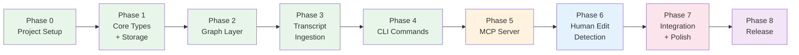
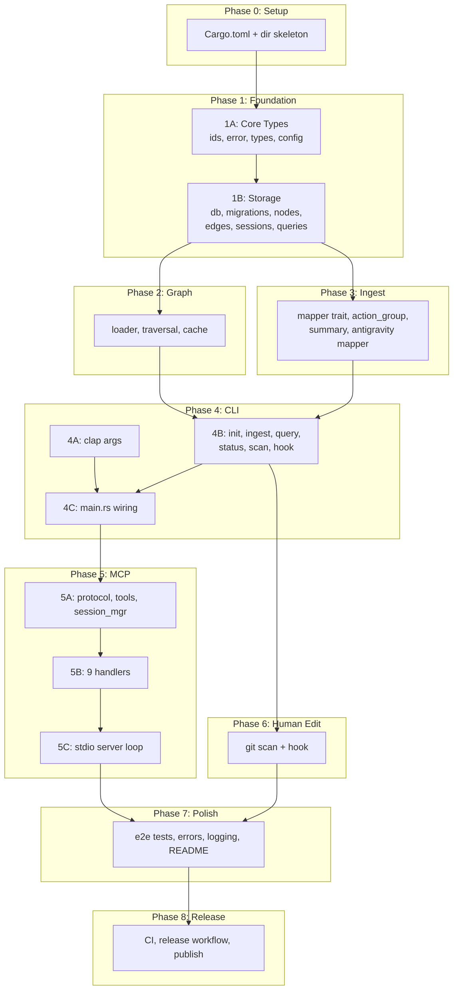

# Knox v1 — Implementation Plan

## Goal

Build Knox v1: a Rust CLI + MCP server that maintains a persistent knowledge graph from IDE conversation history, enabling AI agents to query context instead of re-deriving it. Single binary, cross-platform, local-only.

> [!IMPORTANT]
> This plan is derived from [goal.md](file:///d:/Knox/goal.md) (design decisions) and [code.md](file:///d:/Knox/code.md) (architecture & coding standards). Both documents are the source of truth. This plan is the execution order.

---

## Phase Overview



---

## Phase 0 — Project Setup

**Goal:** Rust project compiles, all dependencies resolve, directory structure exists.  
**Verification:** `cargo build` succeeds with zero warnings.

| # | Task | Files | Details |
|---|---|---|---|
| 0.1 | Initialize Rust project | `Cargo.toml`, `src/main.rs` | `cargo init --name knox` in `d:\Knox` |
| 0.2 | Configure Cargo.toml | `Cargo.toml` | All dependencies from [code.md](file:///d:/Knox/code.md#L670-L719): rusqlite (bundled-full), petgraph, clap (derive), serde, serde_json, tokio (full), chrono, uuid, thiserror, tracing, tracing-subscriber, anyhow, notify. Dev-deps: tempfile, assert_cmd, predicates. Release profile: LTO, strip, codegen-units=1. |
| 0.3 | Create directory skeleton | All `mod.rs` files | Create empty `src/core/`, `src/storage/`, `src/graph/`, `src/ingest/`, `src/commands/`, `src/mcp/`, `src/mcp/handlers/`, `src/cli/`. Each with a `mod.rs` stub. |
| 0.4 | Create test & fixture dirs | `tests/`, `fixtures/` | Empty directories. Add `.gitkeep` if needed. |
| 0.5 | Initialize git repo | `.gitignore`, `LICENSE` | `.gitignore` for Rust (`/target`), `LICENSE` = MIT. |
| 0.6 | Verify build | — | `cargo build` — must compile with zero errors. All mods wired up. |

**Deliverable:** Empty but fully wired Rust project. Every module exists, compiles, does nothing.

---

## Phase 1 — Core Types + Storage Layer

**Goal:** Can create a SQLite database, insert actions/sessions, query them back with filters.  
**Verification:** `cargo test` — all storage unit and integration tests pass.

### 1A: Core Types (Layer 0)

| # | Task | File | Details |
|---|---|---|---|
| 1.1 | ID wrapper types | `src/core/ids.rs` | `ActionId(String)`, `SessionId(String)`, `ProjectId(String)`. Implement `Display`, `Clone`, `Debug`, `PartialEq`, `Eq`, `Hash`, `Serialize`, `Deserialize`. `ActionId::new()` → UUID v4. |
| 1.2 | Error types | `src/core/error.rs` | `KnoxError` enum with variants: `Database`, `SessionNotFound`, `SessionClosed`, `ActionNotFound`, `InvalidInput`, `ParseError`, `Io`, `Json`, `Git`. `KnoxResult<T>` type alias. |
| 1.3 | Domain types | `src/core/types.rs` | `KnoxAction`, `Session`, `QueryFilter` (with defaults: `current_only=true`, `limit=20`), `QueryResult`, `IngestReport`, `StatusReport`, `ScanReport`. All derive `Serialize`, `Deserialize`, `Debug`, `Clone`. |
| 1.4 | Configuration | `src/core/config.rs` | `KnoxConfig`: `kg_path` (default `~/.knox/knox.db`), `session_timeout` (default 30 min), `global_mode` (default true). Load from `KNOX_*` env vars or defaults. |
| 1.5 | Re-exports | `src/core/mod.rs` | `pub mod ids, error, types, config;` + `pub use` for all public types. |

### 1B: Storage Layer (Layer 1)

| # | Task | File | Details |
|---|---|---|---|
| 1.6 | Schema migrations | `src/storage/migrations.rs` | Version 1 schema: `knox_meta`, `projects`, `sessions`, `actions`, `action_files`, `action_tags` tables. All indexes. FTS5 virtual table `actions_fts`. Schema from [code.md](file:///d:/Knox/code.md#L449-L522). |
| 1.7 | Database struct | `src/storage/db.rs` | `KnoxDb` with private `conn: Connection`. `open(path)` → create parent dirs, open SQLite, enable WAL mode, run migrations. `open_memory()` for tests. Expose `conn()` as `pub(crate)` for sibling storage modules only. |
| 1.8 | Node CRUD | `src/storage/nodes.rs` | `insert_action(db, action) → ActionId` — inserts into `actions` + `action_files` + `action_tags` + FTS trigger. `get_action(db, id)`. `mark_superseded(db, old_id, new_id)` — sets `superseded_by` and `is_current=0`. |
| 1.9 | Edge operations | `src/storage/edges.rs` | Helper functions for linking actions: `link_parent(db, child_id, parent_id)`, `link_follows(db, prev_id, next_id)`. Operates on `parent_action_id` column + future edge table if needed. |
| 1.10 | Session lifecycle | `src/storage/sessions.rs` | `start_session(db, actor, project)` → insert + return `Session`. `end_session(db, session_id)` → set `ended_at`, `is_open=0`, return stats. `timeout_stale_sessions(db, max_idle)` → close sessions idle > N mins. `get_session`. |
| 1.11 | Query engine | `src/storage/queries.rs` | `query_actions(db, filter) → QueryResult`. Build dynamic SQL from `QueryFilter` fields. Join `action_files` for file_path filter. Join `action_tags` for tag filter. FTS5 MATCH for keyword search. ORDER BY timestamp DESC. LIMIT + total count. |
| 1.12 | Re-exports | `src/storage/mod.rs` | Re-export all public functions and `KnoxDb`. |
| 1.13 | Storage tests | `tests/test_storage.rs` | Tests: create DB in memory → insert action → get by ID → verify fields. Insert with tags/files → query by tag → found. Insert two actions → supersede first → query current_only → only second returned. Session start → end → verify duration. Timeout stale sessions. FTS search by keyword. |

**Deliverable:** Fully tested data layer. `KnoxDb` can round-trip actions, sessions, and complex queries.

---

## Phase 2 — Graph Layer

**Goal:** Can load a subgraph from SQLite into petgraph, traverse causal chains, cache results.  
**Verification:** `cargo test` — graph traversal tests pass with seeded DB.

| # | Task | File | Details |
|---|---|---|---|
| 2.1 | Graph loader | `src/graph/loader.rs` | `KnoxGraph` type alias (`petgraph::Graph<KnoxAction, KnoxEdge, Directed>`). `load_subgraph(db, anchors, max_depth)` — recursive CTE in SQL to find nodes within N hops of anchors, load into petgraph. `load_full_graph(db)` — load everything. |
| 2.2 | Traversal algorithms | `src/graph/traversal.rs` | `causal_chain(graph, action_id) → Vec<KnoxAction>` — walk parent_action_id links back to root. `descendants(graph, action_id)` — all actions caused by this one. `path_between(graph, from, to)` — shortest path. Uses petgraph's built-in BFS/DFS. |
| 2.3 | LRU cache | `src/graph/cache.rs` | `GraphCache` struct. LRU keyed by `(Option<ProjectId>, Option<String/*file_path*/>)`. Configurable capacity (default 32). `get_or_load(db, key)` — check cache, load if miss. `invalidate(key)` — evict on write. `invalidate_all()` — full flush. |
| 2.4 | Re-exports | `src/graph/mod.rs` | Re-export `KnoxGraph`, `GraphCache`, loader and traversal functions. |
| 2.5 | Graph tests | `tests/test_graph.rs` | Seed DB with a chain: plan → write → debug. Load subgraph from write → verify plan and debug are included. Test `causal_chain` returns [debug, write, plan]. Test cache hit vs miss. Test invalidation. |

**Deliverable:** Three-tier query architecture operational. Tier 1 (SQLite direct), Tier 2 (scoped subgraph), Tier 3 (full graph + cache).

---

## Phase 3 — Transcript Ingestion

**Goal:** Can parse Antigravity `transcript.jsonl` → `Vec<KnoxAction>`, store in DB via the mapper pipeline.  
**Verification:** `cargo test` — ingest tests pass with fixture transcript.

| # | Task | File | Details |
|---|---|---|---|
| 3.1 | TranscriptMapper trait | `src/ingest/mapper.rs` | `trait TranscriptMapper: Send + Sync { fn tool_name(&self) -> &str; fn can_parse(&self, raw: &[u8]) -> bool; fn map(&self, raw: &[u8]) -> KnoxResult<Vec<KnoxAction>>; }` |
| 3.2 | Action group state machine | `src/ingest/action_group.rs` | `ActionGrouper` struct. States: `Idle`, `Collecting`. Boundary: `USER_INPUT`. Collects `PLANNER_RESPONSE` entries. Emits 1-3 `KnoxAction` per group. Handles: tool_calls → write/debug, no tool_calls → decide, USER_INPUT → human plan. |
| 3.3 | Heuristic summary generator | `src/ingest/summary.rs` | `summarize_plan(content) → String` — first 200 chars. `summarize_write(tool_calls) → String` — file paths + line counts. `summarize_debug(tool_calls) → String` — command + exit code. `summarize_decide(content) → String` — first 200 chars, excluding thinking. |
| 3.4 | Antigravity mapper | `src/ingest/antigravity.rs` | `AntigravityMapper` implements `TranscriptMapper`. `can_parse` — checks for JSONL with `step_index` and `type` fields. `map` — parse each line, feed to `ActionGrouper`, collect results. Set actor = `"antigravity"`. Auto-link with `parent_action_id` within groups. |
| 3.5 | Auto-detection + ingest_file | `src/ingest/mod.rs` | `all_mappers() → Vec<Box<dyn TranscriptMapper>>`. `ingest_file(path) → Vec<KnoxAction>` — read file, try each mapper's `can_parse`, route to first match. |
| 3.6 | Test fixture | `fixtures/transcript_antigravity.jsonl` | Realistic sample: 2 USER_INPUTs, each with PLANNER_RESPONSEs including edit_file and run_command tool_calls. ~20 lines total. |
| 3.7 | Ingest tests | `tests/test_ingest.rs` | Parse fixture → verify correct number of actions. Verify actor = "antigravity" for agent actions, "human" for user inputs. Verify file paths extracted from tool_calls. Verify parent_action_id linkage. Verify summary heuristics. |

**Deliverable:** End-to-end ingestion: transcript file → parsed actions → ready for storage.

---

## Phase 4 — CLI Commands

**Goal:** `knox init`, `knox ingest`, `knox query`, `knox status`, `knox scan`, `knox hook` all work end-to-end from the terminal.  
**Verification:** Manual CLI test + `cargo test` for command integration tests.

### 4A: CLI Argument Parsing (Layer 5)

| # | Task | File | Details |
|---|---|---|---|
| 4.1 | Clap derive structs | `src/cli/args.rs` | `#[derive(Parser)] KnoxCli` with subcommands: `Init { path }`, `Ingest { transcript_path }`, `Query { pattern, project?, file?, limit? }`, `Status`, `Serve`, `Scan { project? }`, `Hook { action: Install/Uninstall }`. |
| 4.2 | CLI re-exports | `src/cli/mod.rs` | Re-export `KnoxCli`. |

### 4B: Commands (Layer 3)

| # | Task | File | Details |
|---|---|---|---|
| 4.3 | knox init | `src/commands/init.rs` | `cmd_init(project_path, config)`: 1) Resolve project name from dir name. 2) Open/create global DB. 3) Insert project record. 4) Generate `knox.md` from template (YAML config block + agent instructions). 5) Create `.knox/` dir in project if per-project mode. |
| 4.4 | knox ingest | `src/commands/ingest.rs` | `cmd_ingest(transcript_path, db)`: 1) Call `ingest::ingest_file`. 2) For each `KnoxAction`, call `storage::insert_action`. 3) Link parent/follows edges. 4) Return `IngestReport` (actions_imported, files_touched, sessions_created). |
| 4.5 | knox query | `src/commands/query.rs` | `cmd_query(pattern, db)`: 1) Parse pattern into `QueryFilter` (file path, keyword, or project). 2) Call `storage::query_actions`. 3) Format results as human-readable table (for CLI) or JSON (with `--json` flag). |
| 4.6 | knox status | `src/commands/status.rs` | `cmd_status(db)`: Query aggregate stats: total actions, total sessions, projects tracked, last action timestamp, actions by actor, actions by type. Return `StatusReport`. |
| 4.7 | knox scan | `src/commands/scan.rs` | `cmd_scan(project_path, db)`: 1) Run `git diff --cached --name-only --diff-filter=ACMR`. 2) For each staged file, check DB for recent AI action on that file (within 30 min). 3) Files with no matching AI action → record as `actor: "human"`, `action_type: "human_write"`. 4) Generate diff stats via `git diff --cached --stat`. Return `ScanReport`. |
| 4.8 | knox hook | `src/commands/hook.rs` | `cmd_hook_install(project_path)`: Write `.git/hooks/pre-commit` script that calls `knox scan`. Make executable. `cmd_hook_uninstall`: Remove the hook. |
| 4.9 | Command re-exports | `src/commands/mod.rs` | Re-export all `cmd_*` functions. |

### 4C: Main Entry Point

| # | Task | File | Details |
|---|---|---|---|
| 4.10 | Wire main.rs | `src/main.rs` | Parse `KnoxCli` via clap. Match subcommand → dispatch to `cmd_*` function. Initialize `tracing_subscriber` for logging. Open `KnoxDb` from config path. Handle errors with `anyhow`. |
| 4.11 | Command tests | `tests/test_commands.rs` | Test `knox init` creates knox.md, test `knox ingest` with fixture, test `knox status` shows correct counts, test `knox query` returns expected results. |

**Deliverable:** Fully functional CLI. User can `knox init . && knox ingest transcript.jsonl && knox status && knox query parser`.

---

## Phase 5 — MCP Server

**Goal:** `knox serve` starts a stdio MCP server. IDE agents connect and use all 9 tools.  
**Verification:** Echo JSON-RPC requests to stdin, verify correct stdout responses.

### 5A: MCP Protocol Layer

| # | Task | File | Details |
|---|---|---|---|
| 5.1 | Protocol types | `src/mcp/protocol.rs` | `McpRequest` (jsonrpc, method, params, id), `McpResponse` (jsonrpc, result/error, id), `McpError` (code, message, data), `ToolDescription` (name, description, inputSchema). Serde-compatible with MCP spec. |
| 5.2 | Tool registration | `src/mcp/tools.rs` | `fn all_tools() → Vec<ToolDescription>`. Each tool: name, description, JSON Schema for input. 9 tools: `knox_start_session`, `knox_end_session`, `knox_record_action`, `knox_record_decision`, `knox_get_context`, `knox_get_history`, `knox_search`, `knox_list_stale`, `knox_scan_staged`. |
| 5.3 | Session manager | `src/mcp/session_manager.rs` | In-memory `HashMap<SessionId, SessionState>`. Tracks last activity time per session. `tokio::interval` task checks every 60s, calls `storage::timeout_stale_sessions` for sessions idle > 30 min. |

### 5B: MCP Handlers (one per tool)

| # | Task | File | Details |
|---|---|---|---|
| 5.4 | start_session | `src/mcp/handlers/start_session.rs` | Deserialize params → call `storage::start_session` → return `{session_id, created_at}`. |
| 5.5 | end_session | `src/mcp/handlers/end_session.rs` | Deserialize → `storage::end_session` → return `{status, actions_recorded, duration_seconds}`. |
| 5.6 | record_action | `src/mcp/handlers/record_action.rs` | Deserialize (validate required: session_id, actor, action_type, summary) → build `KnoxAction` → `storage::insert_action` → invalidate graph cache → return `{id, status, timestamp}`. |
| 5.7 | record_decision | `src/mcp/handlers/record_decision.rs` | Same as record_action but force `action_type = "decide"`. |
| 5.8 | get_context | `src/mcp/handlers/get_context.rs` | Deserialize filters → build `QueryFilter` (current_only=true default) → `storage::query_actions` → return flat list. |
| 5.9 | get_history | `src/mcp/handlers/get_history.rs` | Same as get_context but `current_only=false`. |
| 5.10 | search | `src/mcp/handlers/search.rs` | Deserialize (required: query) → build `QueryFilter` with FTS → `storage::query_actions` → return flat list. |
| 5.11 | list_stale | `src/mcp/handlers/list_stale.rs` | Build `QueryFilter` with `current_only=false`, filter only `is_current=false` → return list. |
| 5.12 | scan_staged | `src/mcp/handlers/scan_staged.rs` | Call `commands::cmd_scan` → return `{human_edits_detected, actions_recorded}`. |
| 5.13 | Handler re-exports | `src/mcp/handlers/mod.rs` | `pub fn dispatch(method: &str, params: Value, db: &KnoxDb) → McpResponse` — match method name to handler. |

### 5C: Server Loop

| # | Task | File | Details |
|---|---|---|---|
| 5.14 | stdio server | `src/mcp/server.rs` | `async fn run_mcp_server(db: KnoxDb)`: 1) Tokio stdin reader (line-delimited JSON). 2) Parse `McpRequest`. 3) Handle `initialize` (return server info + tool list). 4) Handle `tools/list` (return all_tools). 5) Handle `tools/call` (dispatch to handler). 6) Spawn session timeout task. 7) Write `McpResponse` to stdout. |
| 5.15 | MCP re-exports | `src/mcp/mod.rs` | Re-export `run_mcp_server`. |
| 5.16 | Wire to main.rs | `src/main.rs` | Add `Serve` subcommand → `tokio::runtime::Runtime::new()` → `run_mcp_server(db)`. |
| 5.17 | MCP tests | `tests/test_mcp.rs` | Create in-memory DB. Call each handler directly with JSON params. Verify: start_session returns session_id, record_action stores and returns id, get_context returns flat list, search returns FTS matches, list_stale returns only superseded. |

**Deliverable:** Fully functional MCP server. Any MCP-compatible IDE can connect via stdio and use all 9 Knox tools.

---

## Phase 6 — Human Edit Detection

**Goal:** `knox scan` and `knox hook install` detect and record human edits via git staged changes.  
**Verification:** Stage a file manually → `knox scan` → verify human_write action in DB.

| # | Task | File | Details |
|---|---|---|---|
| 6.1 | Git integration | `src/commands/scan.rs` | Shell out to `git diff --cached --name-only --diff-filter=ACMR` and `git diff --cached --numstat`. Parse output. Cross-reference each staged file against DB: query recent actions (last 30 min) targeting that file. No match → human edit. |
| 6.2 | Human edit recording | `src/commands/scan.rs` | For detected human edits: build `KnoxAction { actor: "human", action_type: "human_write", files, summary: "Human edit: path (+N -M)" }`. Insert via storage. |
| 6.3 | Pre-commit hook | `src/commands/hook.rs` | `knox hook install`: write bash/sh script to `.git/hooks/pre-commit` that runs `knox scan --project .`. `knox hook uninstall`: remove the file. Cross-platform: detect shell (bash on Unix, PowerShell on Windows). |
| 6.4 | MCP scan_staged | `src/mcp/handlers/scan_staged.rs` | Wire to `cmd_scan`. Agent calls this MCP tool before starting work to ensure KG has latest human edits. |
| 6.5 | Scan tests | `tests/test_commands.rs` | Create temp git repo → stage a file → run `cmd_scan` → verify human_write action recorded. Stage a file that has a recent AI action → verify it's skipped. |

**Deliverable:** Human edits detected via git staged changes, recorded automatically via hook or on-demand.

---

## Phase 7 — Integration & Polish

**Goal:** Everything works together end-to-end. Error messages are clear. Logging is useful. Documentation is complete.  
**Verification:** Full walkthrough: init → ingest → serve → query via MCP → scan → status.

| # | Task | File | Details |
|---|---|---|---|
| 7.1 | End-to-end integration test | `tests/test_e2e.rs` | Programmatic test: create temp dir → `cmd_init` → `cmd_ingest(fixture)` → verify DB has actions → `cmd_query("parser")` → verify results → `cmd_status` → verify counts. |
| 7.2 | knox.md template polish | `src/commands/init.rs` | Verify generated knox.md matches the [spec in goal.md](file:///d:/Knox/goal.md#L156-L228). YAML config block, MANDATORY PROTOCOL section, connection info. Test with a real Antigravity workspace. |
| 7.3 | Error message polish | All error paths | Every `KnoxError` variant should produce a human-readable, actionable message. e.g., "Database not found at ~/.knox/knox.db. Run `knox init` first." |
| 7.4 | Tracing/logging setup | `src/main.rs` | `tracing_subscriber` with `EnvFilter`. Default: WARN. `KNOX_LOG=debug` for verbose. Log: DB open/close, action inserts, query execution time, session lifecycle, MCP requests. |
| 7.5 | README.md | `README.md` | Project description, installation (`cargo install knox`), quickstart (init → ingest → serve), CLI reference, MCP tool reference, configuration, contributing. |
| 7.6 | knox.md verification | — | Generate knox.md → manually verify an Antigravity agent reads and follows the MANDATORY PROTOCOL. |

**Deliverable:** Production-quality v1. Clean errors, useful logs, complete docs.

---

## Phase 8 — Release

**Goal:** Knox v1 is published, installable, and works on all three platforms.  
**Verification:** `cargo install` on Windows, macOS, Linux. Binary runs correctly on each.

| # | Task | File | Details |
|---|---|---|---|
| 8.1 | CI pipeline | `.github/workflows/ci.yml` | GitHub Actions: matrix build (ubuntu-latest, windows-latest, macos-latest). Steps: checkout → install Rust → `cargo build --release` → `cargo test` → upload binary artifacts. |
| 8.2 | Release workflow | `.github/workflows/release.yml` | On tag push (`v0.1.0`): build release binaries for all 3 platforms → create GitHub Release → attach binaries. |
| 8.3 | Cross-compile verification | — | `cargo build --release` on each platform. Run `knox init` + `knox status` on each. Verify SQLite bundled correctly. |
| 8.4 | Publish to crates.io | — | `cargo publish` (optional, if ready). |
| 8.5 | Announce | — | Update README with install instructions, badges, examples. |

**Deliverable:** Tagged v0.1.0 release with binaries for Windows, macOS, Linux.

---

## Dependency Graph



---

## File Creation Order (Complete)

Every file Knox needs, in the exact order it should be created:

| Order | File | Phase |
|---|---|---|
| 1 | `Cargo.toml` | 0 |
| 2 | `.gitignore` | 0 |
| 3 | `LICENSE` | 0 |
| 4 | `src/main.rs` (stub) | 0 |
| 5 | `src/core/mod.rs` | 0 |
| 6 | `src/storage/mod.rs` | 0 |
| 7 | `src/graph/mod.rs` | 0 |
| 8 | `src/ingest/mod.rs` | 0 |
| 9 | `src/commands/mod.rs` | 0 |
| 10 | `src/mcp/mod.rs` | 0 |
| 11 | `src/mcp/handlers/mod.rs` | 0 |
| 12 | `src/cli/mod.rs` | 0 |
| 13 | `src/core/ids.rs` | 1 |
| 14 | `src/core/error.rs` | 1 |
| 15 | `src/core/types.rs` | 1 |
| 16 | `src/core/config.rs` | 1 |
| 17 | `src/storage/migrations.rs` | 1 |
| 18 | `src/storage/db.rs` | 1 |
| 19 | `src/storage/nodes.rs` | 1 |
| 20 | `src/storage/edges.rs` | 1 |
| 21 | `src/storage/sessions.rs` | 1 |
| 22 | `src/storage/queries.rs` | 1 |
| 23 | `tests/test_storage.rs` | 1 |
| 24 | `src/graph/loader.rs` | 2 |
| 25 | `src/graph/traversal.rs` | 2 |
| 26 | `src/graph/cache.rs` | 2 |
| 27 | `tests/test_graph.rs` | 2 |
| 28 | `src/ingest/mapper.rs` | 3 |
| 29 | `src/ingest/action_group.rs` | 3 |
| 30 | `src/ingest/summary.rs` | 3 |
| 31 | `src/ingest/antigravity.rs` | 3 |
| 32 | `fixtures/transcript_antigravity.jsonl` | 3 |
| 33 | `tests/test_ingest.rs` | 3 |
| 34 | `src/cli/args.rs` | 4 |
| 35 | `src/commands/init.rs` | 4 |
| 36 | `src/commands/ingest.rs` | 4 |
| 37 | `src/commands/query.rs` | 4 |
| 38 | `src/commands/status.rs` | 4 |
| 39 | `src/commands/scan.rs` | 4 |
| 40 | `src/commands/hook.rs` | 4 |
| 41 | `tests/test_commands.rs` | 4 |
| 42 | `src/mcp/protocol.rs` | 5 |
| 43 | `src/mcp/tools.rs` | 5 |
| 44 | `src/mcp/session_manager.rs` | 5 |
| 45 | `src/mcp/handlers/start_session.rs` | 5 |
| 46 | `src/mcp/handlers/end_session.rs` | 5 |
| 47 | `src/mcp/handlers/record_action.rs` | 5 |
| 48 | `src/mcp/handlers/record_decision.rs` | 5 |
| 49 | `src/mcp/handlers/get_context.rs` | 5 |
| 50 | `src/mcp/handlers/get_history.rs` | 5 |
| 51 | `src/mcp/handlers/search.rs` | 5 |
| 52 | `src/mcp/handlers/list_stale.rs` | 5 |
| 53 | `src/mcp/handlers/scan_staged.rs` | 5 |
| 54 | `src/mcp/server.rs` | 5 |
| 55 | `tests/test_mcp.rs` | 5 |
| 56 | `tests/test_e2e.rs` | 7 |
| 57 | `README.md` | 7 |
| 58 | `.github/workflows/ci.yml` | 8 |
| 59 | `.github/workflows/release.yml` | 8 |

**Total: 59 files. 9 phases. ~65 tasks.**

---

## Verification Plan

### Automated Tests

Run after each phase:

```bash
# After Phase 1
cargo test test_storage

# After Phase 2
cargo test test_graph

# After Phase 3
cargo test test_ingest

# After Phase 4
cargo test test_commands
cargo run -- init .
cargo run -- status

# After Phase 5
cargo test test_mcp

# After Phase 7
cargo test  # all tests
```

### Manual Verification

| Checkpoint | What to Verify |
|---|---|
| After Phase 4 | Run `knox init .` in a real project → `knox.md` appears with correct YAML config. Run `knox ingest <transcript>` → `knox status` shows correct counts. |
| After Phase 5 | Configure `knox serve` as an MCP server in Antigravity/Cursor → verify tools appear in tool list → call `knox_start_session` → `knox_record_action` → `knox_get_context` → verify round-trip. |
| After Phase 6 | In a git repo tracked by Knox: manually edit a file → `git add` → `knox scan` → verify "human_write" action appears in `knox status`. |
| After Phase 8 | Download release binary on a clean machine → `knox init` → `knox serve` → connect IDE → full workflow works without Rust toolchain installed. |

---

> [!TIP]
> Use `/goal` when executing each phase — it will ensure thoroughness and not stop until all tasks and tests in that phase pass.
