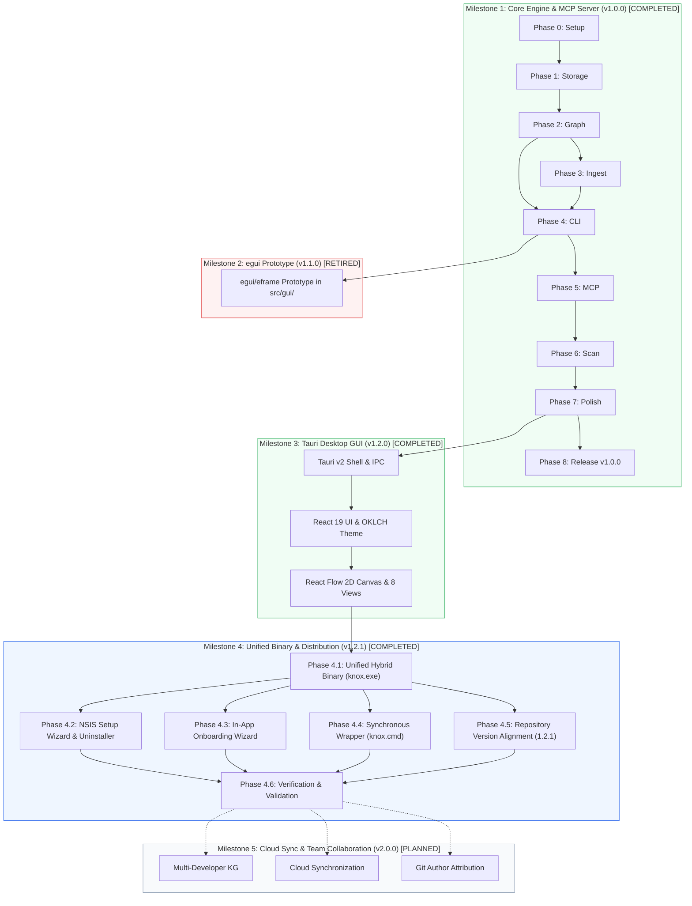
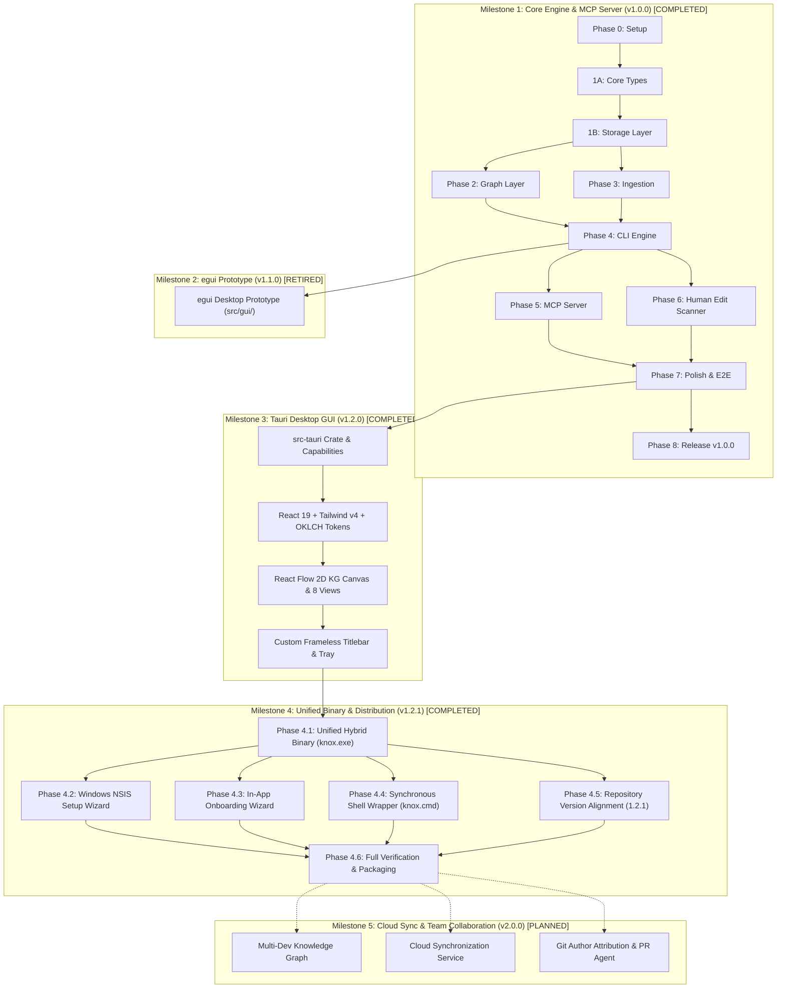

# Knox — Implementation Plan & Project Roadmap (v1.2.1)

## Goal & System Overview

Build Knox: a persistent, cross-platform knowledge graph for AI-assisted software development that maintains conversation-derived context across sessions, tools, and developer workflows. Knox eliminates token re-discovery waste by capturing architectural decisions, implementation actions, and human edits in a local SQLite knowledge graph accessible via standard Model Context Protocol (MCP) and an interactive desktop application.

In Knox v1.2.1, the project delivers a consolidated distribution and execution model:
1. **Unified Hybrid Binary (`knox.exe`)**: Single binary compiling GUI (Tauri v2 + React 19) and headless CLI/MCP stdio server into `target/release/knox.exe` (17.68 MB), eliminating separate `knox-desktop.exe`.
2. **Zero Console Flash GUI Launch**: Subsystem `#![windows_subsystem = "windows"]` ensures zero command prompt flashing when launching the graphical desktop app via shortcut or `knox gui`.
3. **Dynamic Terminal Console Attachment**: Attaches to parent terminal via Win32 `AttachConsole(ATTACH_PARENT_PROCESS)` and rebinds `CONOUT$` / `CONIN$` for interactive CLI commands (`init`, `query`, `status`, `scan`, `hook`).
4. **Inherited Stdio Pipe Preservation**: Automatically preserves inherited pipes (`FILE_TYPE_PIPE`) untouched when spawned by AI agents (`knox serve --stdio`), guaranteeing clean JSON-RPC 2.0 communication.
5. **Windows NSIS Setup Wizard**: Default build output (`pnpm build`) produces `target/release/bundle/nsis/Knox_1.2.1_x64-setup.exe` (~5.46 MB, LZMA compressed from 17.68 MB). Supports dual installation scope (per-user `%LOCALAPPDATA%\Programs\Knox` default and machine-wide `Program Files\Knox`) with integrated uninstaller (`uninstall.exe`).
6. **In-App Onboarding Wizard**: First-run interactive setup dialog (`ui/src/components/OnboardingWizard.tsx`) with 1-click MCP configuration for Antigravity, Cursor, Claude Code, and Gemini CLI, re-accessible via the "Setup Guide" button in `Header.tsx`.
7. **Synchronous Shell Wrapper (`knox.cmd`)**: Ensures synchronous terminal execution and return code propagation in Windows Command Prompt and PowerShell.
8. **Consistent Project Version 1.2.1**: Bumped across all workspace manifests (`Cargo.toml`, `package.json`, `src-tauri/Cargo.toml`, `src-tauri/tauri.conf.json`, `knox.md`).

> [!IMPORTANT]
> This roadmap reflects the cumulative evolutionary milestones of Knox from initial engine conception (v1.0.0) through production desktop distribution (v1.2.1) and future cloud collaboration (v2.0.0). Historical milestone specifications (such as `v1.2.0.md`) are preserved intact as immutable historical references.

---

## Multi-Milestone Roadmap Status

| Milestone | Version | Focus Area | Status | Key Deliverables |
|---|---|---|---|---|
| **M1** | v1.0.0 | Core Engine & MCP Server | **COMPLETED** | CLI (`init`, `query`, `status`, `scan`, `hook`), SQLite WAL/FTS5 storage, 9 MCP tools, Antigravity transcript ingestion |
| **M2** | v1.1.0 | egui Desktop Prototype | **COMPLETED / RETIRED** | Experimental GUI prototype in `src/gui/` using `egui`/`eframe` (validated 2D canvas; retired in v1.2.0) |
| **M3** | v1.2.0 | Tauri v2 Consumer Desktop App | **COMPLETED** | Full desktop transformation: Tauri v2 + React 19 + Tailwind v4 + shadcn/ui + React Flow KG canvas (see `v1.2.0.md`) |
| **M4** | v1.2.1 | Unified Binary & Distribution | **COMPLETED** | Single unified `knox.exe` hybrid binary, NSIS setup wizard with uninstaller, `OnboardingWizard.tsx`, `knox.cmd` |
| **M5** | v2.0.0 | Cloud Sync & Team Collaboration | **PLANNED** | Central cloud repository, multi-developer KG synchronization, Git author signatures, team review agent |

---

## Multi-Milestone Architecture Flowchart



---

## Milestone 1: Core Engine & MCP Server (Knox v1.0.0) [COMPLETED]

### Phase 0 — Project Setup [COMPLETED]

**Goal:** Rust project compiles, all dependencies resolve, directory structure exists.  
**Verification:** `cargo build` succeeds with zero warnings.

| # | Task | Files | Details |
|---|---|---|---|
| 0.1 | Initialize Rust project | `Cargo.toml`, `src/main.rs` | `cargo init --name knox` in `d:\Knox`. *(Note: In v1.2.1, the standalone CLI entrypoint was consolidated into `src-tauri/src/main.rs` to produce the unified hybrid `knox.exe` binary. `src/` now serves as the foundational library crate `src/lib.rs` with `autobins = false`).* |
| 0.2 | Configure Cargo.toml | `Cargo.toml` | All dependencies from [code.md](file:///d:/Knox/code.md#L670-L719): rusqlite (bundled-full), petgraph, clap (derive), serde, serde_json, tokio (full), chrono, uuid, thiserror, tracing, tracing-subscriber, anyhow, notify. Dev-deps: tempfile, assert_cmd, predicates. Release profile: LTO, strip, codegen-units=1. |
| 0.3 | Create directory skeleton | All `mod.rs` files | Create empty `src/core/`, `src/storage/`, `src/graph/`, `src/ingest/`, `src/commands/`, `src/mcp/`, `src/mcp/handlers/`, `src/cli/`. Each with a `mod.rs` stub. |
| 0.4 | Create test & fixture dirs | `tests/`, `fixtures/` | Empty directories. Add `.gitkeep` if needed. |
| 0.5 | Initialize git repo | `.gitignore`, `LICENSE` | `.gitignore` for Rust (`/target`), `LICENSE` = MIT. |
| 0.6 | Verify build | — | `cargo build` — must compile with zero errors. All mods wired up. |

**Deliverable:** Empty but fully wired Rust project. Every module exists, compiles, does nothing.

---

## Phase 1 — Core Types + Storage Layer

**Goal:** Can create a SQLite database, insert actions/sessions, query them back with filters.  
**Verification:** `cargo test` — all storage unit and integration tests pass.

### 1A: Core Types (Layer 0)

| # | Task | File | Details |
|---|---|---|---|
| 1.1 | ID wrapper types | `src/core/ids.rs` | `ActionId(String)`, `SessionId(String)`, `ProjectId(String)`. Implement `Display`, `Clone`, `Debug`, `PartialEq`, `Eq`, `Hash`, `Serialize`, `Deserialize`. `ActionId::new()` → UUID v4. |
| 1.2 | Error types | `src/core/error.rs` | `KnoxError` enum with variants: `Database`, `SessionNotFound`, `SessionClosed`, `ActionNotFound`, `InvalidInput`, `ParseError`, `Io`, `Json`, `Git`. `KnoxResult<T>` type alias. |
| 1.3 | Domain types | `src/core/types.rs` | `KnoxAction`, `Session`, `QueryFilter` (with defaults: `current_only=true`, `limit=20`), `QueryResult`, `IngestReport`, `StatusReport`, `ScanReport`. All derive `Serialize`, `Deserialize`, `Debug`, `Clone`. |
| 1.4 | Configuration | `src/core/config.rs` | `KnoxConfig`: `kg_path` (default `~/.knox/knox.db`), `session_timeout` (default 30 min), `global_mode` (default true). Load from `KNOX_*` env vars or defaults. |
| 1.5 | Re-exports | `src/core/mod.rs` | `pub mod ids, error, types, config;` + `pub use` for all public types. |

### 1B: Storage Layer (Layer 1)

| # | Task | File | Details |
|---|---|---|---|
| 1.6 | Schema migrations | `src/storage/migrations.rs` | Version 1 schema: `knox_meta`, `projects`, `sessions`, `actions`, `action_files`, `action_tags` tables. All indexes. FTS5 virtual table `actions_fts`. Schema from [code.md](file:///d:/Knox/code.md#L449-L522). |
| 1.7 | Database struct | `src/storage/db.rs` | `KnoxDb` with private `conn: Connection`. `open(path)` → create parent dirs, open SQLite, enable WAL mode, run migrations. `open_memory()` for tests. Expose `conn()` as `pub(crate)` for sibling storage modules only. |
| 1.8 | Node CRUD | `src/storage/nodes.rs` | `insert_action(db, action) → ActionId` — inserts into `actions` + `action_files` + `action_tags` + FTS trigger. `get_action(db, id)`. `mark_superseded(db, old_id, new_id)` — sets `superseded_by` and `is_current=0`. |
| 1.9 | Edge operations | `src/storage/edges.rs` | Helper functions for linking actions: `link_parent(db, child_id, parent_id)`, `link_follows(db, prev_id, next_id)`. Operates on `parent_action_id` column + future edge table if needed. |
| 1.10 | Session lifecycle | `src/storage/sessions.rs` | `start_session(db, actor, project)` → insert + return `Session`. `end_session(db, session_id)` → set `ended_at`, `is_open=0`, return stats. `timeout_stale_sessions(db, max_idle)` → close sessions idle > N mins. `get_session`. |
| 1.11 | Query engine | `src/storage/queries.rs` | `query_actions(db, filter) → QueryResult`. Build dynamic SQL from `QueryFilter` fields. Join `action_files` for file_path filter. Join `action_tags` for tag filter. FTS5 MATCH for keyword search. ORDER BY timestamp DESC. LIMIT + total count. |
| 1.12 | Re-exports | `src/storage/mod.rs` | Re-export all public functions and `KnoxDb`. |
| 1.13 | Storage tests | `tests/test_storage.rs` | Tests: create DB in memory → insert action → get by ID → verify fields. Insert with tags/files → query by tag → found. Insert two actions → supersede first → query current_only → only second returned. Session start → end → verify duration. Timeout stale sessions. FTS search by keyword. |

**Deliverable:** Fully tested data layer. `KnoxDb` can round-trip actions, sessions, and complex queries.

---

## Phase 2 — Graph Layer

**Goal:** Can load a subgraph from SQLite into petgraph, traverse causal chains, cache results.  
**Verification:** `cargo test` — graph traversal tests pass with seeded DB.

| # | Task | File | Details |
|---|---|---|---|
| 2.1 | Graph loader | `src/graph/loader.rs` | `KnoxGraph` type alias (`petgraph::Graph<KnoxAction, KnoxEdge, Directed>`). `load_subgraph(db, anchors, max_depth)` — recursive CTE in SQL to find nodes within N hops of anchors, load into petgraph. `load_full_graph(db)` — load everything. |
| 2.2 | Traversal algorithms | `src/graph/traversal.rs` | `causal_chain(graph, action_id) → Vec<KnoxAction>` — walk parent_action_id links back to root. `descendants(graph, action_id)` — all actions caused by this one. `path_between(graph, from, to)` — shortest path. Uses petgraph's built-in BFS/DFS. |
| 2.3 | LRU cache | `src/graph/cache.rs` | `GraphCache` struct. LRU keyed by `(Option<ProjectId>, Option<String/*file_path*/>)`. Configurable capacity (default 32). `get_or_load(db, key)` — check cache, load if miss. `invalidate(key)` — evict on write. `invalidate_all()` — full flush. |
| 2.4 | Re-exports | `src/graph/mod.rs` | Re-export `KnoxGraph`, `GraphCache`, loader and traversal functions. |
| 2.5 | Graph tests | `tests/test_graph.rs` | Seed DB with a chain: plan → write → debug. Load subgraph from write → verify plan and debug are included. Test `causal_chain` returns [debug, write, plan]. Test cache hit vs miss. Test invalidation. |

**Deliverable:** Three-tier query architecture operational. Tier 1 (SQLite direct), Tier 2 (scoped subgraph), Tier 3 (full graph + cache).

---

## Phase 3 — Transcript Ingestion

**Goal:** Can parse Antigravity `transcript.jsonl` → `Vec<KnoxAction>`, store in DB via the mapper pipeline.  
**Verification:** `cargo test` — ingest tests pass with fixture transcript.

| # | Task | File | Details |
|---|---|---|---|
| 3.1 | TranscriptMapper trait | `src/ingest/mapper.rs` | `trait TranscriptMapper: Send + Sync { fn tool_name(&self) -> &str; fn can_parse(&self, raw: &[u8]) -> bool; fn map(&self, raw: &[u8]) -> KnoxResult<Vec<KnoxAction>>; }` |
| 3.2 | Action group state machine | `src/ingest/action_group.rs` | `ActionGrouper` struct. States: `Idle`, `Collecting`. Boundary: `USER_INPUT`. Collects `PLANNER_RESPONSE` entries. Emits 1-3 `KnoxAction` per group. Handles: tool_calls → write/debug, no tool_calls → decide, USER_INPUT → human plan. |
| 3.3 | Heuristic summary generator | `src/ingest/summary.rs` | `summarize_plan(content) → String` — first 200 chars. `summarize_write(tool_calls) → String` — file paths + line counts. `summarize_debug(tool_calls) → String` — command + exit code. `summarize_decide(content) → String` — first 200 chars, excluding thinking. |
| 3.4 | Antigravity mapper | `src/ingest/antigravity.rs` | `AntigravityMapper` implements `TranscriptMapper`. `can_parse` — checks for JSONL with `step_index` and `type` fields. `map` — parse each line, feed to `ActionGrouper`, collect results. Set actor = `"antigravity"`. Auto-link with `parent_action_id` within groups. |
| 3.5 | Auto-detection + ingest_file | `src/ingest/mod.rs` | `all_mappers() → Vec<Box<dyn TranscriptMapper>>`. `ingest_file(path) → Vec<KnoxAction>` — read file, try each mapper's `can_parse`, route to first match. |
| 3.6 | Test fixture | `fixtures/transcript_antigravity.jsonl` | Realistic sample: 2 USER_INPUTs, each with PLANNER_RESPONSEs including edit_file and run_command tool_calls. ~20 lines total. |
| 3.7 | Ingest tests | `tests/test_ingest.rs` | Parse fixture → verify correct number of actions. Verify actor = "antigravity" for agent actions, "human" for user inputs. Verify file paths extracted from tool_calls. Verify parent_action_id linkage. Verify summary heuristics. |

**Deliverable:** End-to-end ingestion: transcript file → parsed actions → ready for storage.

---

## Phase 4 — CLI Commands

**Goal:** `knox init`, `knox ingest`, `knox query`, `knox status`, `knox scan`, `knox hook` all work end-to-end from the terminal.  
**Verification:** Manual CLI test + `cargo test` for command integration tests.

### 4A: CLI Argument Parsing (Layer 5)

| # | Task | File | Details |
|---|---|---|---|
| 4.1 | Clap derive structs | `src/cli/args.rs` | `#[derive(Parser)] KnoxCli` with subcommands: `Init { path }`, `Ingest { transcript_path }`, `Query { pattern, project?, file?, limit? }`, `Status`, `Serve`, `Scan { project? }`, `Hook { action: Install/Uninstall }`. |
| 4.2 | CLI re-exports | `src/cli/mod.rs` | Re-export `KnoxCli`. |

### 4B: Commands (Layer 3)

| # | Task | File | Details |
|---|---|---|---|
| 4.3 | knox init | `src/commands/init.rs` | `cmd_init(project_path, config)`: 1) Resolve project name from dir name. 2) Open/create global DB. 3) Insert project record. 4) Generate `knox.md` from template (YAML config block + agent instructions). 5) Create `.knox/` dir in project if per-project mode. |
| 4.4 | knox ingest | `src/commands/ingest.rs` | `cmd_ingest(transcript_path, db)`: 1) Call `ingest::ingest_file`. 2) For each `KnoxAction`, call `storage::insert_action`. 3) Link parent/follows edges. 4) Return `IngestReport` (actions_imported, files_touched, sessions_created). |
| 4.5 | knox query | `src/commands/query.rs` | `cmd_query(pattern, db)`: 1) Parse pattern into `QueryFilter` (file path, keyword, or project). 2) Call `storage::query_actions`. 3) Format results as human-readable table (for CLI) or JSON (with `--json` flag). |
| 4.6 | knox status | `src/commands/status.rs` | `cmd_status(db)`: Query aggregate stats: total actions, total sessions, projects tracked, last action timestamp, actions by actor, actions by type. Return `StatusReport`. |
| 4.7 | knox scan | `src/commands/scan.rs` | `cmd_scan(project_path, db)`: 1) Run `git diff --cached --name-only --diff-filter=ACMR`. 2) For each staged file, check DB for recent AI action on that file (within 30 min). 3) Files with no matching AI action → record as `actor: "human"`, `action_type: "human_write"`. 4) Generate diff stats via `git diff --cached --stat`. Return `ScanReport`. |
| 4.8 | knox hook | `src/commands/hook.rs` | `cmd_hook_install(project_path)`: Write `.git/hooks/pre-commit` script that calls `knox scan`. Make executable. `cmd_hook_uninstall`: Remove the hook. |
| 4.9 | Command re-exports | `src/commands/mod.rs` | Re-export all `cmd_*` functions. |

### 4C: Main Entry Point

| # | Task | File | Details |
|---|---|---|---|
| 4.10 | Wire main.rs | `src/main.rs` | Parse `KnoxCli` via clap. Match subcommand → dispatch to `cmd_*` function. Initialize `tracing_subscriber` for logging. Open `KnoxDb` from config path. Handle errors with `anyhow`. *(Note: In v1.2.1, this dispatch logic was moved to `src-tauri/src/main.rs` to build the unified `knox.exe` binary).* |
| 4.11 | Command tests | `tests/test_commands.rs` | Test `knox init` creates knox.md, test `knox ingest` with fixture, test `knox status` shows correct counts, test `knox query` returns expected results. |

**Deliverable:** Fully functional CLI. User can `knox init . && knox ingest transcript.jsonl && knox status && knox query parser`.

---

## Phase 5 — MCP Server

**Goal:** `knox serve` starts a stdio MCP server. IDE agents connect and use all 9 tools.  
**Verification:** Echo JSON-RPC requests to stdin, verify correct stdout responses.

### 5A: MCP Protocol Layer

| # | Task | File | Details |
|---|---|---|---|
| 5.1 | Protocol types | `src/mcp/protocol.rs` | `McpRequest` (jsonrpc, method, params, id), `McpResponse` (jsonrpc, result/error, id), `McpError` (code, message, data), `ToolDescription` (name, description, inputSchema). Serde-compatible with MCP spec. |
| 5.2 | Tool registration | `src/mcp/tools.rs` | `fn all_tools() → Vec<ToolDescription>`. Each tool: name, description, JSON Schema for input. 9 tools: `knox_start_session`, `knox_end_session`, `knox_record_action`, `knox_record_decision`, `knox_get_context`, `knox_get_history`, `knox_search`, `knox_list_stale`, `knox_scan_staged`. |
| 5.3 | Session manager | `src/mcp/session_manager.rs` | In-memory `HashMap<SessionId, SessionState>`. Tracks last activity time per session. `tokio::interval` task checks every 60s, calls `storage::timeout_stale_sessions` for sessions idle > 30 min. |

### 5B: MCP Handlers (one per tool)

| # | Task | File | Details |
|---|---|---|---|
| 5.4 | start_session | `src/mcp/handlers/start_session.rs` | Deserialize params → call `storage::start_session` → return `{session_id, created_at}`. |
| 5.5 | end_session | `src/mcp/handlers/end_session.rs` | Deserialize → `storage::end_session` → return `{status, actions_recorded, duration_seconds}`. |
| 5.6 | record_action | `src/mcp/handlers/record_action.rs` | Deserialize (validate required: session_id, actor, action_type, summary) → build `KnoxAction` → `storage::insert_action` → invalidate graph cache → return `{id, status, timestamp}`. |
| 5.7 | record_decision | `src/mcp/handlers/record_decision.rs` | Same as record_action but force `action_type = "decide"`. |
| 5.8 | get_context | `src/mcp/handlers/get_context.rs` | Deserialize filters → build `QueryFilter` (current_only=true default) → `storage::query_actions` → return flat list. |
| 5.9 | get_history | `src/mcp/handlers/get_history.rs` | Same as get_context but `current_only=false`. |
| 5.10 | search | `src/mcp/handlers/search.rs` | Deserialize (required: query) → build `QueryFilter` with FTS → `storage::query_actions` → return flat list. |
| 5.11 | list_stale | `src/mcp/handlers/list_stale.rs` | Build `QueryFilter` with `current_only=false`, filter only `is_current=false` → return list. |
| 5.12 | scan_staged | `src/mcp/handlers/scan_staged.rs` | Call `commands::cmd_scan` → return `{human_edits_detected, actions_recorded}`. |
| 5.13 | Handler re-exports | `src/mcp/handlers/mod.rs` | `pub fn dispatch(method: &str, params: Value, db: &KnoxDb) → McpResponse` — match method name to handler. |

### 5C: Server Loop

| # | Task | File | Details |
|---|---|---|---|
| 5.14 | stdio server | `src/mcp/server.rs` | `async fn run_mcp_server(db: KnoxDb)`: 1) Tokio stdin reader (line-delimited JSON). 2) Parse `McpRequest`. 3) Handle `initialize` (return server info + tool list). 4) Handle `tools/list` (return all_tools). 5) Handle `tools/call` (dispatch to handler). 6) Spawn session timeout task. 7) Write `McpResponse` to stdout. |
| 5.15 | MCP re-exports | `src/mcp/mod.rs` | Re-export `run_mcp_server`. |
| 5.16 | Wire to main.rs | `src/main.rs` | Add `Serve` subcommand → `tokio::runtime::Runtime::new()` → `run_mcp_server(db)`. |
| 5.17 | MCP tests | `tests/test_mcp.rs` | Create in-memory DB. Call each handler directly with JSON params. Verify: start_session returns session_id, record_action stores and returns id, get_context returns flat list, search returns FTS matches, list_stale returns only superseded. |

**Deliverable:** Fully functional MCP server. Any MCP-compatible IDE can connect via stdio and use all 9 Knox tools.

---

## Phase 6 — Human Edit Detection

**Goal:** `knox scan` and `knox hook install` detect and record human edits via git staged changes.  
**Verification:** Stage a file manually → `knox scan` → verify human_write action in DB.

| # | Task | File | Details |
|---|---|---|---|
| 6.1 | Git integration | `src/commands/scan.rs` | Shell out to `git diff --cached --name-only --diff-filter=ACMR` and `git diff --cached --numstat`. Parse output. Cross-reference each staged file against DB: query recent actions (last 30 min) targeting that file. No match → human edit. |
| 6.2 | Human edit recording | `src/commands/scan.rs` | For detected human edits: build `KnoxAction { actor: "human", action_type: "human_write", files, summary: "Human edit: path (+N -M)" }`. Insert via storage. |
| 6.3 | Pre-commit hook | `src/commands/hook.rs` | `knox hook install`: write bash/sh script to `.git/hooks/pre-commit` that runs `knox scan --project .`. `knox hook uninstall`: remove the file. Cross-platform: detect shell (bash on Unix, PowerShell on Windows). |
| 6.4 | MCP scan_staged | `src/mcp/handlers/scan_staged.rs` | Wire to `cmd_scan`. Agent calls this MCP tool before starting work to ensure KG has latest human edits. |
| 6.5 | Scan tests | `tests/test_commands.rs` | Create temp git repo → stage a file → run `cmd_scan` → verify human_write action recorded. Stage a file that has a recent AI action → verify it's skipped. |

**Deliverable:** Human edits detected via git staged changes, recorded automatically via hook or on-demand.

---

## Phase 7 — Integration & Polish

**Goal:** Everything works together end-to-end. Error messages are clear. Logging is useful. Documentation is complete.  
**Verification:** Full walkthrough: init → ingest → serve → query via MCP → scan → status.

| # | Task | File | Details |
|---|---|---|---|
| 7.1 | End-to-end integration test | `tests/test_e2e.rs` | Programmatic test: create temp dir → `cmd_init` → `cmd_ingest(fixture)` → verify DB has actions → `cmd_query("parser")` → verify results → `cmd_status` → verify counts. |
| 7.2 | knox.md template polish | `src/commands/init.rs` | Verify generated knox.md matches the [spec in goal.md](file:///d:/Knox/goal.md#L156-L228). YAML config block, MANDATORY PROTOCOL section, connection info. Test with a real Antigravity workspace. |
| 7.3 | Error message polish | All error paths | Every `KnoxError` variant should produce a human-readable, actionable message. e.g., "Database not found at ~/.knox/knox.db. Run `knox init` first." |
| 7.4 | Tracing/logging setup | `src/main.rs` | `tracing_subscriber` with `EnvFilter`. Default: WARN. `KNOX_LOG=debug` for verbose. Log: DB open/close, action inserts, query execution time, session lifecycle, MCP requests. |
| 7.5 | README.md | `README.md` | Project description, installation (`cargo install knox`), quickstart (init → ingest → serve), CLI reference, MCP tool reference, configuration, contributing. |
| 7.6 | knox.md verification | — | Generate knox.md → manually verify an Antigravity agent reads and follows the MANDATORY PROTOCOL. |

**Deliverable:** Production-quality v1. Clean errors, useful logs, complete docs.

---

### Phase 8 — Initial v1.0.0 Release [COMPLETED]

**Goal:** Knox v1.0.0 is published, installable, and works on all three platforms.  
**Verification:** `cargo install` on Windows, macOS, Linux. Binary runs correctly on each.

| # | Task | File | Details |
|---|---|---|---|
| 8.1 | CI pipeline | `.github/workflows/ci.yml` | GitHub Actions: matrix build (ubuntu-latest, windows-latest, macos-latest). Steps: checkout → install Rust → `cargo build --release` → `cargo test` → upload binary artifacts. |
| 8.2 | Release workflow | `.github/workflows/release.yml` | On tag push (`v1.0.0`): build release binaries for all 3 platforms → create GitHub Release → attach binaries. |
| 8.3 | Cross-compile verification | — | `cargo build --release` on each platform. Run `knox init` + `knox status` on each. Verify SQLite bundled correctly. |
| 8.4 | Publish to crates.io | — | `cargo publish` (optional, if ready). |
| 8.5 | Announce | — | Update README with install instructions, badges, examples. |

**Deliverable:** Tagged v1.0.0 release with binaries for Windows, macOS, Linux.

---

## Milestone 2: egui Desktop Prototype (Knox v1.1.0) [COMPLETED & RETIRED]

**Goal:** Rapidly prototype an embedded GUI cockpit directly in Rust using `egui` and `eframe` within `src/gui/`.  
**Outcome:** Validated the core UX concepts of the 2D physics knowledge graph, live transcript ingestion studio, and real-time metrics dashboard.  
**Retirement Rationale:** While performant, `egui` presented significant barriers to achieving consumer-grade visual polish (e.g. typography rendering, smooth responsive flexbox/grid layouts, accessible modals, and modern design systems). The `src/gui/` subsystem was formally retired and completely replaced by Tauri v2 + React 19 in Milestone 3.

---

## Milestone 3: Tauri v2 Consumer Desktop App (Knox v1.2.0) [COMPLETED]

**Goal:** Transform Knox into a consumer-grade desktop application (Linear/Raycast/Cursor tier) using **Tauri v2 + React 19 + Vite + Tailwind CSS v4 + shadcn/ui**, while keeping the entire Rust domain core (Layers 0–5: `core`, `storage`, `graph`, `ingest`, `commands`, `mcp`) 100% untouched.

> [!NOTE]
> The complete historical specification, UI design system tokens, 58-file inventory, and phase-by-phase implementation plan for this milestone are preserved in [`v1.2.0.md`](file:///d:/Knox/v1.2.0.md).

### Delivered Capabilities
- **Presentation Layer (`ui/`)**: React 19 SPA built with Vite, Tailwind CSS v4 OKLCH dark design tokens (`#0d1117` background floor), bundled Inter and JetBrains Mono typography.
- **Interactive 2D Knowledge Graph Canvas**: Powered by `@xyflow/react` with D3 force-directed physics, Hierarchical ELK layout, Dagre layout, custom ActionNode, FileNode, and CausalEdge renderers, minimap, and inspector rail.
- **8 Dedicated Desktop Views**: Dashboard, Knowledge Graph, Query Console (FTS5 search), Deep Statistics, Transcript Ingestion Studio, Git Human Edit Scanner, MCP Server Configurator, and Workspace Settings.
- **Global Command Palette (`Ctrl+K`)**: Keyboard-driven command palette (`cmdk`) for global search, view switching, and quick action execution.
- **Custom Frameless Titlebar**: Custom drag region with native window controls (minimize, maximize, close) and close-to-tray lifecycle management.
- **Typed IPC Boundary (`src-tauri/`)**: Thin adapter bridging React `invoke` calls to Knox domain APIs across 17 registered commands.

---

## Milestone 4: Distribution Architecture, Unified Binary & Setup Wizard (Knox v1.2.1) [COMPLETED]

**Goal:** Deliver a seamless end-user distribution model by consolidating the desktop GUI and headless CLI/MCP server into a **single unified hybrid binary (`knox.exe`)**, packaging a multi-page **Windows NSIS Setup Wizard with uninstaller**, embedding an **In-App Onboarding Wizard**, and adding a **synchronous Windows shell wrapper (`knox.cmd`)**.

### Phase 4.1 — Single Unified Hybrid Binary (`knox.exe`) [COMPLETED]
- **Target**: `target/release/knox.exe` (17.68 MB).
- **Subsystem**: Compiled under `#![cfg_attr(not(debug_assertions), windows_subsystem = "windows")]` to eliminate console window flash when launched via GUI shortcuts.
- **Dynamic Terminal Console Attachment**: For CLI subcommands (`init`, `query`, `status`, `scan`, `hook`), calls Win32 `AttachConsole(ATTACH_PARENT_PROCESS)` and rebinds standard streams (`CONOUT$`, `CONIN$`) to `SetStdHandle()`.
- **Inherited Stdio Pipe Preservation**: When spawned by AI agents (`knox serve --stdio`), detects `FILE_TYPE_PIPE` and preserves inherited stdio handles untouched, guaranteeing pristine JSON-RPC 2.0 communication.
- **Explicit GUI Subcommand**: `knox gui` command allows launching the desktop interface directly from terminal sessions.
- **Crate Reorganization**: Root `Cargo.toml` specifies `autobins = false` and library target only (`src/lib.rs`). `src-tauri/Cargo.toml` defines `[[bin]] name = "knox" path = "src/main.rs"`, compiling the sole unified binary. Eliminates `knox-desktop.exe`.

### Phase 4.2 — Windows NSIS Setup Wizard & Dedicated Uninstaller [COMPLETED]
- **Production Build**: Running `pnpm build` executes `tauri build --bundles nsis`, compiling the release binary and generating `target/release/bundle/nsis/Knox_1.2.1_x64-setup.exe` (~5.46 MB).
- **LZMA Compression**: Compresses the 17.68 MB binary into a 5.46 MB self-contained installer.
- **Dual Installation Scope**: Configured in `src-tauri/tauri.conf.json` with `installMode: "both"`:
  - Per-User (default): Installs into `%LOCALAPPDATA%\Programs\Knox` without requiring UAC elevation.
  - All Users (machine-wide): Installs into `C:\Program Files\Knox` with standard elevation prompt.
- **Integrated Dedicated Uninstaller**: Automatically packages `uninstall.exe`, creates Start Menu uninstall shortcuts, and registers Knox in Windows *Settings > Installed apps* / *Control Panel* for clean file and registry removal.
- **Portable Build**: `pnpm build:portable` (`tauri build --no-bundle`) outputs standalone `knox.exe`.

### Phase 4.3 — In-App First-Run Onboarding Wizard [COMPLETED]
- **Component**: Implemented in `ui/src/components/OnboardingWizard.tsx` (433 lines) and integrated into `AppShell.tsx`.
- **First-Run Auto-Detection**: Automatically launches on initial app boot when `localStorage.getItem("knox_onboarding_completed")` is absent.
- **4-Step Interactive Guide**:
  1. *Welcome & Architecture*: Local-first SQLite graph, zero token waste, persistent memory across agents.
  2. *Storage Verification*: Confirms active database path (`~/.knox/knox.db`) and workspace instruction file (`knox.md`).
  3. *1-Click AI Integration*: Ready-to-copy JSON configuration snippets for Antigravity, Cursor, Claude Code, and Gemini CLI.
  4. *Keyboard Navigation*: Cheat sheet for `Ctrl+K` (Command Palette), `1-8` (View Switching), and `F5` (Refresh).
- **Header Trigger**: "Setup Guide" button (`<Sparkles />`) in `ui/src/components/layout/Header.tsx` allows reopening the wizard at any time.

### Phase 4.4 — Synchronous Shell Wrapper (`knox.cmd`) [COMPLETED]
- **File**: `knox.cmd` located at repository root.
- **Content**:
  ```cmd
  @echo off
  REM Knox unified launcher for Windows terminal sessions (CMD & PowerShell).
  REM Ensures synchronous execution when running headless CLI / MCP subcommands.
  "%~dp0target\release\knox.exe" %*
  ```
- **Rationale**: Solves Windows asynchronous process launching for GUI subsystem executables, ensuring CMD and PowerShell wait for command completion and cleanly return exit codes.

### Phase 4.5 — Repository Version Alignment (v1.2.1) [COMPLETED]
- Synchronized version `1.2.1` across all workspace manifests and files:
  - `Cargo.toml`: `version = "1.2.1"`
  - `package.json`: `"version": "1.2.1"`
  - `src-tauri/Cargo.toml`: `version = "1.2.1"`
  - `src-tauri/tauri.conf.json`: `"version": "1.2.1"`
  - `knox.md`: `knox_version: "1.2.1"`
  - `goal.md`: Knox v1.2.1 reference specification

### Phase 4.6 — Verification & Validation [COMPLETED]
- Full clean compilation: `cargo check --workspace` and `pnpm typecheck` pass with zero errors.
- Test suite: `cargo test --workspace` passes all 122 tests.
- Release installer: `pnpm build` successfully produces `Knox_1.2.1_x64-setup.exe` (5.46 MB).
- Terminal verification: Background process executes cleanly without unhandled crashes.

---

## Milestone 5: Cloud Sync & Team Collaboration (Knox v2.0.0) [PLANNED]

**Goal:** Extend Knox from single-developer local-first operations to multi-developer team collaboration and cloud synchronization.

### Planned Capabilities
- **Central Team Repository**: Optional cloud sync service allowing distributed developers and CI bots to share a synchronized knowledge graph.
- **Multi-Developer Causal Graph Merging**: CRDT-inspired append-only edge reconciliation to merge branches and remote knowledge graphs without data loss.
- **Git Author Identity Attribution**: Attribute human edits and AI agent actions to specific team members via verified Git author signatures and commit hashes.
- **Pull Request Review Agent**: Automated agent that queries Knox context for changed files and generates contextual architectural reviews in GitHub/GitLab PRs.
- **Team Decision Registry**: Cross-project query tool allowing developers to search organizational decisions and precedents across multiple repositories.

---

## Cumulative Dependency Graph



---

## File Inventory by Milestone

### Milestone 1 — Core Rust Engine (v1.0.0) [59 Files]
Foundational Rust architecture implementing Layers 0–5:
- `Cargo.toml`, `.gitignore`, `LICENSE`, `README.md`
- `src/core/` (`ids.rs`, `error.rs`, `types.rs`, `config.rs`, `mod.rs`)
- `src/storage/` (`migrations.rs`, `db.rs`, `nodes.rs`, `edges.rs`, `sessions.rs`, `queries.rs`, `mod.rs`)
- `src/graph/` (`loader.rs`, `traversal.rs`, `cache.rs`, `mod.rs`)
- `src/ingest/` (`mapper.rs`, `action_group.rs`, `summary.rs`, `antigravity.rs`, `mod.rs`, `fixtures/`)
- `src/commands/` (`init.rs`, `ingest.rs`, `query.rs`, `status.rs`, `scan.rs`, `hook.rs`, `mod.rs`)
- `src/mcp/` (`protocol.rs`, `tools.rs`, `session_manager.rs`, `server.rs`, `mod.rs`, `handlers/*.rs`)
- `src/cli/` (`args.rs`, `mod.rs`)
- `tests/` (`test_storage.rs`, `test_graph.rs`, `test_ingest.rs`, `test_commands.rs`, `test_mcp.rs`, `test_e2e.rs`)
- `.github/workflows/` (`ci.yml`, `release.yml`)

### Milestone 3 — Tauri v2 Desktop GUI (v1.2.0) [58 Files]
Modern desktop user experience (see detailed inventory in [`v1.2.0.md`](file:///d:/Knox/v1.2.0.md)):
- `src-tauri/` (`Cargo.toml`, `build.rs`, `tauri.conf.json`, `capabilities/default.json`, `src/main.rs`, `src/lib.rs`, `src/commands/*.rs`, `icons/`)
- `ui/` (`package.json`, `vite.config.ts`, `index.html`, `public/fonts/`, `src/App.tsx`, `src/globals.css`, `src/store/useKnoxStore.ts`, `src/services/api.ts`, `src/types/knox.ts`, `src/components/layout/`, `src/components/graph/`, `src/components/views/`, `src/components/ui/`, `src/hooks/`)

### Milestone 4 — Unified Binary & Distribution (v1.2.1) [Key Files]
- `knox.cmd` — Root synchronous terminal launcher for CMD and PowerShell.
- `src-tauri/src/main.rs` — Unified hybrid binary entrypoint (`windows_subsystem`, dynamic `AttachConsole`, pipe detection, GUI/CLI dispatch).
- `src-tauri/Cargo.toml` — Produces `[[bin]] name = "knox"` (eliminating `knox-desktop.exe`).
- `src-tauri/tauri.conf.json` — NSIS bundle configuration (`installMode: "both"`, uninstaller).
- `ui/src/components/OnboardingWizard.tsx` — 4-step first-boot onboarding wizard with 1-click MCP configs.
- `ui/src/components/layout/Header.tsx` — Desktop header "Setup Guide" trigger button.

---

## Comprehensive Verification Plan

### Automated Verification Commands

```bash
# 1. Rust workspace test suite (122 tests)
cargo test --workspace

# 2. Frontend type validation
pnpm typecheck

# 3. Code formatting and linting
cargo fmt --check
pnpm lint   # cargo clippy --workspace --all-targets

# 4. Production NSIS setup installer build
pnpm build  # tauri build --bundles nsis -> target/release/bundle/nsis/Knox_1.2.1_x64-setup.exe

# 5. Standalone portable executable build
pnpm build:portable  # tauri build --no-bundle -> target/release/knox.exe
```

### Milestone 4 Checkpoint Verification Matrix

| Checkpoint | Scope | Verified Behavior | Pass Criterion |
|---|---|---|---|
| **C1: GUI Launch** | Unified Binary | Double-clicking `target/release/knox.exe` or running `knox gui` | Boots desktop window with `#0d1117` background; **zero console window flash**. |
| **C2: CLI Subcommand** | Unified Binary | Executing `knox.cmd status` or `knox.cmd query parser` | Win32 `AttachConsole` attaches to parent console; outputs formatted text synchronously. |
| **C3: MCP stdio** | Unified Binary | Spawning `knox.cmd serve --stdio` via IDE agent | Detects `FILE_TYPE_PIPE`, keeps stdio clean; executes JSON-RPC 2.0 requests. |
| **C4: Onboarding Wizard** | Desktop UI | First launch with empty `localStorage` | `OnboardingWizard` modal dialog opens automatically; displays DB stats and 1-click MCP snippets. |
| **C5: Setup Guide Button**| Desktop UI | Clicking "Setup Guide" (`Sparkles` icon) in header | Reopens `OnboardingWizard` dialog on demand from any view. |
| **C6: NSIS Installer** | Distribution | Executing `target/release/bundle/nsis/Knox_1.2.1_x64-setup.exe` | Multi-page setup wizard with dual install scope (`AppData` vs `Program Files`) and shortcut creation. |
| **C7: Uninstaller** | Distribution | Windows *Settings > Installed apps* | Knox registers publisher, version 1.2.1, and `uninstall.exe` for clean removal. |
| **C8: Shell Wrapper** | Terminal Shell | Running `knox.cmd --version` in CMD and PowerShell | Returns `knox 1.2.1` synchronously and returns command prompt cleanly. |
