# Knox v1.2.0 — Tauri v2 Consumer-Grade Desktop App

## Goal Description

Knox v1.2.0 completely replaces the current `egui/eframe` GUI subsystem (`src/gui/`) with a **Tauri v2 + React + Vite + Tailwind CSS v4 + shadcn/ui** frontend that delivers a **Linear/Raycast/Cursor-tier consumer desktop experience** — while keeping the entire Rust core (Layers 0–5: `core`, `storage`, `graph`, `ingest`, `commands`, `mcp`) **100% untouched**.

The guiding principle: **Rust owns the data. React owns the experience.**

> [!NOTE]
> **What stays the same (zero changes):**
> All of `src/core/`, `src/storage/`, `src/graph/`, `src/ingest/`, `src/commands/`, `src/mcp/`, `src/cli/`, and all integration tests. The MCP server, CLI, SQLite, petgraph — none of it changes. Only `src/gui/` and `src/main.rs` (GUI dispatch) are replaced.

---

## Architecture: Before vs After

````carousel
### BEFORE: Knox v1.1.0 (egui)
```
src/
├── gui/               ← egui/eframe widgets (REPLACED)
│   ├── app.rs
│   ├── canvas.rs      ← Manual physics simulation (REPLACED)
│   ├── state.rs
│   ├── theme.rs
│   └── views/         ← 8 egui view modules (REPLACED)
└── main.rs            ← `knox gui` → eframe::run_native (MODIFIED)

Cargo.toml:
  eframe = "0.32"      ← REMOVED
  rfd = "0.17"         ← REMOVED
```
<!-- slide -->
### AFTER: Knox v1.2.0 (Tauri v2)
```
Knox/
├── src/                   ← Rust core — UNTOUCHED
│   ├── core/   storage/   graph/   ingest/   commands/   mcp/
│   └── main.rs            ← MODIFIED (tauri dispatch, drop gui module)
├── src-tauri/             ← NEW: Tauri v2 application shell
│   ├── Cargo.toml         ← depends on knox library crate
│   ├── tauri.conf.json
│   ├── capabilities/
│   │   └── default.json
│   └── src/
│       ├── main.rs
│       ├── lib.rs         ← Tauri builder + command registration
│       └── commands/      ← IPC bridge wrappers
│           ├── mod.rs
│           ├── graph.rs
│           ├── query.rs
│           ├── status.rs
│           ├── ingest.rs
│           ├── sessions.rs
│           └── scan.rs
└── ui/                    ← NEW: React/Vite frontend
    ├── package.json
    ├── vite.config.ts
    ├── index.html
    ├── src/
    │   ├── main.tsx
    │   ├── App.tsx
    │   ├── globals.css         ← Tailwind v4 + design tokens
    │   ├── services/
    │   │   └── api.ts          ← Type-safe IPC wrappers
    │   ├── types/
    │   │   └── knox.ts         ← Mirrored Rust types
    │   ├── store/
    │   │   └── useKnoxStore.ts ← Zustand global state
    │   ├── hooks/
    │   │   ├── useKnoxData.ts
    │   │   └── useCommandPalette.ts
    │   └── components/
    │       ├── layout/         ← Shell, Sidebar, Titlebar
    │       ├── graph/          ← React Flow KG canvas
    │       ├── views/          ← 8 dashboard views
    │       └── ui/             ← shadcn/ui primitives
    └── public/
        └── fonts/              ← Inter + JetBrains Mono
```
````

---

## Design System & Visual Language

### Color Palette (Tailwind v4 + OKLCH tokens)

The palette is derived from the **Linear / Raycast dark-first aesthetic** — deep obsidian layered surfaces with vivid accent glows, not harsh pure black or garish neon.

| Token | OKLCH Value | Hex Approx | Role |
|---|---|---|---|
| `--background` | `oklch(0.128 0.005 285)` | `#0d1117` | Base window floor |
| `--card` | `oklch(0.162 0.006 285)` | `#161b22` | Raised panels/cards |
| `--popover` | `oklch(0.180 0.006 285)` | `#1c2128` | Dropdowns, modals |
| `--sidebar` | `oklch(0.145 0.005 285)` | `#13181f` | Left nav rail |
| `--border` | `oklch(0.245 0.006 285)` | `#30363d` | 1px structural lines |
| `--muted` | `oklch(0.440 0.010 285)` | `#6e7681` | Secondary text, hints |
| `--primary` | `oklch(0.623 0.214 260)` | `#6366f1` | Indigo accent, focus |
| `--success` | `oklch(0.620 0.160 160)` | `#10b981` | Write/success states |
| `--warning` | `oklch(0.740 0.180  80)` | `#f59e0b` | Decide/warning states |
| `--danger` | `oklch(0.580 0.200  25)` | `#ef4444` | Debug/error states |
| `--plan` | `oklch(0.620 0.185 295)` | `#8b5cf6` | Plan actions (violet) |

### Typography

| Family | Source | Usage |
|---|---|---|
| **Inter Variable** | [rsms/inter](https://github.com/rsms/inter) bundled in `ui/public/fonts/` | All UI labels, headings, body text |
| **JetBrains Mono** | [JetBrains/JetBrainsMono](https://github.com/JetBrains/JetBrainsMono) bundled | Action IDs, file paths, timestamps, MCP JSON |
| **Geist Sans** (fallback) | CDN | System fallback if fonts fail to load |

Font scale: `text-xs` (10px) for metadata tags → `text-sm` (12–13px) for body → `text-base` (14px) for headings. Dense, information-rich, not bloated.

### Spatial Elevation Model

```
Elevation 0: --background     (window base, never used for content)
Elevation 1: --card           (panels, sidebar, list pane)
Elevation 2: --popover        (modals, dropdowns, tooltips)
Elevation 3: blur-backdrop    (command palette overlay, sheet drawers)
```

Depth is conveyed through **1px border-border strokes + OKLCH lightness steps**, not `box-shadow` blurs. Exception: Command Palette uses `backdrop-blur-xl` frosted glass for drama.

### Layout Architecture: Three-Zone Split

```
┌──────────┬──────────────────────────────┬──────────────────────┐
│  Sidebar │       Main Content           │   Detail Inspector   │
│  w-56    │       flex-1                 │   w-80 (optional)    │
│  (rail)  │       (view-specific)        │   (expandable)       │
│          │                              │                      │
│ Knox 🛡️  │  [ View Title + Toolbar ]   │  Selected Action     │
│ ─────── │  ─────────────────────────  │  ─────────────────── │
│ • Graph  │  (Graph Canvas / Tables /   │  Actor: gemini       │
│ • Query  │   Stats Cards / Ingest /    │  Type: write         │
│ • Stats  │   Scanner / MCP Config)     │  Files: [...]        │
│ • Ingest │                              │  Tags: [...]         │
│ • Scan   │                              │  Confidence: 0.85    │
│ • MCP    │                              │  ─────────────────── │
│ ─────── │                              │  Causal Chain ↑      │
│ DB: ✓   │                              │  parent_action_id    │
│ MCP: ✓  │                              │                      │
└──────────┴──────────────────────────────┴──────────────────────┘
```

---

## Controls & Component Inventory

### Global Controls (always visible)

| Control | Type | Position | Behavior |
|---|---|---|---|
| `Ctrl+K` / `Cmd+K` | Command Palette | Fullscreen overlay, center-top | Opens `CommandDialog` (shadcn cmdk). Searches: nav views, recent queries, projects, files, actions |
| `Ctrl+/` | Keyboard shortcut help | Overlay | Shows all registered hotkeys |
| DB connection badge | Status indicator | Sidebar footer | Green dot = connected; Red = error |
| MCP server status | Status indicator | Sidebar footer | Shows `stdio` / `sse` / `stopped` |

### Sidebar Navigation (Left Rail, `w-56`)

| Item | Icon | Route | Shortcut |
|---|---|---|---|
| Dashboard / Welcome | `LayoutDashboard` | `/` | `G D` |
| Knowledge Graph | `Network` | `/graph` | `G G` |
| Query Console | `Search` | `/query` | `G Q` |
| Metrics & Stats | `BarChart2` | `/stats` | `G S` |
| Ingest Transcripts | `FileInput` | `/ingest` | `G I` |
| Human Edit Scan | `ShieldCheck` | `/scan` | `G C` |
| MCP Server Config | `PlugZap` | `/mcp` | `G M` |
| Workspace & Hook | `FolderGit2` | `/workspace` | `G W` |

Sidebar footer shows: KG path, DB row count, Knox version.

### View 1: Dashboard (Welcome / Status Overview)

**Layout:** 4 metric cards top row, then 2-column split (recent actions feed + system diagnostics).

| Component | Type | Position | Data Source |
|---|---|---|---|
| `TotalActionsCard` | Metric card with large numeral | Top row, col 1 | `cmd_status → total_actions` |
| `SessionsCard` | Metric card | Top row, col 2 | `total_sessions` |
| `ProjectsCard` | Metric card | Top row, col 3 | `projects_tracked` |
| `LastUpdateCard` | Metric card with relative time | Top row, col 4 | `last_action_timestamp` |
| `RecentFeed` | Scrollable action list | Bottom left | Last 15 actions |
| `DiagnosticsPanel` | DB path, version, git hook status | Bottom right | Config + `cmd_status` |
| `QuickActionBar` | Buttons: Init, Ingest, Serve MCP | Below metric row | `tauri::invoke` |

### View 2: Knowledge Graph Canvas

**Layout:** Full-bleed React Flow canvas (fills `flex-1`) with floating controls overlay.

| Component | Type | Position | Details |
|---|---|---|---|
| `ReactFlow` | Canvas | Full area | pan, zoom, `fitView`, `minZoom=0.1`, `maxZoom=3.0` |
| `ActionNode` | Custom Node | Floating in canvas | Shows: icon by type, actor badge, 22-char summary truncated, glow ring on hover |
| `FileNode` | Custom Node | Floating in canvas | Shows: file path, connection count |
| `CausalEdge` | Custom Edge | Connecting nodes | Smooth step path, relationship label (`follows` / `superseded_by` / `targets`) |
| `MiniMap` | React Flow built-in | Bottom-right corner | Semi-transparent dark minimap |
| `Controls` | React Flow built-in | Bottom-left | Zoom in, zoom out, fit view, lock |
| `FilterBar` | Toolbar | Top overlay bar | Actor filter pills, type filter pills, `hide_superseded` toggle |
| `SearchInput` | Input | Top overlay, left | Real-time node highlight by keyword |
| `NodeInspector` | Slide-in panel | Right side (Detail Inspector zone) | Shows full `KnoxAction` details: ID, actor, type, summary, files, tags, confidence, timestamp, causal chain |
| `GraphControls` | Floating buttons | Top-right overlay | Layout engine selector: Force / ELK / Dagre |

**Node Design (ActionNode):**
```
┌─────────────────────────────┐  ← 8px rounded, 1px --border
│  ⚡ write         [gemini]  │  ← type icon + actor badge (right-aligned)
│  Implemented nom parser...  │  ← 22-char truncated summary
│  src/parser.rs +2 files     │  ← file count chip
│  ──────────────────────    │
│  2026-10-29 · s-uuid-001   │  ← muted timestamp + session
└─────────────────────────────┘
     ●                         ← source handle (bottom center)
```

Colors: border glow color = action type color (write=green, plan=violet, debug=red, decide=amber)

### View 3: Query Console

**Layout:** Search bar full-width top, results table fills remaining space, detail panel on click.

| Component | Type | Position | Details |
|---|---|---|---|
| `SearchInput` | Large text input | Top, full width | Placeholder: "Search actions, files, decisions…"; autofocus on view mount |
| `FileFilter` | Text input | Top row, inline | Filter by file path prefix |
| `ActorSelect` | Dropdown multi-select | Top row, inline | Options: all actors from DB |
| `TypeSelect` | Dropdown multi-select | Top row, inline | write, plan, decide, debug, etc. |
| `DateRangePicker` | Date range | Top row, inline | `since` filter |
| `CurrentOnlyToggle` | Switch | Top row, inline | Excludes superseded |
| `LimitSelect` | Select | Top row, inline | 20 / 50 / 100 |
| `SearchButton` | Primary button | Top row, right | Triggers `invoke('query_actions')` |
| `ResultsTable` | Virtualized table | Main area | Columns: type badge, actor badge, status, summary, files, timestamp |
| `Pagination` | Controls | Bottom bar | Has-more + load-more |
| `ResultDetail` | Inspector panel | Right rail | Same as graph NodeInspector |

### View 4: Metrics & Stats

**Layout:** Top row of 4 KPI cards, below: two side-by-side distribution charts.

| Component | Type | Position | Details |
|---|---|---|---|
| 4× `KpiCard` | Metric card | Top row | Total actions, sessions, projects, stale count |
| `ActorDistribution` | Horizontal bar chart | Bottom left | Actor → count + % fill bar (colored per actor) |
| `TypeDistribution` | Horizontal bar chart | Bottom right | Action type → count + % fill bar (colored per type) |
| `RecentTrend` | Sparkline (7-day) | Card, below KPIs | Actions per day — rendered via inline SVG |
| `RefreshButton` | Icon button | Top right | Re-fetches `cmd_status` |

### View 5: Ingest Transcripts

| Component | Type | Position | Details |
|---|---|---|---|
| `DropZone` | Drag-and-drop area | Top, large | Accept `.jsonl` files; shows file icon + instructions; highlight on drag-over |
| `FileSelector` | `dialog::open` button | Inside DropZone | Opens native OS file picker via Tauri dialog plugin |
| `SelectedFileChip` | File badge | Below DropZone | Shows filename, size, detected format (Antigravity / Unknown) |
| `FormatBadge` | Status badge | Inline | Auto-detected mapper name |
| `IngestButton` | Large primary button | Below chip | Disabled until file selected; shows spinner on ingest |
| `IngestReport` | Results card | Post-ingest | actions_imported, files_touched, sessions_created, duration |
| `PreviewAccordion` | Expandable section | Below report | First 5 parsed actions preview |

### View 6: Human Edit Scanner

| Component | Type | Position | Details |
|---|---|---|---|
| `ProjectPathInput` | Text input + folder picker | Top | Defaults to last workspace path |
| `ScanButton` | Primary button | Right of path | Triggers `invoke('scan_staged')` |
| `ScanReport` | Result section | Below button | human_edits_detected count, list of detected files |
| `DetectedEditsTable` | Table | Main area | File path, diff stats (+N -M), recorded action ID |
| `HookStatus` | Status banner | Bottom | Hook installed/not-installed with install/uninstall buttons |

### View 7: MCP Server Config

| Component | Type | Position | Details |
|---|---|---|---|
| `McpStatusCard` | Status card | Top | Server status: Stopped / Running; PID; uptime |
| `StartStopButton` | Toggle button | Inside status card | Start/stop the MCP server process |
| `TransportBadge` | Badge | Inside status card | `stdio` · `SSE` |
| `ToolList` | Accordion | Middle | All 9 Knox MCP tools; each expandable with input schema |
| `CopyConfigButton` | Button | Top right | Copies MCP server config JSON for pasting into cursor/antigravity |
| `ConfigBlock` | Code block (monospace) | Bottom | `knox serve --stdio` command; connection config |

### View 8: Workspace & Hook Setup

| Component | Type | Position | Details |
|---|---|---|---|
| `WorkspaceInput` | Path input + browse | Top | Project root path |
| `InitButton` | Primary button | Right | Calls `invoke('init_project')` |
| `KnoxMdPreview` | Code block | Below | Live-renders the generated `knox.md` content |
| `HookInstall` | Card with two buttons | Bottom | Install / Uninstall pre-commit hook; shows current hook status |
| `StepWizard` | Numbered step indicator | Top area | Steps 1–4: Set path → Init → Install hook → Done |

---

## Full Phase Plan

```mermaid
flowchart LR
    P0["Phase 0\nRust Workspace\nRestructure"]
    P1["Phase 1\nIPC Bridge\n(src-tauri)"]
    P2["Phase 2\nVite + React\nFoundation"]
    P3["Phase 3\nDesign System\n+ Layout Shell"]
    P4["Phase 4\nDashboard +\nStats Views"]
    P5["Phase 5\nQuery Console\n+ Ingest View"]
    P6["Phase 6\nKG Graph\nCanvas"]
    P7["Phase 7\nScan + MCP\n+ Workspace Views"]
    P8["Phase 8\nCommand Palette\n+ Polish"]
    P9["Phase 9\nCleanup +\nRelease Build"]

    P0 --> P1 --> P2 --> P3 --> P4 --> P5 --> P6 --> P7 --> P8 --> P9

    style P0 fill:#e8f5e9,stroke:#2e7d32
    style P1 fill:#e8f5e9,stroke:#2e7d32
    style P2 fill:#e3f2fd,stroke:#1565c0
    style P3 fill:#e3f2fd,stroke:#1565c0
    style P4 fill:#fff3e0,stroke:#e65100
    style P5 fill:#fff3e0,stroke:#e65100
    style P6 fill:#fce4ec,stroke:#880e4f
    style P7 fill:#f3e5f5,stroke:#4a148c
    style P8 fill:#f1f8e9,stroke:#33691e
    style P9 fill:#e0f2f1,stroke:#004d40
```



---

### Phase 0 — Rust Workspace Restructure

**Goal:** Convert the existing single-crate project into a Cargo workspace so the knox library and the Tauri shell are separate crates.

**Key constraint:** The `src/gui/` module and `eframe`/`rfd` deps are REMOVED from the main crate. The main `knox` crate becomes a pure library + slim CLI binary (no GUI). The new Tauri shell lives in `src-tauri/`.

#### [MODIFY] `Cargo.toml` (root)

```toml
[workspace]
members = [".", "src-tauri"]
resolver = "2"

[package]
name = "knox"
version = "1.2.0"
edition = "2024"
# ... same as before ...

[lib]
name = "knox"
path = "src/lib.rs"

[[bin]]
name = "knox"
path = "src/main.rs"

[dependencies]
# Layer 0–5 unchanged
chrono = { version = "0.4", features = ["serde"] }
uuid = { version = "1", features = ["v4", "serde"] }
serde = { version = "1", features = ["derive"] }
serde_json = "1"
thiserror = "1"
rusqlite = { version = "0.31", features = ["bundled-full"] }
petgraph = "0.6"
tokio = { version = "1", features = ["full"] }
clap = { version = "4", features = ["derive"] }
tracing = "0.1"
tracing-subscriber = { version = "0.3", features = ["env-filter"] }
anyhow = "1"
notify = "6"
# REMOVED: eframe, rfd
```

#### [DELETE] `src/gui/` (entire module directory)
- `src/gui/mod.rs`, `src/gui/app.rs`, `src/gui/canvas.rs`, `src/gui/state.rs`, `src/gui/theme.rs`
- `src/gui/views/` (all 8 view files + mod.rs)

#### [MODIFY] `src/lib.rs`
Remove `pub mod gui;` declaration.

#### [MODIFY] `src/main.rs`
Remove `handle_gui` function and `Commands::Gui` arm. Remove `GuiArgs` import. `knox gui` will be replaced by the Tauri binary.

#### [MODIFY] `src/cli/args.rs`
Remove `Gui(GuiArgs)` variant from `Commands` enum. Remove `GuiArgs` struct.

---

### Phase 1 — IPC Bridge (`src-tauri/`)

**Goal:** The Tauri shell compiles and can invoke Knox Rust business logic through type-safe IPC commands.

#### [NEW] `src-tauri/Cargo.toml`

```toml
[package]
name = "knox-desktop"
version = "1.2.0"
edition = "2024"

[lib]
name = "knox_desktop_lib"
crate-type = ["staticlib", "cdylib", "rlib"]

[build-dependencies]
tauri-build = { version = "2", features = [] }

[dependencies]
knox = { path = ".." }          # The core library crate
tauri = { version = "2", features = ["tray-icon"] }
tauri-plugin-dialog = "2"
tauri-plugin-fs = "2"
tauri-plugin-shell = "2"
serde = { version = "1", features = ["derive"] }
serde_json = "1"
tokio = { version = "1", features = ["full"] }
tracing = "0.1"
tracing-subscriber = { version = "0.3", features = ["env-filter"] }
```

#### [NEW] `src-tauri/build.rs`

```rust
fn main() {
    tauri_build::build()
}
```

#### [NEW] `src-tauri/tauri.conf.json`

```json
{
  "$schema": "https://schema.tauri.app/config/2",
  "productName": "Knox",
  "version": "1.2.0",
  "identifier": "dev.knox.desktop",
  "build": {
    "frontendDist": "../ui/dist",
    "devUrl": "http://localhost:5173"
  },
  "app": {
    "security": { "csp": null },
    "windows": [
      {
        "label": "main",
        "title": "Knox 🛡️ — Knowledge Graph",
        "width": 1280,
        "height": 820,
        "minWidth": 960,
        "minHeight": 640,
        "decorations": true,
        "center": true,
        "backgroundColor": "#0d1117"
      }
    ]
  },
  "bundle": {
    "active": true,
    "targets": "all",
    "icon": ["icons/32x32.png", "icons/128x128.png", "icons/icon.icns", "icons/icon.ico"]
  }
}
```

#### [NEW] `src-tauri/capabilities/default.json`

```json
{
  "$schema": "../gen/schemas/desktop-schema.json",
  "identifier": "main-capability",
  "windows": ["main"],
  "permissions": [
    "core:default",
    "dialog:default",
    "fs:default",
    "shell:default"
  ]
}
```

#### [NEW] `src-tauri/src/commands/` — IPC wrappers (one file per domain)

**`src-tauri/src/commands/status.rs`**
```rust
use knox::commands::cmd_status;
use knox::core::types::StatusReport;
use knox::storage::db::KnoxDb;
use tauri::State;
use crate::AppState;

#[tauri::command]
pub async fn get_status(state: State<'_, AppState>) -> Result<StatusReport, String> {
    let db = state.db.lock().await;
    cmd_status(&db).map_err(|e| e.to_string())
}
```

**`src-tauri/src/commands/query.rs`**
```rust
#[tauri::command]
pub async fn query_actions(
    state: State<'_, AppState>,
    search: Option<String>,
    file_path: Option<String>,
    actor: Option<String>,
    action_types: Option<Vec<String>>,
    current_only: bool,
    limit: usize,
) -> Result<QueryResult, String> { ... }
```

**Full IPC command set:**

| Command (Tauri invoke name) | Rust handler | Knox function |
|---|---|---|
| `get_status` | `commands::status` | `cmd_status` |
| `query_actions` | `commands::query` | `storage::nodes::query_actions` |
| `get_action` | `commands::query` | `storage::nodes::get_action` |
| `get_graph_data` | `commands::graph` | `commands::cmd_query` + graph loader |
| `ingest_transcript` | `commands::ingest` | `cmd_ingest` |
| `init_project` | `commands::workspace` | `cmd_init` |
| `scan_staged` | `commands::scan` | `cmd_scan` |
| `install_hook` | `commands::workspace` | `cmd_hook_install` |
| `uninstall_hook` | `commands::workspace` | `cmd_hook_uninstall` |
| `start_session` | `commands::sessions` | `storage::sessions::start_session` |
| `end_session` | `commands::sessions` | `storage::sessions::end_session` |
| `get_sessions` | `commands::sessions` | List open/recent sessions |
| `get_config` | `commands::config` | Returns `KnoxConfig` |
| `open_file_dialog` | `commands::dialog` | Tauri dialog plugin |

#### [NEW] `src-tauri/src/lib.rs`

```rust
use std::sync::Arc;
use tokio::sync::Mutex;
use knox::storage::db::KnoxDb;
use knox::core::config::KnoxConfig;

pub struct AppState {
    pub db: Arc<Mutex<KnoxDb>>,
    pub config: KnoxConfig,
}

#[cfg_attr(mobile, tauri::mobile_entry_point)]
pub fn run() {
    let config = KnoxConfig::from_env();
    let db = KnoxDb::open(&config.kg_path)
        .expect("Failed to open Knox database");

    tauri::Builder::default()
        .plugin(tauri_plugin_dialog::init())
        .plugin(tauri_plugin_fs::init())
        .plugin(tauri_plugin_shell::init())
        .manage(AppState { db: Arc::new(Mutex::new(db)), config })
        .invoke_handler(tauri::generate_handler![
            commands::status::get_status,
            commands::query::query_actions,
            commands::query::get_action,
            commands::graph::get_graph_data,
            commands::ingest::ingest_transcript,
            commands::workspace::init_project,
            commands::workspace::install_hook,
            commands::workspace::uninstall_hook,
            commands::scan::scan_staged,
            commands::sessions::start_session,
            commands::sessions::end_session,
            commands::sessions::get_sessions,
            commands::config::get_config,
        ])
        .run(tauri::generate_context!())
        .expect("error while running tauri application");
}
```

---

### Phase 2 — Vite + React Frontend Foundation

**Goal:** `pnpm dev` spins up the React dev server on `:5173`. Tauri's `pnpm tauri dev` hot-reloads instantly.

#### [NEW] `ui/package.json`

```json
{
  "name": "knox-ui",
  "version": "1.2.0",
  "private": true,
  "type": "module",
  "scripts": {
    "dev": "vite",
    "build": "tsc && vite build",
    "preview": "vite preview"
  },
  "dependencies": {
    "@tauri-apps/api": "^2",
    "@tauri-apps/plugin-dialog": "^2",
    "@xyflow/react": "^12",
    "cmdk": "^1",
    "d3-force": "^3",
    "elkjs": "^0.10",
    "lucide-react": "^0.511",
    "react": "^19",
    "react-dom": "^19",
    "zustand": "^5",
    "clsx": "^2",
    "tailwind-merge": "^2"
  },
  "devDependencies": {
    "@tailwindcss/vite": "^4",
    "@types/react": "^19",
    "@types/react-dom": "^19",
    "@vitejs/plugin-react": "^4",
    "tailwindcss": "^4",
    "typescript": "^5",
    "vite": "^6"
  }
}
```

> [!NOTE]
> **shadcn/ui components:** We vendor specific shadcn/ui components (Button, Badge, Card, Command, Dialog, DropdownMenu, Input, Select, Switch, Tabs, Tooltip, ScrollArea, Separator) into `ui/src/components/ui/`. Run: `pnpm dlx shadcn@latest add button badge card command dialog dropdown-menu input select switch tabs tooltip scroll-area separator` after Tailwind config is established.

#### [NEW] `ui/vite.config.ts`

```typescript
import { defineConfig } from "vite";
import react from "@vitejs/plugin-react";
import tailwindcss from "@tailwindcss/vite";
import path from "path";

export default defineConfig({
  plugins: [react(), tailwindcss()],
  resolve: {
    alias: { "@": path.resolve(__dirname, "./src") },
  },
  clearScreen: false,
  server: {
    port: 5173,
    strictPort: true,
    watch: { ignored: ["**/src-tauri/**"] },
  },
  envPrefix: ["VITE_", "TAURI_"],
  build: {
    target: ["es2021", "chrome100", "safari13"],
    minify: !process.env.TAURI_DEBUG ? "esbuild" : false,
    sourcemap: !!process.env.TAURI_DEBUG,
  },
});
```

#### [NEW] `ui/src/types/knox.ts` — Mirror of Rust types

```typescript
export interface KnoxAction {
  id: string;
  actor: string;
  action_type: string;
  summary: string;
  files: string[];
  tags: string[];
  confidence: number | null;
  timestamp: string;       // ISO 8601
  session_id: string | null;
  parent_action_id: string | null;
  supersedes: string | null;
  is_current: boolean;
}

export interface Session {
  id: string;
  actor: string;
  project: string | null;
  started_at: string;
  ended_at: string | null;
  is_open: boolean;
}

export interface StatusReport {
  total_actions: number;
  total_sessions: number;
  projects_tracked: number;
  last_action_timestamp: string | null;
  actions_by_actor: Record<string, number>;
  actions_by_type: Record<string, number>;
}

export interface QueryResult {
  results: KnoxAction[];
  total_count: number;
  has_more: boolean;
}

export interface ScanReport {
  human_edits_detected: number;
  actions_recorded: KnoxAction[];
}

export interface IngestReport {
  actions_imported: number;
  files_touched: number;
  sessions_created: number;
}
```

#### [NEW] `ui/src/services/api.ts` — Type-safe IPC service layer

```typescript
import { invoke } from "@tauri-apps/api/core";
import type { KnoxAction, StatusReport, QueryResult, ScanReport, IngestReport } from "@/types/knox";

export const KnoxAPI = {
  async getStatus(): Promise<StatusReport> {
    return invoke<StatusReport>("get_status");
  },
  async queryActions(params: {
    search?: string;
    file_path?: string;
    actor?: string;
    action_types?: string[];
    current_only: boolean;
    limit: number;
  }): Promise<QueryResult> {
    return invoke<QueryResult>("query_actions", params);
  },
  async getGraphData(): Promise<{ nodes: KnoxAction[] }> {
    return invoke("get_graph_data");
  },
  async ingestTranscript(path: string): Promise<IngestReport> {
    return invoke<IngestReport>("ingest_transcript", { path });
  },
  async initProject(path: string): Promise<void> {
    return invoke("init_project", { path });
  },
  async scanStaged(project: string): Promise<ScanReport> {
    return invoke<ScanReport>("scan_staged", { project });
  },
  async installHook(project: string): Promise<void> {
    return invoke("install_hook", { project });
  },
  async uninstallHook(project: string): Promise<void> {
    return invoke("uninstall_hook", { project });
  },
};
```

---

### Phase 3 — Design System + Layout Shell

**Goal:** `globals.css` establishes the full OKLCH design token palette. The app shell (titlebar, sidebar, main content router) renders correctly with the dark theme.

#### [NEW] `ui/src/globals.css`

```css
@import "tailwindcss";

@theme inline {
  --color-background: var(--background);
  --color-card: var(--card);
  --color-popover: var(--popover);
  --color-sidebar: var(--sidebar);
  --color-border: var(--border);
  --color-primary: var(--primary);
  --color-success: var(--success);
  --color-warning: var(--warning);
  --color-danger: var(--danger);
  --color-plan: var(--plan);
  --color-muted: var(--muted);
  --color-muted-foreground: var(--muted-foreground);
  --radius-sm: 4px;
  --radius-md: 6px;
  --radius-lg: 8px;
  --radius-xl: 12px;
}

:root {
  --background:        oklch(0.128 0.005 285);
  --card:              oklch(0.162 0.006 285);
  --popover:           oklch(0.180 0.006 285);
  --sidebar:           oklch(0.145 0.005 285);
  --border:            oklch(0.245 0.006 285);
  --primary:           oklch(0.623 0.214 260);
  --success:           oklch(0.620 0.160 160);
  --warning:           oklch(0.740 0.180  80);
  --danger:            oklch(0.580 0.200  25);
  --plan:              oklch(0.620 0.185 295);
  --muted:             oklch(0.230 0.006 285);
  --muted-foreground:  oklch(0.440 0.010 285);
  --foreground:        oklch(0.960 0.000   0);
}

html, body, #root {
  height: 100%;
  overflow: hidden;
  background-color: var(--background);
  color: var(--foreground);
  font-family: "Inter Variable", "Inter", "Geist Sans", ui-sans-serif, system-ui, sans-serif;
  font-size: 13px;
  -webkit-font-smoothing: antialiased;
}

code, pre, .font-mono {
  font-family: "JetBrains Mono", "Geist Mono", ui-monospace, monospace;
}
```

#### [NEW] Key Layout Components

**`ui/src/components/layout/AppShell.tsx`** — Root three-zone layout
**`ui/src/components/layout/Sidebar.tsx`** — Left navigation rail
**`ui/src/components/layout/Header.tsx`** — Top bar with page title + breadcrumb
**`ui/src/components/layout/Router.tsx`** — View router (hash-based, no react-router needed for desktop)

#### [NEW] Zustand Global Store (`ui/src/store/useKnoxStore.ts`)

```typescript
import { create } from "zustand";
import type { StatusReport, KnoxAction } from "@/types/knox";

interface KnoxStore {
  status: StatusReport | null;
  isLoading: boolean;
  activeView: string;
  selectedAction: KnoxAction | null;
  commandPaletteOpen: boolean;
  setStatus: (s: StatusReport) => void;
  setActiveView: (v: string) => void;
  setSelectedAction: (a: KnoxAction | null) => void;
  toggleCommandPalette: () => void;
}

export const useKnoxStore = create<KnoxStore>((set) => ({
  status: null,
  isLoading: false,
  activeView: "dashboard",
  selectedAction: null,
  commandPaletteOpen: false,
  setStatus: (status) => set({ status }),
  setActiveView: (activeView) => set({ activeView }),
  setSelectedAction: (selectedAction) => set({ selectedAction }),
  toggleCommandPalette: () =>
    set((s) => ({ commandPaletteOpen: !s.commandPaletteOpen })),
}));
```

---

### Phase 4 — Dashboard & Stats Views

**Goal:** Welcome/Dashboard view and Metrics/Stats view render live data from the Rust backend.

#### [NEW] `ui/src/components/views/DashboardView.tsx`
- 4 `KpiCard` components (actions, sessions, projects, last update)
- Recent 15 actions feed with actor/type badges
- System diagnostics panel (DB path, version, hook status)
- Quick action buttons: Init Project, Launch MCP, Open Query

#### [NEW] `ui/src/components/views/StatsView.tsx`
- 4 KPI cards
- `ActorDistributionChart` — horizontal bars with `actor_color` mapping
- `TypeDistributionChart` — horizontal bars with `action_color` mapping
- 7-day activity sparkline (rendered with inline SVG `polyline`)

#### [NEW] Shared components
- `ui/src/components/ui/KpiCard.tsx` — large metric number + label + icon + trend arrow
- `ui/src/components/ui/ActionBadge.tsx` — colored pill for action type
- `ui/src/components/ui/ActorBadge.tsx` — colored pill for actor name
- `ui/src/components/ui/ActionRow.tsx` — reusable table row for action lists

---

### Phase 5 — Query Console & Ingest View

**Goal:** Query Console can search the KG with full filters. Ingest View can drop a `.jsonl` and import it.

#### [NEW] `ui/src/components/views/QueryView.tsx`
- Full filter bar (search, file, actor, type, date range, current-only, limit)
- Virtualized table (use `react-window` or CSS `overflow-y: auto` with `max-height`)
- Detail inspector slide-in panel for selected action
- Keyboard shortcut: `Enter` triggers search, `Escape` clears

#### [NEW] `ui/src/components/views/IngestView.tsx`
- Drop zone with `onDragOver` / `onDrop` handlers
- Tauri `dialog.open` file picker button
- Format auto-detection status badge (calls `detect_format` command)
- Ingest progress (optimistic spinner → IngestReport)

#### [NEW] `ui/src/components/graph/ActionDetail.tsx`
- Right-panel inspector showing full `KnoxAction` JSON in a structured layout
- Causal chain: parent action link, children list
- File chips, tag chips, confidence bar

---

### Phase 6 — Knowledge Graph Canvas

**Goal:** Interactive React Flow KG canvas with custom Knox-styled nodes, causal edges, live layout engines, and a real-time node inspector.

#### [NEW] `ui/src/components/graph/KnoxGraphCanvas.tsx`
Main canvas component:
```tsx
<ReactFlow
  nodes={nodes}
  edges={edges}
  nodeTypes={nodeTypes}
  edgeTypes={edgeTypes}
  onNodeClick={(_, node) => selectAction(node.data.action)}
  fitView
  minZoom={0.05}
  maxZoom={4}
  proOptions={{ hideAttribution: true }}
>
  <Background color="#1e2530" gap={24} size={1} />
  <MiniMap nodeColor={getNodeColor} maskColor="rgba(13,17,23,0.7)" />
  <Controls showInteractive={false} />
  <Panel position="top-left"><FilterBar /></Panel>
  <Panel position="top-right"><LayoutSelector /></Panel>
</ReactFlow>
```

#### [NEW] `ui/src/components/graph/ActionNode.tsx` — Custom memoized node

Design:
- 180px wide, auto height
- 8px corner radius, 1px border in action type color
- Subtle glow ring on hover (`box-shadow: 0 0 0 2px <type-color>/40`)
- Internal layout: `[icon] [actor badge]` top bar + summary line + file count chip + muted timestamp
- Source handle bottom-center, target handle top-center

#### [NEW] `ui/src/components/graph/FileNode.tsx`
- Simpler pill node for file system entities
- Shows file path truncated to 30 chars, connection count badge

#### [NEW] `ui/src/components/graph/CausalEdge.tsx`
- Animated smooth-step path using `getSmoothStepPath`
- Center `EdgeLabelRenderer` shows relation type (tiny pill)
- Dashed line for `superseded_by` edges, solid for `follows`/`targets`

#### [NEW] `ui/src/hooks/useGraphLayout.ts`
- ELK layout engine integration for auto-arranging nodes
- Dagre fallback for hierarchical data
- D3-force option for organic physics clustering
- Returns positioned `nodes` array compatible with React Flow

**Layout engine option switcher positions:**
```
[  Force (D3)  |  Hierarchical (ELK)  |  Dagre  ]   ← LayoutSelector panel
```

---

### Phase 7 — Scan, MCP Config & Workspace Views

#### [NEW] `ui/src/components/views/ScanView.tsx`
- Project path input + Tauri folder picker
- `Scan for Human Edits` primary button
- Results: detected-edits count, table of file diffs
- Hook management card (install/uninstall buttons + status badge)

#### [NEW] `ui/src/components/views/McpView.tsx`
- Server status card with start/stop toggle
- One-click copy of MCP config JSON block
- Accordion of all 9 Knox tools with input schemas
- Copyable connection string: `knox serve --stdio`

#### [NEW] `ui/src/components/views/WorkspaceView.tsx`
- 4-step wizard: Set path → Init → Install hook → Verify
- Knox.md preview code block (syntax-highlighted via `<pre>`)
- Step completion badges

---

### Phase 8 — Command Palette & Global Polish

**Goal:** `Ctrl+K` command palette works from any view. All micro-interactions, keyboard navigation, transitions, and tooltips are polished to production standard.

#### [NEW] `ui/src/components/CommandPalette.tsx`

```tsx
<CommandDialog open={open} onOpenChange={setOpen}>
  <CommandInput placeholder="Search views, actions, files…" />
  <CommandList>
    <CommandGroup heading="Navigation">
      {VIEWS.map(v => (
        <CommandItem key={v.id} onSelect={() => navigate(v.id)}>
          <v.Icon className="mr-2 h-4 w-4" />
          {v.label}
          <CommandShortcut>{v.shortcut}</CommandShortcut>
        </CommandItem>
      ))}
    </CommandGroup>
    <CommandGroup heading="Recent Actions">
      {recentActions.map(a => (
        <CommandItem key={a.id} onSelect={() => openAction(a)}>
          <ActionBadge type={a.action_type} />
          <span className="ml-2 truncate">{a.summary}</span>
        </CommandItem>
      ))}
    </CommandGroup>
  </CommandList>
</CommandDialog>
```

#### Global Keyboard Map

| Shortcut | Action |
|---|---|
| `Ctrl+K` | Open Command Palette |
| `G D` | Go to Dashboard |
| `G G` | Go to Graph |
| `G Q` | Go to Query Console |
| `G S` | Go to Stats |
| `G I` | Go to Ingest |
| `G C` | Go to Scan |
| `G M` | Go to MCP |
| `G W` | Go to Workspace |
| `Escape` | Close active modal/palette |
| `Enter` | Execute search / confirm |
| `F5` | Refresh current view data |

#### [NEW] `ui/src/hooks/useKeyboard.ts`
- Registers `keydown` listener at document level
- Dispatches to Zustand command palette state or router

#### Polish Checklist
- [ ] All buttons have `:hover` and `:focus-visible` ring states
- [ ] Empty states for all views (no data) show icon + helpful CTA
- [ ] Loading skeletons during async invoke calls
- [ ] Toast notifications for success/error (top-right, 3s auto-dismiss)
- [ ] All async errors surface as user-visible messages (never silent)
- [ ] Startup flash prevention: `backgroundColor: "#0d1117"` in tauri.conf.json matches CSS
- [ ] Window drag region: custom titlebar area has `data-tauri-drag-region`

---

### Phase 9 — Cleanup, Testing & Release Build

**Goal:** `cargo test` passes 100%, `pnpm tauri build` produces installable binaries for Windows, macOS, Linux.

#### [MODIFY] `src/lib.rs`
Ensure `pub mod gui` is removed. Run `cargo check` with zero warnings.

#### [MODIFY] `.github/workflows/ci.yml`
Add frontend build step:
```yaml
- name: Install pnpm
  uses: pnpm/action-setup@v4
  with: { version: 9 }
- name: Install UI deps
  run: pnpm --dir ui install --frozen-lockfile
- name: Build UI
  run: pnpm --dir ui build
- name: Build Tauri
  uses: tauri-apps/tauri-action@v0
  with:
    projectPath: .
    tauriScript: pnpm tauri
```

#### [NEW] `src-tauri/icons/`
- Generate from a base 1024×1024 PNG using `pnpm tauri icon`

---

## Design Resources You Can Provide

> [!IMPORTANT]
> The following design resources would directly accelerate visual quality. You mentioned being ready to provide resources — here is the exact list:
>
> **Fonts (self-hosted in `ui/public/fonts/`):**
> - **Inter Variable** — Download: https://github.com/rsms/inter/releases (Latest release, `Inter.var.woff2`)
> - **JetBrains Mono Variable** — Download: https://github.com/JetBrains/JetBrainsMono/releases (`JetBrainsMono[wght].woff2`)
>
> **Icons:** Lucide icons (`lucide-react` package) — already in dependencies, no additional resource needed.
>
> **Design Inspiration Reference (for Component Decisions):**
> - Linear's issue list density patterns
> - Raycast's command palette frosted glass
> - Cursor IDE's sidebar and status bar layout

> [!NOTE]
> **Anthropic / Claude Design Skills:** The Claude Sonnet model running this session has access to its own visual design reasoning without needing an external MCP tool. For structured design token generation (exact OKLCH hex swatches, component spacing systems), just ask directly and they can be produced inline.

---

## Decisions Locked ✅

| # | Decision | Choice |
|---|---|---|
| 1 | **Window Style** | Custom frameless titlebar (`decorations: false` + React drag region) |
| 2 | **System Tray** | ✅ Yes — closing window hides to tray; MCP server stays alive |
| 3 | **Auto-updates** | ❌ Deferred to v1.3.0 |
| 4 | **Frontend Framework** | React 19 + TypeScript |
| 5 | **Fonts** | ✅ Copied to `d:\Knox\ui\public\fonts\` — 6 files ready |

---

## File Creation Order (Complete)

| Order | File | Phase |
|---|---|---|
| 1 | `Cargo.toml` (workspace) | 0 |
| 2 | Delete `src/gui/` (entire dir) | 0 |
| 3 | `src/lib.rs` (remove gui mod) | 0 |
| 4 | `src/main.rs` (remove gui dispatch) | 0 |
| 5 | `src/cli/args.rs` (remove Gui variant) | 0 |
| 6 | `src-tauri/Cargo.toml` | 1 |
| 7 | `src-tauri/build.rs` | 1 |
| 8 | `src-tauri/tauri.conf.json` | 1 |
| 9 | `src-tauri/capabilities/default.json` | 1 |
| 10 | `src-tauri/src/commands/mod.rs` | 1 |
| 11 | `src-tauri/src/commands/status.rs` | 1 |
| 12 | `src-tauri/src/commands/query.rs` | 1 |
| 13 | `src-tauri/src/commands/graph.rs` | 1 |
| 14 | `src-tauri/src/commands/ingest.rs` | 1 |
| 15 | `src-tauri/src/commands/workspace.rs` | 1 |
| 16 | `src-tauri/src/commands/scan.rs` | 1 |
| 17 | `src-tauri/src/commands/sessions.rs` | 1 |
| 18 | `src-tauri/src/commands/config.rs` | 1 |
| 19 | `src-tauri/src/lib.rs` | 1 |
| 20 | `src-tauri/src/main.rs` | 1 |
| 21 | `ui/package.json` | 2 |
| 22 | `ui/vite.config.ts` | 2 |
| 23 | `ui/tsconfig.json` | 2 |
| 24 | `ui/index.html` | 2 |
| 25 | `ui/src/main.tsx` | 2 |
| 26 | `ui/src/App.tsx` | 2 |
| 27 | `ui/src/types/knox.ts` | 2 |
| 28 | `ui/src/services/api.ts` | 2 |
| 29 | `ui/src/globals.css` | 3 |
| 30 | `ui/public/fonts/Inter.var.woff2` | 3 |
| 31 | `ui/public/fonts/JetBrainsMono.var.woff2` | 3 |
| 32 | `ui/src/store/useKnoxStore.ts` | 3 |
| 33 | `ui/src/components/layout/AppShell.tsx` | 3 |
| 34 | `ui/src/components/layout/Sidebar.tsx` | 3 |
| 35 | `ui/src/components/layout/Header.tsx` | 3 |
| 36 | `ui/src/components/layout/Router.tsx` | 3 |
| 37 | `ui/src/components/ui/` (shadcn vendored) | 3 |
| 38 | `ui/src/components/ui/KpiCard.tsx` | 3 |
| 39 | `ui/src/components/ui/ActionBadge.tsx` | 3 |
| 40 | `ui/src/components/ui/ActorBadge.tsx` | 3 |
| 41 | `ui/src/components/ui/ActionRow.tsx` | 3 |
| 42 | `ui/src/components/views/DashboardView.tsx` | 4 |
| 43 | `ui/src/components/views/StatsView.tsx` | 4 |
| 44 | `ui/src/components/views/QueryView.tsx` | 5 |
| 45 | `ui/src/components/views/IngestView.tsx` | 5 |
| 46 | `ui/src/components/graph/ActionDetail.tsx` | 5 |
| 47 | `ui/src/components/graph/KnoxGraphCanvas.tsx` | 6 |
| 48 | `ui/src/components/graph/ActionNode.tsx` | 6 |
| 49 | `ui/src/components/graph/FileNode.tsx` | 6 |
| 50 | `ui/src/components/graph/CausalEdge.tsx` | 6 |
| 51 | `ui/src/hooks/useGraphLayout.ts` | 6 |
| 52 | `ui/src/components/views/ScanView.tsx` | 7 |
| 53 | `ui/src/components/views/McpView.tsx` | 7 |
| 54 | `ui/src/components/views/WorkspaceView.tsx` | 7 |
| 55 | `ui/src/components/CommandPalette.tsx` | 8 |
| 56 | `ui/src/hooks/useKeyboard.ts` | 8 |
| 57 | `src-tauri/icons/` (generated) | 9 |
| 58 | `.github/workflows/ci.yml` (updated) | 9 |

**Total: 58 files. 10 phases.**

---

## Verification Plan

### Automated Tests

```bash
# Phase 0: Verify core Rust still compiles cleanly
cargo check
cargo test

# Phase 1: Verify IPC bridge compiles
cd src-tauri && cargo check

# Phase 2–3: Verify React dev server
cd ui && pnpm install && pnpm dev

# Phase 9: Full release build (all platforms)
pnpm tauri build
```

### Manual Verification Checkpoints

| Phase | Checkpoint | Pass Criteria |
|---|---|---|
| 0 | `cargo check` | Zero errors, zero warnings. `src/gui/` is gone. |
| 1 | `cd src-tauri && cargo check` | IPC commands compile against knox library |
| 2 | `pnpm dev` in `ui/` | Dev server starts, React renders on `localhost:5173` |
| 3 | `pnpm tauri dev` | Native window opens, dark background visible instantly (no white flash), sidebar renders |
| 4 | Dashboard view | 4 KPI cards show live counts; recent actions list populates |
| 5 | Query Console | Search by keyword returns relevant actions; file filter works |
| 6 | Graph Canvas | Nodes appear, edges connect them; pan/zoom work; node click opens inspector; ELK layout auto-arranges |
| 7 | Scan View | `scan_staged` reports human edits; hook install/uninstall buttons work |
| 8 | `Ctrl+K` | Command palette opens with frosted glass; keyboard navigation works; Enter navigates |
| 9 | `pnpm tauri build` | Produces `.msi` (Windows), `.dmg` (macOS), `.AppImage` (Linux) |

### Visual Polish Pass

Before declaring Phase 8 complete, manually verify:
- [ ] No white flash on app startup (background color matches immediately)
- [ ] All hover states have smooth transitions (CSS `transition-colors duration-150`)
- [ ] Font renders as Inter (not system default) — check DevTools font panel
- [ ] Graph canvas renders at 60fps on 200+ nodes (Chrome DevTools performance tab)
- [ ] Command palette overlay has backdrop blur
- [ ] Keyboard navigation in all tables/lists works with arrow keys
- [ ] Empty states show helpful icons and CTAs (not blank white areas)
- [ ] All error conditions surface a toast (never silent failure)
